## 标题 {#title .t-title .s-title data-label="Title"}

::: {.bg-word}
死
:::

::: {.content}
::: {.top}
《救命》读书分享
:::

::: {.main-title}
<h1>如何不被<br><span class="hl">死神</span> 💀 带走</h1>

::: {.sub}
科学证实可以预防并逆转疾病的食物
:::
:::

::: {.bottom}
[《救命》 · 迈克尔 · 格雷格]{.name}
:::
:::

## 现实检视 {#reality-check .t-split .t-split-light .s-reality data-label="Reality Check"}

:::: {.columns}
::: {.column .pad width="62.5%"}
::: {.tag}
⚠️ 剧透警告
:::

::: {.line-1}
💀 死亡，是每个人都无法逃避的终点。⚰️
:::

::: {.line-2 .fragment fragment-index=1}
🌱 但我们可以选择，
活得更[长久]{.hl} 🏃，更[健康]{.hl} 💪。
:::
:::

::: {.column .art width="37.5%"}
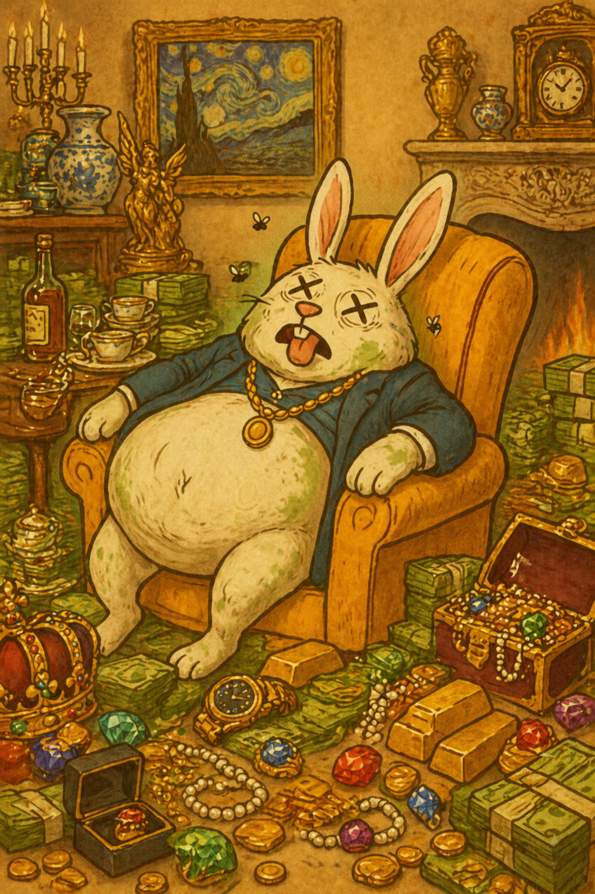{.fragment .fade-out fragment-index=1 fig-alt="坐拥财富的兔子插图"}

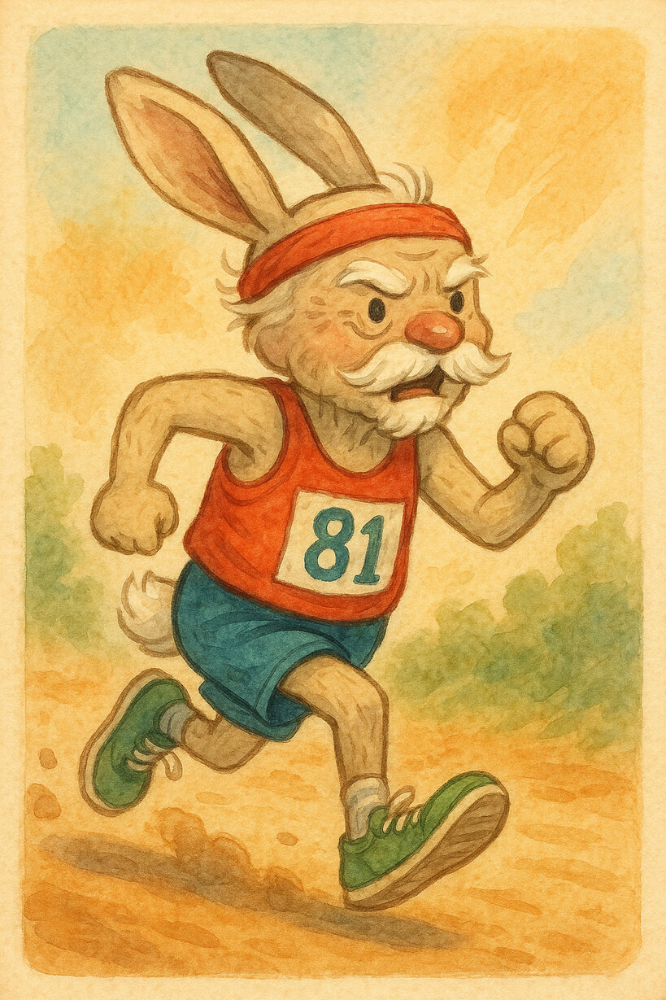{.fragment fragment-index=1 fig-alt="奔跑的兔子插图"}
:::
::::

## 这本书 {#the-book .t-book .t-split .t-split-dark .s-book data-label="The Book"}

:::: {.columns}
::: {.column .cover width="41%"}
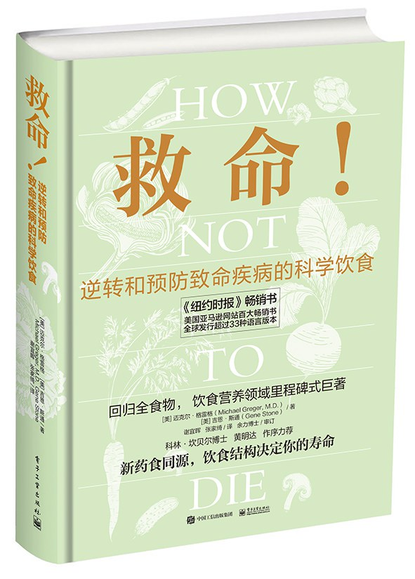
:::

::: {.column .info width="59%"}
::: {}
::: {.eyebrow}
[]{.dot}今天要分享的书
:::

### 救命
逆转和预防致命疾病的科学饮食

::: {.intro}
迈克尔 · 格雷格医生与吉恩 · 斯通合著，系统讲述如何用饮食与生活方式，预防甚至逆转头号致命疾病。
:::
:::

::: {.authors}
::: {.author .fragment fragment-index=1}
::: {.portrait}
{fig-alt="迈克尔 · 格雷格医生肖像"}
:::

::: {.n}
迈克尔 · 格雷格
:::

::: {.r}
🩺 医生 · ✍️ 作家 · 📢 公共健康倡导者
:::
:::

::: {.author .fragment fragment-index=2}
::: {.portrait}
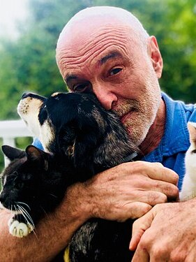{fig-alt="吉恩 · 斯通肖像"}
:::

::: {.n}
吉恩 · 斯通
:::

::: {.r}
📖 知名作家与记者
:::
:::
:::
:::
::::

::: {.notes}
书的核心信息：绝大多数过早死亡是可以预防的。

在美国，仅四个简单生活习惯（不吸烟、保持体重、每天半小时运动、多吃蔬果全谷少吃肉）就能解释 78% 的慢性病风险，并能消除 90% 以上的糖尿病风险、80% 以上的心梗风险、一半中风风险。

我们追求的不只是活得久，而是活得健康——研究显示我们这一代虽然多活了一年，却多病了三年。

**关于格雷格医生本人的一段轶事**（可用来说明他为什么值得信任）：他行医后觉得 "一天看几十个病人只是杯水车薪"，于是上路演讲。目标是每两年把美国每一所医学院讲一遍，不让任何一个医生毕业时手里没有"食物"这件工具。最疯的时候，他**一个月讲四十场**——早上给扶轮社讲早餐会，中午到医学院讲一场，晚上再对社区团体讲一场。那几年他**住在自己车里，钥匙链上只有一把钥匙**。累计下来，他在全球讲了**一千多场**——注意这个"一千多场"是本书**英文版 2015 年 12 月出版**时的数字，也就是他讲到那时为止的总量，如今只会更多。

这样的生活当然撑不下去——他在书里直言，自己为此失去了一段婚姻。后来他把每年的研究整理成 DVD 系列，再后来在慈善家 Jesse Rasch 的资助下把全部内容搬上网，就有了 NutritionFacts.org（后面会讲到）：无广告、无赞助、永久免费。

**最值得说的一句**：他从 DVD、演讲和包括这本书在内的所有著作中拿到的钱，**一分不留，全部捐给慈善机构**。他自己的话是——在临床上能影响几百人，在路上能影响几千人，而这些关乎生死的信息，需要抵达几百万人。
:::

## 第一部分 {#section-part-i .t-section .s-section data-label="Section · Part I"}

:::: {.columns}
::: {.column .center width="62.5%"}
::: {.num}
第 01 部分
:::

::: {.kicker}
如何躲过美国的头号杀手
:::

::: {.section-title}
谁是最致命 😱
的杀手？
:::

::: {.sub}
您能猜到，美国的头号死因是什么吗？ 🤔
:::
:::

::: {.column .art width="37.5%"}
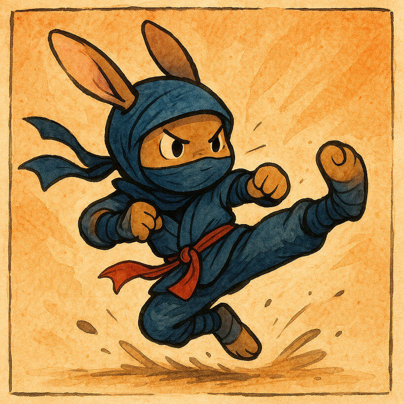
:::
::::

## 答案 {#the-answer .t-metric .s-number data-label="The Answer"}

::: {.answer-tag}
答案 🫀
:::

::: {.big}
683,491[人]{.tail}
:::

::: {.label}
2024 年美国死于**心脏病** 💔 的人数。
:::

::: {.caption}
⏱️ 平均每 46 秒就有一人离世 · 口径为各类心脏病合计、不含中风 🕯️
:::

::: {.notes}
心脏病已经连续一百多年是美国头号杀手。

名词解释：

- **心脏病 (heart disease)**：一大类心脏疾病的统称，包括冠心病、高血压性心脏病、心律失常、心力衰竭等。这一页的 683,491 就是这个合并大类。
- **冠心病 (coronary heart disease)**，死因统计里又叫 **缺血性心脏病 (ischemic heart disease)**：给心脏自身供血的冠状动脉被斑块堵塞、心肌长期缺血缺氧。本书第 1 章讲的就是它，也是本场“心脏病”一词的默认所指。
- **心肌梗死（心梗，myocardial infarction）**：冠状动脉被彻底堵死，那一块心肌因缺血而坏死——就是俗称的“心脏病发作”。
- **高血压性心脏病 (hypertensive heart disease)**：长期高血压让心脏一直在高阻力下泵血，心肌增厚、最终衰竭。是单独的一行死因，不等于冠心病。
- **中风（卒中，stroke）**，死因表里叫 **脑血管病**：脑血管堵塞或破裂，脑组织受损。详见第 3 章一页。

**口径提醒（重要）：** 683,491 用的是美国 NCHS 的“心脏病”合并大类（Diseases of heart，含 I00–I09、I11 高血压性心脏病、I13、I20–I51）。**本书第 1 章讲的是范围更窄的“冠心病”，格雷格给的数字是每年约 40 万美国人**（书中“每 83 秒一人”）；高血压在书里是单独的第 7 章。所以：
- 要和后面“中国主要死因”一页比较，应该拿 683,491 对**缺血性心脏病 220 万 + 高血压性心脏病 100 万 = 320 万**，不要只对 220 万。
- 讲“美国心脏病第 1、中国脑血管病第 1”时，记得这部分差异来自分类口径，详见“四川主要死因”一页的备注。

重点：这不是衰老的必然结果，而是饮食疾病——只要血液胆固醇足够低，就几乎不会患冠心病。书的编辑 William Roberts 直接说：“只有一个真正的危险因素，就是胆固醇。”

研究朝鲜战争阵亡美军（平均 22 岁）解剖发现，77% 已有冠状动脉斑块。换句话说：动脉硬化在我们二十多岁就已经开始了。
:::

## 贵州 1973–75 {#guizhou-1973-75 .t-stat-cards .t-stat-cards-dark .cards-3 .s-guizhou data-label="Guizhou 1973–75"}

::: {.pad}
::: {.eyebrow}
[]{.dot}🌾 在某些传统饮食地区，冠心病曾极为罕见
:::

### 1973–1975 年的贵州

::: {.intro}
康奈尔、牛津与中国联合开展的大规模流行病学研究，揭示了饮食与健康之间的深层联系。
:::

::: {.stat-cards}
::: {.card-dark .fragment fragment-index=1}
::: {.card-tag}
👥 样本规模
:::
::: {.card-desc}
这一地区的总人口
:::
::: {.card-main}
500,000
:::
:::

::: {.card-dark .fragment fragment-index=2}
::: {.card-tag}
⏳ 观察时长
:::
::: {.card-desc}
连续追踪冠心病死亡情况
:::
::: {.card-main}
3 年
:::
:::

::: {.card-light .hi .fragment fragment-index=3}
::: {.card-tag}
🫀 冠心病死亡
:::
::: {.card-desc}
在该地区 65 岁以下的男性中
:::
::: {.card-main .leaf}
0
:::
:::
:::
:::

::: {.notes}
这就是著名的「🇨🇳 中国研究」(🇨🇳 China Study)——康奈尔大学坎贝尔教授、牛津大学和 🇨🇳 中国预防医学科学院联合开展，被《纽约时报》称为流行病学的“豪华大奖”。

在传统饮食的贵州农村，三年间 50 万人中，65 岁以下男性死于冠心病的人数为零——这是心脏病"并非命中注定"的有力证据。

**年份的出处**：死亡数据来自 1973–1975 年的全国死因回顾调查，这是中国研究的起点；膳食和血样调查要到 1983 年前后才做。书中引用的论文（Campbell、Parpia、Chen，[*Am J Cardiol*. 1998;82(10B):18T–21T](https://pubmed.ncbi.nlm.nih.gov/9860369/)）发表于 1998 年——那是发表年份，不是数据年份。论文原文是：贵州一个县的 24.6 万名男性中，3 年观察期内 64 岁及以下没有一例登记的冠心病死亡；书中写作"约 50 万人的地区"，指的是男女合计的总人口，不是"参与研究的人数"。台上说"上世纪 70 年代的贵州"最稳妥。

需要说清楚的对照：这是 1973–1975 年、仍以传统植物性饮食为主时的贵州；随着"营养转型"，今天 🇨🇳 中国的心脏病负担已大不相同（详见心脏病现状一页）。坎贝尔在《中国健康调查报告》(The China Study) 里据此提出：动物蛋白摄入与冠心病、若干癌症的死亡率正相关——这一结论在营养学界仍有争论，但传统饮食区慢性病罕见这一流行病学事实是稳健的。
:::

## 过去 vs 现在 {#then-vs-now .t-stat-cards .t-stat-cards-light .cards-2 .s-thenow data-label="Then vs Now"}

::: {.pad}
::: {.eyebrow}
[]{.dot}🌍 跨地域的尸检对照
:::

### 1960 年的乌干达

::: {.intro}
研究者对比了乌干达与美国圣路易斯，相同年龄段死者的尸检结果。
:::

::: {.stat-cards}
::: {.card-dark .fragment fragment-index=1}
::: {.card-tag}
🇺🇸 美国 · 圣路易斯
:::
::: {.card-desc}
在 [632 例]{.strong} 尸检中查出心肌梗死 🫀 的例数
:::
::: {.card-main}
136
:::
:::

::: {.card-light .hi .fragment fragment-index=2}
::: {.card-tag}
🇺🇬 非洲 · 乌干达
:::
::: {.card-desc}
在 [632 例]{.strong} 尸检中查出心肌梗死 🫀 的例数
:::
::: {.card-main .leaf}
1
:::
::: {.card-desc}
而这唯一一例只是一处 [已经愈合的陈旧病灶]{.strong} — 这个人[并不是死于心梗]{.hl}的。
:::
:::
:::
:::

::: {.notes}
1930-40 年代，西方传教士医生在撒哈拉以南非洲的医院里发现：困扰发达国家的慢性病在那里几乎不存在。乌干达的医生说冠心病“几乎找不到”。

**年份的出处**：这页的尸检对照来自 Thomas 等人 1960 年发表在《美国心脏病学杂志》的研究（Thomas WA et al., *Am J Cardiol*. 1960;5:41–7），标题就是“基于乌干达与美国圣路易斯尸检的地区比较”。尸检本身在此之前几年完成，所以台上说“1960 年前后”“上世纪五六十年代”都稳妥。书中另一处引用的血胆固醇与冠心病数据是 Shaper & Jones 1959 年的乌干达研究。

口径要讲准：这两个数字是**尸检中发现的心肌梗死例数**，不是“死于心脏病的人数”。书中还说明，乌干达那一例只是一处已经愈合的小病灶，**当年那次心梗并没有致命**；研究者后来又检查了 800 例乌干达死者，合计 1,400 多例中也只有这一例。所以这页证明的是“动脉粥样硬化性心脏病在当地极其罕见”，不要说成死亡率对比。

同样地，巴布亚新几内亚高地、墨西哥塔拉乌马拉印第安人这样的传统饮食人群——以全谷物、豆类、根茎、蔬果为主——心脏病罕见。

一旦他们改吃西式饮食，心脏病就跟来。
:::

## 中国心脏病 {#heart-disease-in-china .t-takeaway .tone-ember .s-china data-label="Heart Disease in China"}

::: {.pad}
::: {.eyebrow}
[]{.dot}🇨🇳 中国 · 现状 🫀
:::

### 随着饮食结构 🍔➡️🥬 的改变，
心脏病已成为中国 [头号死因]{.hl}。

::: {.stat-row}
::: {.stat .fragment fragment-index=1}
::: {.n}
🕯️ 3.2M
:::

::: {.u}
每年约 320 万人死于心脏病 — 冠心病 220 万 ＋ 高血压性心脏病 100 万
:::
:::

::: {.stat .fragment fragment-index=2}
::: {.n}
⚠️ 2.3 / 1k
:::

::: {.u}
也就是说，每一千人中就有 2.3 人死于心脏病。
:::
:::
:::

::: {.foot}
📐 口径与美国 CDC 一致：冠心病与高血压性心脏病合并为“心脏病”大类

🗓️ 中国疾控周报 2017–2021 年数据
:::
:::

::: {.notes}
🇨🇳 中国正在经历“营养转型”——主食与蔬菜摄入下降，动物性食物、烹调用油与盐摄入上升，肥胖等代谢问题随之增加（来源：[Eur J Clin Nutr 2021](https://www.nature.com/articles/s41430-020-0674-8)）。

结果是几十年间，心脏病、糖尿病、肥胖率飙升。1980 年 🇨🇳 中国糖尿病患病率不到 1%，2018 年已达 12.4%（来源：[JAMA 2021](https://jamanetwork.com/journals/jama/fullarticle/2787545)，[JAMA 2013](https://jamanetwork.com/journals/jama/fullarticle/1734701)）。

**GBD 是什么**：Global Burden of Disease Study，**全球疾病负担研究**——由美国华盛顿大学健康测量与评估研究所 (IHME) 主持、成果多发表于《柳叶刀》的全球性研究，用统一的模型重新估算每个国家各种疾病的死亡和伤残数。它和中国疾控的数字不一样是正常的：疾控报的是**登记死因的实际统计**，而 GBD 会把“死因不明”等模糊编码重新分配、并校正漏登，为的是让各国可比。所以遇到两个数对不上，先问一句“这是登记数还是估算数”。

**这一页为什么说“头号死因”（务必讲清楚）：** 底部那行小字就是关键。中国疾控周报（China CDC Weekly）用的是“**单病种**”分类，会把心脏病拆成好几行——缺血性心脏病（冠心病）220 万是一行，高血压性心脏病 100 万是另一行；而脑血管病（中风）240 万始终是完整的一块，所以单病种榜上中风排第 1、冠心病排第 2。美国 CDC/NCHS 公布的“心脏病”（Diseases of heart）则是一个**合并大类**，明确包含 I00–I09、**I11 高血压性心脏病**、I13、I20–I51——正好把我们分开列的那两行算在一起。用同一把尺子量中国：220 + 100 = **320 万 > 240 万**，心脏病就是第一。

- 320 万其实还是**下限**：美国那个大类还包含心律失常、心力衰竭等，这些没有出现在中国的前十表里。
- 这不是我们自创的算法。按合并大类的中国官方口径，《中国卫生健康统计年鉴》2021 年数据中心脏病在城市和农村都排第 1（来源：[中国抗癌协会转载年鉴数据](https://www.csco.org.cn/cn/ncontent.aspx?oid=2027)）。
- 如果有人问“可我看到的说法是中风第一”：两种说法都对，区别只在**单病种**还是**合并大类**。别争，直接把这两个口径讲出来。
- 若按 GBD 的统计，缺血性心脏病单病种死亡约 177 万/年（2020），而把所有心血管病合并则是中国第一大死因（来源：[PMC 中国心血管健康报告 2021](https://pmc.ncbi.nlm.nih.gov/articles/PMC10320777/)）。
- 后面“中国主要死因”一页会把这十行原样列出来，那时要再解释一次为什么表上是中风第一——完整对照见“四川主要死因”一页的备注。

核心信息：心脏病不是基因决定的命运，而是随饮食结构改变而来的"生活方式病"。
:::

## 动脉粥样硬化 {#atherosclerosis .t-split .t-steps .t-split-dark .s-ather data-label="Atherosclerosis"}

:::: {.columns}
::: {.column .left width="59.5%"}
::: {}
::: {.eyebrow}
[]{.dot}主要成因
:::

### 动脉粥样硬化：无声的进展 🤫
:::

::: {.steps .number-list}
::: {.step .fragment}
::: {.k}
01
:::

::: {.t}
**斑块堆积** 🧱 — 胆固醇等脂质在动脉内壁层层沉积，逐渐形成硬化斑块。
:::
:::

::: {.step .fragment}
::: {.k}
02
:::

::: {.t}
**血流受限** 🚧 — 管腔随之狭窄，心肌供血不足，引发 **心绞痛**。
:::
:::

::: {.step .fragment}
::: {.k}
03
:::

::: {.t}
**斑块破裂** 💥 — 一旦破裂形成血栓，冠状动脉被彻底堵塞，就是 **心肌梗死**。
:::
:::

::: {.step .fragment}
::: {.k}
04
:::

::: {.t}
**无声的杀手** 😨 — 对许多猝死者而言，发作的那一刻，是他们感受到的第一个、也是最后一个症状。
:::
:::
:::
:::

::: {.column .visual width="40.5%"}
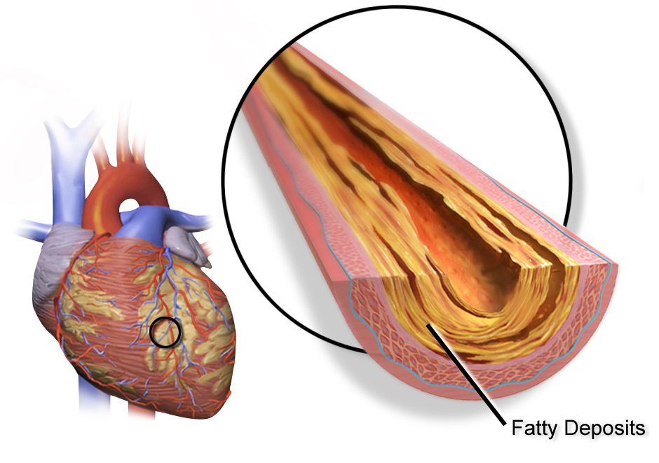{.artery-img}
:::
::::

::: {.notes}
名词解释：

- **动脉粥样硬化** (atherosclerosis)：希腊语 athere = 粥糊，sklerosis = 硬化。胆固醇等脂质堆积在动脉内壁，形成像粥一样的斑块。
- **冠状动脉**：包绕心脏供血的血管，因像皇冠（corona）一样得名。
- **心绞痛** (angina)：血管狭窄、心肌缺氧引起的胸痛。
- **心肌梗死** (myocardial infarction)：斑块破裂形成血栓，完全堵塞血管，心肌坏死。
研究发现：动脉硬化甚至在胎儿期就可以开始——母亲胆固醇高，胎儿动脉就已出现病变。10 岁时几乎所有美国儿童动脉里都已有“脂肪条纹”。这不是老年病，是童年病。
:::

## 奶奶的故事 {#grandmother-story .t-split .t-story .t-split-dark .s-story data-label="Grandmother Story"}

:::: {.columns}
::: {.column .left width="62.5%"}
::: {.eyebrow}
[]{.dot}📖 一个真实的故事
:::

### 一位被判“死刑”的外祖母

65 岁那年，格雷格医生的外祖母因终末期心脏病 🫀，被宣告无药可救 😢。

绝望中，她尝试了一项以 **全食物植物性饮食** 🌱 与 **适量运动** 🚶 为核心的实验疗程。

::: {.fragment}
::: {.highlight}
奇迹出现了 ✨ — 她又健康地活了 31 年。
:::

::: {.story-note}
这段经历，让格雷格医生从此走上了营养学研究之路。
:::
:::
:::

::: {.column .right width="37.5%"}
::: {.portrait}
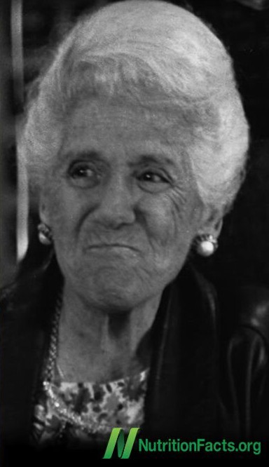
:::
:::
::::

::: {.notes}
名词解释：**全食物植物性饮食** (whole-food plant-based diet) —— 全食物植物性饮食就是在植物饮食的基础上，不要去吃精加工的食物。

格雷格的外祖母 Frances Greger 当时被多次搭桥——医生甚至说“已经没有血管可以再搭”。她坐着轮椅去加州找 Pritikin。

Pritikin 不是医生，只是一位工程师，他自己得了心脏病后，研究文献，发现非洲农村心脏病罕见，于是模仿那种饮食，竟然把自己治好了。外祖母三周后能每天走 10 英里。

这个故事让格雷格立志学医，也写下了这本书。“她原本被宣告只能再活几周，最后活到了 96 岁，亲眼看着我从医学院毕业。”
:::

## 坏胆固醇 {#bad-cholesterol .t-card-grid .cards-3 .s-foods data-label="Bad Cholesterol"}

::: {.eyebrow}
[]{.dot}🧈 坏胆固醇
:::

###  低密度脂蛋白 (LDL) 水平过高
是动脉粥样硬化与心脏病的关键风险因素。

::: {.intro}
要显著降低低密度脂蛋白，应尽量减少摄入以下三类成分。
:::

::: {.stat-cards}
::: {.card-dark .fragment}
::: {.card-tag}
01 / 03
:::
::: {.card-main .name}
🍟 反式脂肪
:::
::: {.card-desc .sources}
主要存在于加工食品（如氢化植物油）、肉类与奶制品。
:::
:::

::: {.card-dark .fragment}
::: {.card-tag}
02 / 03
:::
::: {.card-main .name}
🥩 饱和脂肪
:::
::: {.card-desc .sources}
大量存在于动物制品（如红肉、奶油）与各类垃圾食品。
:::
:::

::: {.card-dark .fragment}
::: {.card-tag}
03 / 03
:::
::: {.card-main .name}
🥚 膳食胆固醇
:::
::: {.card-desc .sources}
只存在于动物性食品中，植物性食物本身不含胆固醇。
:::
:::
:::

::: {.bot}
这三类成分有什么共同点？ [→ 它们几乎全部来自动物性食品 🐄。]{.fragment}
:::

::: {.notes}
名词解释：

- **LDL（低密度脂蛋白）**：把胆固醇从肝脏运到全身的“快递车”，运多了就堆在动脉壁——所以叫“坏胆固醇”。
- **HDL（高密度脂蛋白）**：把多余胆固醇运回肝脏处理——“好胆固醇”。
- **理想 LDL**：50–70 mg/dL（这是新生儿水平，也是无心脏病人群的水平）。
- **总胆固醇 < 150 mg/dL**：著名的 Framingham 心脏研究中，这个水平以下没有人死于冠心病。
重点：膳食胆固醇只存在于动物性食品中，植物（包括椰子油、棕榈油）本身不含胆固醇——但椰子油棕榈油富含饱和脂肪。反式脂肪现已被多国禁用，但加工食品里仍然常见。
:::

## 他汀类药物 {#statins .t-split .t-side-list .s-statin data-label="Statins"}

:::: {.columns}
::: {.column .left width="50%"}
::: {.eyebrow}
[]{.dot}💊 他汀类药物
:::

<h3>史上最畅销的<br>处方药 💰。</h3>

立普妥等他汀类药物，全球累计销售额惊人

::: {.money}
[$]{.s}1,400 亿
:::

::: {.statin-note .fragment fragment-index=1}
既然有药，是否就能一边大快朵颐 🍔，一边靠药物抵消风险？
:::

::: {.statin-note .fragment fragment-index=2}
对无法靠饮食控制胆固醇的高危人群，药物确能救命；但长期依赖，**并非没有代价**。
:::
:::

::: {.column .right width="50%" .fragment fragment-index=3}
::: {.t}
⚠️ 他汀药物的已知副作用
:::

#### 药物背后的代价，  
就写在说明书上。

::: {.side .number-list}
::: {.item .fragment fragment-index=4}
::: {.n}
01
:::

::: {.d}
**肝毒性风险** 🧪 — 长期服药者需定期验血，监测肝功能。
:::
:::

::: {.item .fragment fragment-index=5}
::: {.n}
02
:::

::: {.d}
**肌肉损伤** 🦵 — 即使血检正常，长期服药仍可能造成肌肉微损伤，增加老年人跌倒风险。
:::
:::

::: {.item .fragment fragment-index=6}
::: {.n}
03
:::

::: {.d}
**认知风险** 🧠 — 包括记忆下降与意识混乱，2012 年 FDA 为此要求强制加注警告标签。
:::
:::

::: {.item .fragment fragment-index=7}
::: {.n}
04
:::

::: {.d}
**增加二型糖尿病风险** 🍬 — 已列入药品说明书的明确警示。
:::
:::
:::
:::
::::

::: {.notes}
**他汀** (statin)：抑制肝脏制造胆固醇的酶，例如阿托伐他汀（立普妥 Lipitor）。立普妥单药全球累计销售额 $1400 亿，是史上最畅销处方药。

关键观点：他汀绝对获益其实很有限——六年内降低再次心梗或死亡风险约 3%；而严格全食物植物性饮食在 Esselstyn 的研究中可使 99.4% 的患者不再发生重大心血管事件，效果约为他汀的 20 倍。对已有严重心脏病的高危人群，他汀确能救命；但用药物去抵消不健康饮食是不划算的。书的态度：先尝试饮食，必要时加药。

副作用证据强度（用于答疑）：

- **认知副作用**：FDA 在 2012 年要求他汀加注记忆/意识模糊的警告标签——这是官方动作，证据确凿。
- **二型糖尿病**：多项荟萃分析与说明书均确认他汀小幅升高新发糖尿病风险，证据确凿。
- **肌肉问题、肝酶升高**：常见且写入说明书，需定期验血监测。
- **乳腺癌**：书中引用 2013 年西雅图研究"长期服用使浸润性乳腺癌风险翻倍"，但 **2020–2023 年更大规模的荟萃分析并未证实，甚至提示他汀可能降低复发与死亡**——所以这一条已从幻灯片删除，若有人问可如实说明"早期单项研究的发现没有被后续证据支持"（来源：[CEBP 2013](https://aacrjournals.org/cebp/article/22/9/1529/69853/)，[PMC 荟萃分析 2023](https://pmc.ncbi.nlm.nih.gov/articles/PMC10757972/)）。
:::

## 核心结论 {#core-conclusion .t-takeaway .tone-ember .s-core data-label="Core Conclusion"}

::: {.pad}
::: {.eyebrow}
[]{.dot}🌱 书中的核心结论
:::

### 全食物植物性饮食 🥗 [已被证明]{.hl} —
在降低胆固醇方面，与一线他汀类药物 💊 同样有效，[甚至更胜一筹]{.hl}，
[却没有药物的那些长期副作用]{.hl} 😌。

::: {.cite}
— 迈克尔 · 格雷格医生，《救命》
:::
:::

## 身体的自愈力 {#body-heals-itself .t-quote .s-quote data-label="Body Heals Itself"}

::: {.mark}
“
:::

> 现代医学最常被忽视的秘密是 —
> 只要 [条件合适]{.hl}，
> 我们的身体，就拥有惊人的 [自我修复能力]{.hl} 🩹。

::: {.cite}
迈克尔 · 格雷格医生 ·《救命》
:::

## 第二部分 {#section-part-ii .t-section .s-section data-label="Section · Part II"}

:::: {.columns}
::: {.column .center width="62.5%"}
::: {.num}
第 02 部分
:::

::: {.kicker}
如何躲开其他致命疾病
:::

::: {.section-title}
健康威胁 💀   
远不止心脏病
:::

::: {.sub}
《救命》第一部分以十五章的详实研究 📚，回答同一个核心问题：我们该如何避免死于这些现代常见病？
:::
:::

::: {.column .art width="37.5%"}
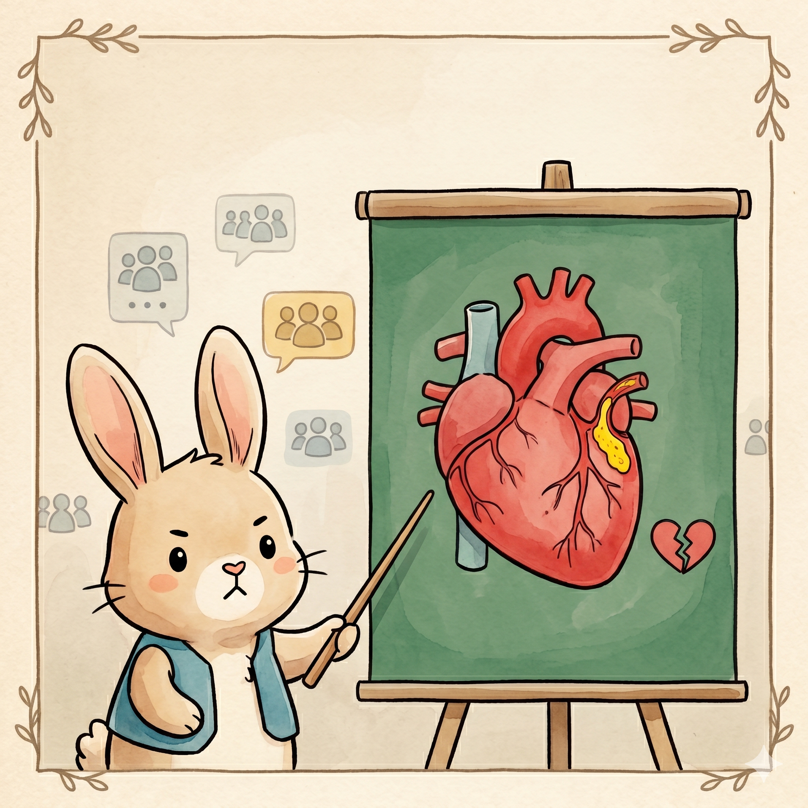
:::
::::

## 中国主要死因 {#china-leading-causes .t-table .s-causes data-label="China Leading Causes"}

::: {.eyebrow}
[]{.dot}🇨🇳 中国主要死因概览
:::

### 在中国，最常夺走生命的
[十类主要原因]{.hl}。

:::: {.columns}
::: {.column width="50%"}
| 疾病名称 | 每年估算死亡人数 |
|---|---:|
| 🧠 脑血管疾病 | 240 万 |
| 🫀 冠心病 | 220 万 |
| 🫁 慢阻肺（COPD） | 110 万 |
| 🚬 肺部相关癌症 | 70 万 |
| 🍺 肝癌 | 50 万 |
:::

::: {.column .fragment width="50%"}
| 疾病名称 | 每年估算死亡人数 |
|---|---:|
| 💢 高血压性心脏病 | 100 万 |
| 🍜 胃癌 | 40 万 |
| 🍬 糖尿病 | 30 万 |
| 🚗 道路交通安全事故 | 20 万 |
| 🤕 跌倒等意外伤害 | 20 万 |
:::
::::

::: {.source}
数据来源参考自：中国疾控周报 (2017–2021)
:::

::: {.notes}
⚠️ **必讲：这张表和前面“心脏病是中国头号死因”看起来矛盾，要主动解释，别等人举手。**

一句话版本：**这张表是“单病种”榜，心脏病在表上被拆成了两行。** 左栏第 2 行冠心病 220 万、右栏第 1 行高血压性心脏病 100 万是分开的两行；而脑血管病 240 万始终是完整的一块，所以表上中风排第 1。前面那页用的是**美国 CDC 的合并口径**，把这两行加回去：220 + 100 = 320 万 > 240 万，心脏病重新排第 1。

台上的做法：**先念表，再回头指这两行**，比划一下“把这两行加起来”，观众立刻就懂。强调这不是玩数字游戏——中国自己的合并口径（《中国卫生健康统计年鉴》2021 年数据）同样是心脏病在城市和农村都排第 1；两种排法差的只是**怎么归类**。

**术语口径（全场统一）：** 表中“冠心病”即原始资料里的“**缺血性心脏病**”（ICD-10 I20–I25），两者在死因统计中通用；本场对外一律说“冠心病”，因为这也是本书第 1 章讲的病（coronary heart disease）。

名词解释（表中首次出现的病，冠心病与高血压性心脏病见“答案”一页）：

- **脑血管疾病 (cerebrovascular disease)**：脑部血管的疾病，绝大多数死亡来自中风——血管堵塞（缺血性）或破裂（出血性）造成脑组织坏死。
- **慢阻肺（COPD，慢性阻塞性肺疾病）**：气道长期炎症、气流受阻且不可逆，表现为长期咳嗽、咳痰、走两步就喘；主要包括慢性支气管炎和肺气肿。第 2 章详谈。
- **肺部相关癌症**：主要是 **肺癌**——支气管和肺组织里的恶性肿瘤，吸烟与空气污染是主要成因，发现时多已偏晚。
- **肝癌 (liver cancer)**：肝细胞的恶性肿瘤。在 🇨🇳 中国主要与乙肝、黄曲霉毒素、酒精和脂肪肝相关。第 8 章详谈肝脏。
- **胃癌 (gastric cancer)**：胃黏膜的恶性肿瘤，与高盐、腌制食品和幽门螺杆菌感染相关。第 4 章归入消化道癌症。
- **糖尿病 (diabetes)**：血糖长期偏高的代谢病；死因表里的 30 万只算“直接死于糖尿病”，不含它引发的心血管死亡。第 6 章详谈。

和美国那页对比时也记得：不要拿 683,491（合并大类）直接对 220 万（单病种），要对就对 320 万——详见“答案”一页和“四川主要死因”一页的备注。
:::

## 四川主要死因 {#sichuan-leading-causes .t-table .s-sichuan-causes data-label="Sichuan Leading Causes"}

::: {.eyebrow}
[]{.dot}🐼 四川 · 2022 年死因构成
:::

### 四川的第二大死因不是冠心病，
而是[慢阻肺]{.hl}。

:::: {.columns}
::: {.column width="50%"}
| 单病种 | 占全部死亡 |
|---|---:|
| 🧠 脑血管病 | 18.68% |
| 🫁 慢阻肺 | 15.81% |
| 🫀 冠心病 | 14.45% |
| 🚬 肺癌 | 6.56% |
| 🍬 糖尿病 | 3.28% |
:::

::: {.column .fragment width="50%"}
| 单病种 | 占全部死亡 |
|---|---:|
| 🍺 肝癌 | 3.19% |
| 🦠 下呼吸道感染 | 2.81% |
| 🤕 跌倒 | 2.72% |
| 💢 高血压及并发症 | 2.56% |
| 🍜 食管癌 | 2.21% |
:::
::::

::: {.source}
前四种合计 55.5% · 四川 31 个国家级死因监测点户籍人口 · [四川省疾控中心研究（2023）](https://doi.org/10.20043/j.cnki.MPM.202306482)
:::

::: {.notes}
**这页的一句话**：四川的死因结构和全国不一样——慢阻肺排到了第 2，压过冠心病。

名词解释（这页新出现的两种）：

- **下呼吸道感染 (lower respiratory infection)**：气管以下、支气管和肺部的感染，最常见的是**肺炎**；老年人和慢阻肺患者尤其危险。第 5 章详谈感染。
- **食管癌 (esophageal cancer)**：食管黏膜的恶性肿瘤，与过烫饮食、腌制食品、酒精和吸烟相关；🇨🇳 中国是高发国。第 4 章归入消化道癌症。

**注意这个“第 2”依赖单病种口径。** 表里冠心病 14.45% 和高血压及并发症 2.56% 是分开的两行；若按美国那种“各类心脏病合计”的宽口径相加（≥17%），心脏病就会重新超过慢阻肺 15.81%。所以台上要说“**第二大单病种死因**”，不要说成“心脏病在四川不重要”——真正的对比是：全国排第 2 的位置通常属于冠心病，四川却让给了慢阻肺。这不是四川人“死得更多”，而是死因的**构成**不同，而且这个突出的第 2 位恰好是最可预防的一类。

**数据是什么。** 四川省疾控中心研究者对“中国疾病预防控制信息系统—人口死亡信息登记管理系统”的分析，涵盖四川 31 个国家级死因监测点的户籍人口，研究者说明这些监测点具有全省代表性。表中是占全部登记死亡的比例；前四种（脑血管病、慢阻肺、缺血性心脏病、肺癌）相加为 55.50%。慢性非传染性疾病占 87.44%，伤害占 7.39%，感染性、母婴和营养缺乏疾病占 4.26%。

**为什么这页只讲构成比、不讲每 10 万人死亡率。** 2022 年是异常年份：四川监测点全因粗死亡率为 862.01/10 万，而 2021 年为 699.93、2023 年官方报告为 780.81。2022 年末的疫情冲高了当年的粗死亡率，因此单病种的绝对死亡率不宜直接引用；构成比和排序则稳健得多（2015 年四川同类监测里，慢阻肺同样排第 2，占 17.96%）。如果有人问绝对数：2023 年四川官方数字为脑血管病 133.97、慢阻肺 125.43、缺血性心脏病 105.67/10 万，排序不变（来源：[2023 年四川省人群健康状况及重点疾病报告](https://wsjkw.sc.gov.cn/scwsjkw/gzdt/2024/12/24/8ee8d430ea9143bd82d43e6b13106614.shtml)）。

**不要和上一页相除。** 上一页全国数字是估算的“每年死亡人数”，本页是构成比，两者口径不同。要比也得用同类监测资料：2021 年四川全因粗死亡率 699.93/10 万，略低于全国 709.76；年龄标化后四川 407.50、全国 464.82，比全国低 12.3%。所以四川总体死亡水平并不比全国高。同理，脑血管病在四川排第 1，只说明它在四川各死因中最多，**不能**据此推断四川脑血管病死亡率高于全国（来源：[《疾病监测》2025](https://doi.org/10.3784/jbjc.202502210117)）。

**慢阻肺才是四川真正的异常项。** 2020 年全国死亡监测数据中，四川慢阻肺死亡率 123.7/10 万，在各省级地区中居首位，第 2 位云南为 116.3；公开的全国平均值因方法而异（不同研究给出的全国年龄标化率从 20 余到 70 余不等），所以现场只说“明显高于全国、居全国首位”，不要报具体倍数（来源：[Liu 等，2021](https://doi.org/10.2147/COPD.S330792)）。GBD 2019 省级分析也显示四川慢阻肺年龄标化发病率和患病率在 33 个省级地区中最高（来源：[Frontiers in Public Health 2022](https://doi.org/10.3389/fpubh.2022.859499)）。主要推手是吸烟、二手烟、室内燃煤与油烟、以及盆地地形下的空气污染——都是可以改变的。这一页正好接第 2 章“肺部”。

**如果有人问：为什么美国头号杀手是心脏病，中国的榜首却常是脑血管病（卒中）？** 一半是记账方式，一半是真实差异。

**记账方式：心脏病被拆开了，卒中没有。** 不是中美用了两套标准，而是这两页用的是“单病种”表，而单病种口径会把心脏病拆成几行。看上一页：缺血性心脏病 220 万和高血压性心脏病 100 万是**两行**，而脑血管病 240 万始终是完整的一块。美国 NCHS 公布的“心脏病”（Diseases of heart）是一个合并大类，明确包含 I00–I09、**I11（高血压性心脏病）**、I13、I20–I51——正好把我们分开列的那两行算在一起；美国的脑血管病（I60–I69）反而是另一个单独类别，规模远小于心脏病。所以只要把上一页那两行相加（220 + 100 = 320 万 > 240 万），中国的榜首也变成心脏病。中国自己的合并口径同样如此：《中国卫生健康统计年鉴》2021 年数据中，心脏病在城市和农村都排第 1（来源：[中国抗癌协会转载年鉴数据](https://www.csco.org.cn/cn/ncontent.aspx?oid=2027)）。这一点和第 10 页“心脏病已升至中国第二大死因”并不矛盾——那句用的是单病种口径，详见该页备注。

**年龄结构也会翻转排名。** 中国疾控 2019 年数据中，卒中粗死亡率 171.6/10 万高于缺血性心脏病的 147.3，但年龄标化后变成 130.0 对 142.1，顺序反转；中国东部城市里缺血性心脏病已经超过卒中（来源：[中国疾控中心：2019 年心血管病死亡](https://en.chinacdc.cn/health_topics/ncd_surveillance/202205/t20220513_259155.html)）。

**真实差异确实也存在。** 中国长期高盐摄入、高血压患病率高而知晓率与控制率偏低，叠加吸烟和空气污染，使风险更偏向卒中——尤其是**出血性卒中**，这一型在中国占全部卒中的比例明显高于西方国家。机制（盐 → 血压 → 同时伤脑也伤心）留到第 3 章（中风）和第 7 章（高血压）展开。

结论：**统计分组 + 年龄结构 + 长期危险因素暴露**共同造成了表面差异，不是不可改变的遗传宿命。

盐 → 血压 → 同时伤脑和伤心的机制，留到第 3 章（中风）和第 7 章（高血压）讲，这里不展开。注意口径一致：第 7 章用的是中国家庭人均每天烹调用盐约 9.3 克（2020 年报告）。

**局限。** 论文报告 2019—2021 年漏报率 6.20%–8.39%，这是一幅可靠但有误差的监测画像。四川省 2024 年统计公报只有全因死亡 78.9 万、死亡率 9.43‰，没有分死因数据，不能替代这份死因排序（来源：[四川省统计局 2024 年统计公报](https://tjj.sc.gov.cn/scstjj/c112126/2025/3/17/35d7e3f9f0c34555a09c002535c26842.shtml)）。2014—2018 年四川死因监测同样把心脑血管病、恶性肿瘤、呼吸系统疾病列为前三大类（来源：[《疾病监测》2020](https://doi.org/10.3784/j.issn.1003-9961.2020.06.010)）。
:::

## 十五章 {#fifteen-chapters .t-index .s-index data-label="Fifteen Chapters"}

::: {.eyebrow}
[]{.dot}📚 《救命》第一部分 · 重点章节列表
:::

### 针对不同器官与病种，
作者逐一剖析饮食的影响。

::: {.grid}
::: {.item .fragment fragment-index=1}
<a href="#/heart-disease-in-china">[01]{.n} [❤️ 冠心病]{.t}</a>
:::

::: {.item .fragment fragment-index=1}
<a href="#/chapter-2-lungs">[02]{.n} [🫁 肺部疾病]{.t}</a>
:::

::: {.item .fragment fragment-index=1}
<a href="#/chapter-3-stroke">[03]{.n} [🧠 脑部疾病]{.t}</a>
:::

::: {.item .fragment fragment-index=2}
<a href="#/chapter-4-digestive-cancer">[04]{.n} [🍽️ 消化道癌]{.t}</a>
:::

::: {.item .fragment fragment-index=2}
<a href="#/chapter-5-infections">[05]{.n} [🦠 感染性疾病]{.t}</a>
:::

::: {.item .fragment fragment-index=2}
<a href="#/chapter-6-diabetes">[06]{.n} [🍬 糖尿病]{.t}</a>
:::

::: {.item .fragment fragment-index=3}
<a href="#/chapter-7-hypertension">[07]{.n} [💢 高血压]{.t}</a>
:::

::: {.item .fragment fragment-index=3}
<a href="#/chapter-8-liver">[08]{.n} [🥃 肝脏疾病]{.t}</a>
:::

::: {.item .fragment fragment-index=3}
<a href="#/chapter-9-blood-cancers">[09]{.n} [🩸 血液系统癌症]{.t}</a>
:::

::: {.item .fragment fragment-index=4}
<a href="#/chapter-10-kidney">[10]{.n} [💧 肾脏疾病]{.t}</a>
:::

::: {.item .fragment fragment-index=4}
<a href="#/chapter-11-breast-cancer">[11]{.n} [🎀 乳腺癌]{.t}</a>
:::

::: {.item .fragment fragment-index=4}
<a href="#/chapter-12-depression">[12]{.n} [🌧️ 自杀与抑郁]{.t}</a>
:::

::: {.item .fragment fragment-index=5}
<a href="#/chapter-13-prostate">[13]{.n} [👨 前列腺癌]{.t}</a>
:::

::: {.item .fragment fragment-index=5}
<a href="#/chapter-14-parkinson">[14]{.n} [🧓 帕金森病]{.t}</a>
:::

::: {.item .fragment fragment-index=5}
<a href="#/chapter-15-iatrogenic">[15]{.n} [⚕️ 医源性伤害]{.t}</a>
:::
:::

## 第2章 · 肺部 {#chapter-2-lungs .t-chapter .s-chapter data-label="Chapter 2 · Lungs"}

::: {.head}
<h3><span class="emj">🫁</span>如何避免死于 — 肺部疾病</h3>

::: {.ch}
第 02 章 · 肺病
:::
:::

::: {.body}
::: {.item .fragment}
::: {.stat .leaf}
20 分钟
:::

::: {.desc}
🚬 戒烟是最关键的一步 — 停止吸烟 **20 分钟后**，心率与血压便开始下降。
:::
:::

::: {.item .fragment}
::: {.stat .leaf}
-50%
:::

::: {.desc}
🫀 持续戒烟 **一年后**，冠心病风险下降约一半。
:::
:::

::: {.item .fragment}
::: {.stat .leaf}
-41%
:::

::: {.desc}
🥦 重度吸烟者每天吃 **一根西兰花**，10 天内血液 DNA 突变减少 41%。
:::
:::

::: {.item .fragment}
::: {.stat .leaf}
-24%
:::

::: {.desc}
🍎 每天多吃 **一份水果**，死于慢阻肺（COPD）的风险下降 24%。
:::
:::

:::

::: {.notes}
- **慢阻肺 (COPD)**：慢性阻塞性肺病，主要包括慢性支气管炎和肺气肿，长期咳嗽、喘不过气；🇨🇳 中国 40 岁以上人群患病率约 13.6%，患者接近 1 亿。🇨🇳 中国主要死因表中，慢阻肺约 110 万/年，居第 3；肺部相关癌症约 70 万/年，居第 5（来源：[Lancet Respir Med 2018](https://pubmed.ncbi.nlm.nih.gov/29650407/)，[China CDC Weekly 2023](https://weekly.chinacdc.cn/en/article/doi/10.46234/ccdcw2023.013)）。
- 停止吸烟后的身体恢复时间线：20 分钟后心率血压开始下降；几周后血液循环和肺功能改善；几个月后清扫黏液的纤毛细胞重新长出；1 年后冠心病风险减半；约 15 年后**肺癌**风险接近终身不吸烟者（书中这一条说的是肺癌，不要讲成“所有风险”）。
- 西兰花的关键成分是 **萝卜硫素 (sulforaphane)**；书中强调西兰花芽是便宜、浓缩的来源，鲜芽吸收效果远好于商业补剂。
- 香烟烟雾里有 70 多种已知致癌物。重度吸烟者还可以做的：吃十字花科蔬菜（西兰花、卷心菜、抱子甘蓝）和姜黄。
:::

## 第3章 · 中风 {#chapter-3-stroke .t-chapter .s-chapter .dark data-label="Chapter 3 · Stroke"}

::: {.head}
<h3><span class="emj">🧠</span>如何避免死于 — 脑部疾病</h3>

::: {.ch}
第 03 章 · 脑病
:::
:::

::: {.body}
::: {.item .fragment}
::: {.stat .leaf}
-7%
:::

::: {.desc}
每天多摄入 **7 克膳食纤维**（约一碗蓝莓燕麦 🫐），中风风险可降低约 7%。
:::
:::

::: {.item .fragment}
::: {.stat .leaf}
-21%
:::

::: {.desc}
每天多摄入 **1,640 毫克钾**，可降低 21% 的中风风险 — 最佳来源：绿叶菜 🥬、豆类与红薯。
:::
:::

::: {.item .fragment}
::: {.stat}
+50%
:::

::: {.desc}
睡眠极度不规律 😴（**少于 4 小时** 或 **多于 10 小时**）会显著推高中风死亡风险。
:::
:::

::: {.item .fragment}
::: {.stat .leaf}
🍊
:::

::: {.desc}
常吃柑橘类水果（如橙子、葡萄柚），与中风风险下降密切相关。
:::
:::

:::

::: {.notes}
- **中风/卒中 (stroke)**：分两种——**缺血性**（血管堵塞，约 80%）和**出血性**（血管破裂）。🇨🇳 中国主要死因表中，脑血管疾病约 240 万/年，居第 1（来源：[China CDC Weekly 2023](https://weekly.chinacdc.cn/en/article/doi/10.46234/ccdcw2023.013)）。
- 钾的关键作用：抵消钠对血压的影响。WHO 推荐每天 4700 mg 钾——大多数人远远达不到。豆类、绿叶菜、香蕉、红薯都是好来源。
- 阿尔茨海默病：🇨🇳 中国老龄化下也是上升中的脑病。书中提到地中海饮食和全食物植物性饮食人群发病率显著较低。蓝莓、姜黄（咖喱里的姜黄素）对脑健康都有研究支持。
:::

## 第4章 · 消化道癌症 {#chapter-4-digestive-cancer .t-chapter .s-chapter data-label="Chapter 4 · Digestive Cancer"}

::: {.head}
<h3><span class="emj">🍽️</span>如何避免死于 — 消化道癌</h3>

::: {.ch}
第 04 章 · 消化道癌
:::
:::

::: {.body}
::: {.item .fragment}
::: {.stat}
1 类
:::

::: {.desc}
WHO 已把 **加工肉** 🥓（培根、香肠、火腿）列为 **一类致癌物** — 与香烟同级；每天 50 克，结肠癌风险上升约 18%。
:::
:::

::: {.item .fragment}
::: {.stat}
+17%
:::

::: {.desc}
综合多项研究：每天多吃 **100 克红肉** 🥩，结肠癌风险上升约 17%；高温煎炸烧烤还会再生成致癌物。
:::
:::

::: {.item .fragment}
::: {.stat .leaf}
-65%
:::

::: {.desc}
每天多吃不到四分之一杯 **豆类** 🫘，可显著降低结肠癌前息肉的复发风险。
:::
:::

::: {.item .fragment}
::: {.stat .leaf}
-50%
:::

::: {.desc}
临床试验表明，食用 **浆果** 🫐 可使部分家族性息肉病患者的息肉数量在 9 个月内减半。
:::
:::

:::

::: {.notes}
- **消化道癌症 (digestive tract cancers)**：从食管到直肠这条“管道”上的恶性肿瘤，本章主要讲三种——**结肠直肠癌**（大肠癌，结肠或直肠黏膜癌变，多由息肉逐步发展而来，是本章重点）、**食管癌**、**胰腺癌**（胰腺的恶性肿瘤，早期几乎无症状、预后最差）。
- **加工肉与红肉的证据强度**：2015 年 WHO/IARC 把**加工肉**（火腿、培根、香肠）列为 **1 类致癌物**（与香烟、石棉同级，指"证据确凿"，不代表危害程度相同）；红肉列为 **2A 类**（很可能致癌）。剂量关系：每天 50 克加工肉，结肠直肠癌风险约 +18%；最新荟萃分析显示每天 100 克红肉约 +17%（[Springer 综述 2025](https://link.springer.com/article/10.1007/s11357-025-01646-1)）。
- 书中引用的"每周吃红肉、结肠癌风险翻倍"来自一项约 3 万人的加州队列，是单项研究的高端结果；荟萃分析的共识是 +20~40%，所以幻灯片改用更稳健的共识数字。
- 书中的"每天 50 克禽肉、胰腺癌 +72%"来自 EPIC 大型前瞻队列（47.7 万人，Rohrmann 2012），但**未被后续研究稳定重复**，机制可能是高温烹饪而非禽肉本身（[PubMed](https://pubmed.ncbi.nlm.nih.gov/22610753/)）——可作谈资，但不宜当定论。
- 红肉致癌机制：**血红素铁** (heme iron) 在肠道氧化生成自由基；高温烹饪产生**杂环胺 (HCAs)** 和**多环芳烃 (PAHs)**；亚硝酸盐转化为亚硝胺。
- **家族性息肉病 (FAP)**：一种遗传病，肠道长出几百到上千个息肉，几乎必然癌变。临床试验显示每天 60 克黑覆盆子粉，9 个月后息肉减少。
- 🇨🇳 中国主要死因表中，胃癌约 40 万/年，居第 7；高盐、腌制食品（咸鱼、腌菜）、幽门螺杆菌都是相关因素（来源：[China CDC Weekly 2023](https://weekly.chinacdc.cn/en/article/doi/10.46234/ccdcw2023.013)）。
:::

## 第5章 · 感染性疾病 {#chapter-5-infections .t-chapter .s-chapter .dark data-label="Chapter 5 · Infections"}

::: {.head}
<h3><span class="emj">🦠</span>如何避免死于 — 感染性疾病</h3>

::: {.ch}
第 05 章 · 感染
:::
:::

::: {.body}
::: {.item .fragment}
::: {.stat}
🧼
:::

::: {.desc}
**基本卫生** 是第一道防线 — 咳嗽用手肘遮挡、勤洗手，别用脏手碰口、眼、鼻。
:::
:::

::: {.item .fragment}
::: {.stat .leaf}
+82%
:::

::: {.desc}
💉 65–85 岁老人每天 **5 份蔬果**，肺炎疫苗产生的保护性抗体反应高出 82%。
:::
:::

::: {.item .fragment}
::: {.stat .leaf}
NK ↑
:::

::: {.desc}
🫐 长跑通常会压低免疫力；但每天吃 **一杯半蓝莓** 的运动员，**NK 免疫细胞** 反而上升。
:::
:::

::: {.item .fragment}
::: {.stat}
🍗
:::

::: {.desc}
食源性感染重灾区：**禽肉、鸡蛋与加工肉**，易在厨房造成交叉污染。
:::
:::

:::

::: {.notes}
- **感染性疾病 (infectious disease)**：由细菌、病毒、真菌、寄生虫等病原体侵入人体引起的疾病，可在人与人、动物与人之间传播——与前面几章的“生活方式病”不同。夺命最多的是 **肺炎**（肺泡的感染与炎症，老年人首要致死感染）和 **脓毒症/败血症 (sepsis)**（感染引发全身失控的炎症反应，器官衰竭）。
- **NK 细胞**：自然杀伤细胞 (Natural Killer)，免疫系统对付病毒感染细胞和早期癌细胞的“特种部队”。
- 蓝莓、绿茶、菇类（白蘑菇、香菇）都被证明能提升 NK 细胞活性。
- 食源性病原体在美国每年致 4800 万人生病。沙门菌、弯曲杆菌主要来自禽类——美国超市鸡肉中 97% 检出弯曲杆菌或大肠杆菌。
- 厨房安全：处理生肉的砧板和洗菜分开，洗鸡肉反而会让病菌喷溅扩散——美国 CDC 建议直接下锅不要清洗。
:::

## 第6章 · 糖尿病 {#chapter-6-diabetes .t-chapter .s-chapter data-label="Chapter 6 · Diabetes"}

::: {.head}
<h3><span class="emj">🍬</span>如何避免死于 — 糖尿病</h3>

::: {.ch}
第 06 章 · 二型糖尿病
:::
:::

::: {.body}
::: {.item .fragment}
::: {.stat .leaf}
-78%
:::

::: {.desc}
美国加州 8.9 万人研究：**全食物植物性饮食者** 🥗 的糖尿病患病率比 **每天吃肉** 者低约 78%（校正体重后仍低约一半）。
:::
:::

::: {.item .fragment}
::: {.stat .leaf}
-75%
:::

::: {.desc}
台湾 4 千人研究：对照组本就 **吃很少肉**（女性约每周一份）— 完全不吃肉的女性风险仍低 **75%**，男性低约一半 🥬。最后那点肉也算数。
:::
:::

::: {.item .fragment}
::: {.stat}
🔒
:::

::: {.desc}
肌肉与肝脏细胞中过多的 **脂肪微粒** 会引发胰岛素抵抗 — 如同堵住锁孔，让血糖无法进入。
:::
:::

::: {.item .fragment}
::: {.stat .leaf}
1 / 2
:::

::: {.desc}
转向全食物植物性饮食 🌱 仅 **16 天** 后，研究中半数糖尿病患者完全停用胰岛素。
:::
:::

:::

::: {.notes}
- **糖尿病 (diabetes mellitus)**：胰岛素不够用或用不好，血糖长期偏高，日久损伤血管、神经、眼、肾。**1 型**是免疫系统摧毁了产胰岛素的细胞，需终身注射胰岛素，与饮食无关；**2 型**占 90% 以上，是细胞对胰岛素不敏感，与饮食和体重密切相关——本章讲的是 2 型。
- 🇨🇳 中国糖尿病人数全球第一：患病率从 1980 年的不到 1% 飙升到 2018 年的 12.4%；患病成人数书中写约 1.4 亿，但**最新估计 2021 年已约 1.4 亿、2023 年已升至约 2.3 亿**（来源：[Lancet Public Health 2024](https://www.thelancet.com/journals/lanpub/article/PIIS2468-2667(24)00250-0/fulltext)）。
- 死亡数取决于归因口径：直接死于糖尿病约 17.8 万/年（GBD 2021），但糖尿病间接导致的心血管死亡另有约 50 万/年。🇨🇳 中国主要死因表中"糖尿病"约 30 万/年居第 8，是按主因统计（来源：[China CDC Weekly 2023](https://weekly.chinacdc.cn/en/article/doi/10.46234/ccdcw2023.013)，[PMC GBD 2021](https://pmc.ncbi.nlm.nih.gov/articles/PMC11457207/)）。
- 关键概念：**胰岛素抵抗** (insulin resistance)。胰岛素就像钥匙，开启细胞门让血糖进入。脂肪堆积在肌肉和肝脏细胞里时，"锁孔被堵"，胰岛素失灵——这是 2 型糖尿病的根源。
- 幻灯片的"-78%"来自基督复临安息日会健康研究二期（AHS-2，书中用的是 8.9 万人这一子集，整个队列约 9.6 万人）的**未校正患病率**对比；校正 BMI 后纯植物饮食者风险仍低约 49%（OR≈0.51）。两个口径都成立，差别在于植物性饮食者本身体重更低（来源：[PMC](https://pmc.ncbi.nlm.nih.gov/articles/PMC4073139/)）。书中还给了完整的梯度：偶尔吃肉 -28%、只吃鱼 -50%、不吃肉但吃蛋奶 -61%、纯植物 -78%——**越植物越低，是一条阶梯，不是一个开关**。
- **前两张卡不是同一个比较，不要说成"两个研究互相印证"。** 第 1 张的对照组是**每天吃肉**的人；第 2 张（台湾，Chiu 等 2014，PLoS One）的对照组是**吃传统亚洲饮食、本来就很少吃肉**的人——女性每周约一份肉，男性每几天一份。两组都不喝汽水，饮食都算健康。所以台湾这一张回答的是另一个问题：**"就吃那么一点点肉，还有区别吗？"** 答案是有：在校正体重、家族史、运动、吸烟之后，植物性饮食的男性，糖尿病风险只有一半，女性低 75%。
- 台湾研究里还有一个细节值得讲：研究中的 **69 名纯植物饮食者，糖尿病患病率是 0**——研究者想把他们和吃蛋奶的人做对比都做不了，因为分母上一个病例都没有。样本小，别当铁证，但作为故事很有力。
- 这四张卡的顺序是有意的：**风险（对比每天吃肉）→ 风险（连一点点肉也算）→ 机制（为什么）→ 逆转（16 天停胰岛素）**。落点在最后一张。
- 1979 年研究：让糖尿病患者吃高碳水高纤维全食物植物性饮食 16 天，半数人完全停用胰岛素。这违反了"糖尿病要少吃碳水"的常识——区别在于：**精制碳水**（白米白面糖）有害，而**全谷物豆类**带来的纤维和营养可以恢复胰岛素敏感性。
- 不是糖吃多了直接得糖尿病，而是脂肪堵塞细胞使糖代谢不了。
:::

## 第7章 · 高血压 {#chapter-7-hypertension .t-chapter .s-chapter .dark data-label="Chapter 7 · Hypertension"}

::: {.head}
<h3><span class="emj">💢</span>如何避免死于 — 高血压</h3>

::: {.ch}
第 07 章 · 高血压
:::
:::

::: {.body}
::: {.item .fragment}
::: {.stat}
9M
:::

::: {.desc}
高血压是全球 **第一大** 死亡风险因素 ⚠️，每年约 900 万人的死亡与之相关。
:::
:::

::: {.item .fragment}
::: {.stat}
9.3g
:::

::: {.desc}
🧂 中国家庭人均每天做饭用盐 **9.3&nbsp;克**，接近 WHO 上限（**5 克/天**）的 **两倍** — 高血压的主要推手之一。
:::
:::

::: {.item .fragment}
::: {.stat .leaf}
3 份
:::

::: {.desc}
每天 **三份全谷物** 🌾（如燕麦、糙米）带来的降压效果，有时可媲美一线降压药。
:::
:::

::: {.item .fragment}
::: {.stat .leaf}
-75%
:::

::: {.desc}
数据显示，全食物植物性饮食者 🥬 相比每周吃肉一次以上的人，患高血压的风险显著降低。
:::
:::

:::

::: {.notes}
- **高血压 (hypertension)**：血液冲击动脉壁的压力长期偏高。两个数字分别是**收缩压**（心脏收缩泵血时的峰值）和**舒张压**（心脏舒张时的低值），🇨🇳 中国诊断线是 ≥140/90 mmHg。它本身几乎没有症状，被称为“沉默的杀手”——伤害是通过中风、心梗、肾衰表现出来的。
- 高血压被 WHO 列为全球头号死亡风险因素——通过中风、心梗、肾衰间接夺命，每年杀死约 900 万人。
- 🇨🇳 中国成人高血压患病率约 **31.6%（2021–2022 年全国调查，约 2.74 亿人）**，知晓率/控制率都偏低（来源：[Frontiers 2023](https://www.frontiersin.org/journals/public-health/articles/10.3389/fpubh.2023.1125608/full)）。🇨🇳 中国主要死因表中，高血压性心脏病约 100 万/年，居第 4（来源：[WHO China](https://www.who.int/china/health-topics/hypertension)，[BMJ 2023](https://pmc.ncbi.nlm.nih.gov/articles/PMC10498511/)，[China CDC Weekly 2023](https://weekly.chinacdc.cn/en/article/doi/10.46234/ccdcw2023.013)）。
- **用盐数字的口径**：《中国居民营养与慢性病状况报告（2020 年）》中，家庭人均每日烹调用盐 **9.3 克**，比 2015 年报告的 10.5 克（2012 年数据）下降了 1.2 克，仍接近 WHO 上限 5 克的两倍。这只算家里做饭放的盐，**不含**酱油等调味品、加工食品和在外就餐，实际总摄入更高——所以台上说"做饭用盐"，不要说成"每天吃盐"（来源：[中国新闻网 · 国新办发布会 2020-12-23](https://www.chinanews.com.cn/m/jk/2020/12-23/9369221.shtml)）。
- “正常”血压 120/80 其实并不理想：原始狩猎采集人群成人血压约 110/70，且基本不随年龄上升。我们以为的“年纪大血压自然高”其实是饮食所致。
- 书中提到一个有趣事实：**洛神花茶 (hibiscus)** 在试验里降压效果可媲美一线降压药。**亚麻籽**研究中也显示对顽固性高血压有强大降压效果（相当于增加一倍剂量的降压药）。
- **“改吃植物，多久能见效？”这是最常被问到的问题，书里给了一整条时间表**（从快到慢）：
  - **半小时**：一顿咸饭就能损伤动脉功能——而且和血压升不升无关。
  - **三小时**：让血压正常的人喝一碗含普通美式餐盐量的汤，之后三小时血压就爬上去。
  - **数小时**：喝甜菜汁，收缩压可下降 **10 个点**，效果持续一整天（甜菜、绿叶菜富含天然硝酸盐，在体内转化成一氧化氮，让血管放松）。
  - **几天**：反过来也成立——在全食物植物性饮食里**重新加入肉**，几天之内血压就显著上升。这类研究早在 1920 年代就有了。
  - **三周**：全食物植物性饮食组血压降幅之大，**半数人的高血压看起来已经"治好"**，降压药需求下降 **80%**。（这一段书里写在第 6 章糖尿病那部分，受试者是糖尿病患者。）
  - **四周**：每天一杯甜菜汁，收缩压降约 8 个点，而且**逐周还在继续降**，说明远没到头。
- ⚠️ **讲这条时间表时必须带上的一句话**（书中原文强调）：血压降下来的时候，药也要**同步由医生减量或停用**，否则血压或血糖可能掉得过低。台上的说法是"改饮食请和你的医生一起改"，不要让人自己停药。
- 格雷格自己给听众的收尾是：**"哪怕只认真吃上几个星期，你可能就会对结果感到吃惊。"**
:::

## 第8章 · 肝脏 {#chapter-8-liver .t-chapter .s-chapter data-label="Chapter 8 · Liver"}

::: {.head}
<h3><span class="emj">🥃</span>如何避免死于 — 肝脏疾病</h3>

::: {.ch}
第 08 章 · 肝病
:::
:::

::: {.body}
::: {.item .fragment}
::: {.stat}
70M
:::

::: {.desc}
**非酒精性脂肪肝**（2023 年更名 **MASLD** · 代谢相关脂肪性肝病）已成严重问题 ⚠️ — 在美国，每 3 名成年人中就有 1 人受其困扰。
:::
:::

::: {.item .fragment}
::: {.stat}
7 天
:::

::: {.desc}
瑞典一项实验发现：连续一周每天两顿 **快餐** 🍔，超过 75% 的受试者出现肝酶异常。
:::
:::

::: {.item .fragment}
::: {.stat}
+45%
:::

::: {.desc}
研究指出，每天多喝 **一罐含糖汽水** 🥤，会显著增加脂肪肝的长期风险。
:::
:::

::: {.item .fragment}
::: {.stat .leaf}
🫐
:::

::: {.desc}
护肝食物包括：**燕麦、全谷物、蓝莓、紫薯，以及不加糖的咖啡** ☕。
:::
:::

:::

::: {.notes}
- **非酒精性脂肪肝 (NAFLD)**：肝细胞里堆积脂肪，与饮酒无关，由饮食和肥胖引起。可发展为肝炎、肝硬化、肝癌。在 🇨🇳 中国患病率约 30%。**2023 年国际共识将其更名为 MASLD（代谢相关脂肪性肝病）**，强调它与代谢综合征的关系——遇到新名词时两者指同一件事。🇨🇳 中国主要死因表中，肝癌约 50 万/年，居第 6（来源：[Hepatology 2019](https://pubmed.ncbi.nlm.nih.gov/31070259/)，[Diabetes Obes Metab 2023](https://pubmed.ncbi.nlm.nih.gov/36775938/)，[China CDC Weekly 2023](https://weekly.chinacdc.cn/en/article/doi/10.46234/ccdcw2023.013)）。
- 关键发现：肝脏脂肪堆积主要不是吃肥肉的脂肪——而是**果糖**（特别是含糖饮料里的高果糖玉米糖浆）和精制碳水化合物在肝里转化成脂肪。
- 那项瑞典实验是受电影《Super Size Me》启发——连续一周每天两顿快餐，75% 受试者出现肝酶 ALT 异常升高。
- 咖啡（不加糖、不加奶油）反复显示对肝脏有保护作用，降低肝硬化和肝癌风险。
:::

## 第9章 · 血癌 {#chapter-9-blood-cancers .t-chapter .s-chapter .dark data-label="Chapter 9 · Blood Cancers"}

::: {.head}
<h3><span class="emj">🩸</span>如何避免死于 — 血液系统癌症</h3>

::: {.ch}
第 09 章 · 血液癌症
:::
:::

::: {.body}
::: {.item .fragment}
::: {.stat}
3 类
:::

::: {.desc}
血液癌症主要包括 **白血病、淋巴瘤** 与 **多发性骨髓瘤**，多从骨髓或免疫细胞起病。
:::
:::

::: {.item .fragment}
::: {.stat .leaf}
1 / 2
:::

::: {.desc}
🌱 牛津 6 万余人随访：**全食物植物性饮食者** 的血液癌症发病率，约为肉食者的一半。
:::
:::

::: {.item .fragment}
::: {.stat .leaf}
3 份
:::

::: {.desc}
🥬 非霍奇金淋巴瘤患者中，每天至少 **3 份蔬菜** 者生存率更佳。
:::
:::

::: {.item .fragment}
::: {.stat .leaf}
🌿
:::

::: {.desc}
**姜黄素**（来自姜黄）在多发性骨髓瘤前期研究中显示出希望，作为日常香料即可。
:::
:::

:::

::: {.notes}
- **白血病** (leukemia)：血液和骨髓里的白细胞癌变。
- **淋巴瘤** (lymphoma)：淋巴系统的癌变；分霍奇金和非霍奇金两类。
- **多发性骨髓瘤** (multiple myeloma)：骨髓里浆细胞癌变。
- **姜黄素** (curcumin)：姜黄（咖喱黄色的来源）里的活性成分。一项研究中，骨髓瘤前期 (MGUS) 患者每天服姜黄素，部分人异常蛋白下降——这是首次有任何治疗显示效果。
- 实用建议：姜黄需要黑胡椒（胡椒碱）一起吃才能更好吸收，吸收率提升 20 倍——印度咖喱传统组合就是这样。
:::

## 第10章 · 肾脏 {#chapter-10-kidney .t-chapter .s-chapter data-label="Chapter 10 · Kidney"}

::: {.head}
<h3><span class="emj">💧</span>如何避免死于 — 肾脏疾病</h3>

::: {.ch}
第 10 章 · 肾病
:::
:::

::: {.body}
::: {.item .fragment}
::: {.stat}
142 L
:::

::: {.desc}
肾脏是极高效的过滤器 — 每天过滤约 **142 升血液**，最终生成约 2 升尿液。
:::
:::

::: {.item .fragment}
::: {.stat}
+36%
:::

::: {.desc}
食用 **金枪鱼** 🐟 等动物蛋白后 3 小时内，肾脏的滤过负荷急剧上升约 36%。
:::
:::

::: {.item .fragment}
::: {.stat .leaf}
≈ 0
:::

::: {.desc}
相比之下，摄入等量蛋白的 **豆腐** 🫘，几乎不会给肾脏带来额外的代谢负担。
:::
:::

::: {.item .fragment}
::: {.stat .leaf}
🌱
:::

::: {.desc}
格雷格医生的建议很明确：**少吃肉与糖，多吃全食物植物性饮食。**
:::
:::

:::

::: {.notes}
- **慢性肾病 (chronic kidney disease, CKD)**：肾功能持续三个月以上的下降，肾小球滤过率降低或尿里持续漏蛋白；分 1–5 期，第 5 期即 **尿毒症/肾衰竭**，需要透析或换肾。
- 肾脏每天过滤约 142 升血液，吸收水分回收营养。
- 动物蛋白引起 **肾脏过度滤过 (hyperfiltration)**——短期内肾负荷暴涨 36%。一两次没问题，但日复一日会损伤肾小球。糖尿病也是这样损伤肾的。
- 同样数量的植物蛋白（豆腐、豆类）几乎不增加肾脏负荷——因为没有高血红素铁、没有动物源的酸负荷、含纤维。
- 慢性肾病早期几乎无症状，等到发现往往肾功能已经丢失一大半。预防比治疗重要得多——尤其是有糖尿病、高血压、家族史的人。
:::

## 第11章 · 乳腺癌 {#chapter-11-breast-cancer .t-chapter .s-chapter .dark data-label="Chapter 11 · Breast Cancer"}

::: {.head}
<h3><span class="emj">🎀</span>如何避免死于 — 乳腺癌</h3>

::: {.ch}
第 11 章 · 乳腺癌
:::
:::

::: {.body}
::: {.item .fragment}
::: {.stat .leaf}
-62%
:::

::: {.desc}
三项健康习惯 — **戒酒、全食物植物性饮食、维持正常体重** 🏃 — 可大幅降低绝经后女性的患癌风险。
:::
:::

::: {.item .fragment}
::: {.stat}
🍷
:::

::: {.desc}
WHO 已将 **酒精** 列为人类乳腺致癌物 — 即便少量摄入，也会增加风险。
:::
:::

::: {.item .fragment}
::: {.stat .leaf}
🫘
:::

::: {.desc}
每天摄入约 **一杯黑豆** 的膳食纤维，与绝经前乳腺癌风险下降显著相关。
:::
:::

::: {.item .fragment}
::: {.stat .leaf}
2 周
:::

::: {.desc}
仅两周健康饮食加 **每天适度步行** 🚶，血液中抑制癌细胞生长的能力就显著增强。
:::
:::

:::

::: {.notes}
- **乳腺癌 (breast cancer)**：乳腺的导管或小叶细胞癌变，是全球女性最常见的癌症（男性也会得，但罕见）。多数属**激素受体阳性**——癌细胞靠雌激素刺激生长，所以终身雌激素暴露量、酒精、体脂都是风险因素。
- 🇨🇳 中国乳腺癌负担持续上升：1990–2021 年年龄标化发病率约翻倍，也是中国女性最常见癌症，城市地区负担更高（来源：[BMC Cancer 2024](https://bmccancer.biomedcentral.com/articles/10.1186/s12885-024-13336-w)，[Chinese J Cancer Res 2017](https://pmc.ncbi.nlm.nih.gov/articles/PMC5415464/)）。
- 酒精：哪怕每天一杯也增加风险。机制——酒精代谢产生乙醛（致癌物），还提高雌激素水平。
- **大豆与乳腺癌**：很多人担心大豆“高雌激素”反而致癌。其实**大豆异黄酮 (isoflavones)** 是植物雌激素，与人体雌激素结构不同，**在乳腺组织里反而是抗雌激素作用**——上海乳腺癌生存研究等大型队列证明，乳腺癌幸存者吃豆制品越多，复发率和死亡率越低。
- **十字花科蔬菜**（西兰花、芥蓝、卷心菜）里的萝卜硫素能抑制乳腺癌干细胞。
:::

## 第12章 · 抑郁症 {#chapter-12-depression .t-chapter .s-chapter data-label="Chapter 12 · Depression"}

::: {.head}
<h3><span class="emj">🌧️</span>如何避免死于 — 抑郁与自杀</h3>

::: {.ch}
第 12 章 · 抑郁与自杀
:::
:::

::: {.body}
::: {.item .fragment}
::: {.stat}
🧠
:::

::: {.desc}
抑郁 **不是 “想开点”** 的问题 — 饮食可能影响炎症、睡眠、精力与情绪。
:::
:::

::: {.item .fragment}
::: {.stat}
🥚
:::

::: {.desc}
**花生四烯酸**（促炎脂肪酸）主要来自 **鸡肉、鸡蛋、红肉与鱼**，与抑郁、自杀风险相关。
:::
:::

::: {.item .fragment}
::: {.stat .leaf}
2 周
:::

::: {.desc}
🌱 让食肉者去掉 **肉、禽与蛋** 仅 **两周**，情绪量表即显著改善。
:::
:::

::: {.item .fragment}
::: {.stat .leaf}
☕
:::

::: {.desc}
**不加糖咖啡** 与较低自杀风险相关；含糖饮料与代糖则反向相关。
:::
:::

:::

::: {.notes}
- **抑郁症 (major depression)**：不是“心情不好”，而是持续两周以上的情绪低落、兴趣丧失，伴随睡眠、食欲、精力和专注力的改变，严重时出现自杀念头——是需要诊断和治疗的疾病。这一章讲的是饮食这一个可调整的因素。
- **花生四烯酸 (arachidonic acid)**：一种 ω-6 脂肪酸，主要来自鸡肉、蛋、红肉。在大脑里转化成促炎物质。研究显示抑郁与脑内神经炎症相关。
- 这一章不是说“光改饮食就能治抑郁”——抑郁是复杂的多因素疾病，需要专业治疗。但饮食是常被忽略的因素之一。
- 书中还提到：**叶酸**（深绿叶菜）、**藏红花** 在临床试验里效果可与抗抑郁药媲美；**运动** 与抗抑郁药效果相当但副作用为零。
:::

## 第13章 · 前列腺 {#chapter-13-prostate .t-chapter .s-chapter .dark data-label="Chapter 13 · Prostate"}

::: {.head}
<h3><span class="emj">👨</span>如何避免死于 — 前列腺癌</h3>

::: {.ch}
第 13 章 · 前列腺癌
:::
:::

::: {.body}
::: {.item .fragment}
::: {.stat}
🥛
:::

::: {.desc}
研究表明 **牛奶** 可能促进前列腺癌细胞生长，而杏仁奶则表现出保护作用。
:::
:::

::: {.item .fragment}
::: {.stat}
×2
:::

::: {.desc}
在已确诊患者中，每天摄入 **不到一个鸡蛋** 🥚，即与癌症进展风险翻倍相关。
:::
:::

::: {.item .fragment}
::: {.stat .leaf}
PSA↓
:::

::: {.desc}
奥尼什的干预研究显示：严格遵循全食物植物性饮食 🌱 的一组，**PSA（前列腺特异性抗原）显著下降**。
:::
:::

::: {.item .fragment}
::: {.stat .leaf}
西兰花
:::

::: {.desc}
若要加入抗癌食物，**十字花科蔬菜**（如西兰花 🥦）与 **磨碎的亚麻籽** 是首选。
:::
:::

:::

::: {.notes}
- **前列腺 (prostate)**：男性膀胱下方、包绕尿道的一个栗子大小的腺体，分泌精液成分。**前列腺癌**是其腺体细胞癌变，多数生长缓慢；**良性前列腺增生 (BPH)** 则不是癌，只是腺体随年龄增大压迫尿道，导致尿频、尿不尽——两者常被混为一谈。
- **PSA (前列腺特异性抗原)**：血检指标，越高提示前列腺问题（增生或癌）。
- **奥尼什前列腺癌研究** (Ornish 2005)：93 名早期前列腺癌患者随机分组，干预组吃全食物植物性饮食 + 运动 + 减压。一年后干预组 PSA 下降，对照组上升。后续滴血在癌细胞上的实验，干预组的血液抑制癌细胞生长能力强 8 倍。
- 牛奶可能促进前列腺癌的机制：奶里有 **IGF-1**（胰岛素样生长因子 1），刺激细胞增殖。男性饮奶量与前列腺癌死亡率正相关。
- **亚麻籽**：必须**磨碎**才能吸收（整粒会原样排出）。富含 ω-3 ALA 和木酚素。每天一汤匙即可。
:::

## 第14章 · 帕金森病 {#chapter-14-parkinson .t-chapter .s-chapter data-label="Chapter 14 · Parkinson"}

::: {.head}
<h3><span class="emj">🧓</span>如何避免死于 — 帕金森病</h3>

::: {.ch}
第 14 章 · 帕金森病
:::
:::

::: {.body}
::: {.item .fragment}
::: {.stat}
🧠
:::

::: {.desc}
神经退行性疾病 — 典型表现：**手抖、僵硬、平衡变差、行走困难**。
:::
:::

::: {.item .fragment}
::: {.stat}
🏭
:::

::: {.desc}
持久性污染物沿食物链富集 — **鱼、肉、奶、蛋** 承载更多二噁英、PCB 与重金属。
:::
:::

::: {.item .fragment}
::: {.stat}
+17%
:::

::: {.desc}
🥛 三十万人荟萃分析：每天多 **一杯牛奶**，帕金森风险增加约 17%。
:::
:::

::: {.item .fragment}
::: {.stat .leaf}
🫐
:::

::: {.desc}
哈佛 13 万人研究：多吃 **蓝莓与草莓**，帕金森风险显著更低。
:::
:::

:::

::: {.notes}
- **帕金森病**：脑内黑质多巴胺神经元逐渐死亡，导致运动障碍。🇨🇳 中国患者超过 300 万（来源：[国家卫健委/Xinhua 2019](https://en.nhc.gov.cn/2019-04/12/c_75009.htm)）。
- **持久性有机污染物 (POPs)**：二噁英、多氯联苯 (PCBs)、有机氯农药——脂溶性、难降解，在食物链中**生物富集** (biomagnification)。我们吃的肉是动物一辈子积累毒素的浓缩。
- 食物链最顶端（金枪鱼、剑鱼、鲨鱼）汞含量最高；动物脂肪（黄油、奶酪、肥肉）二噁英最高。
- 母乳是 POPs 排出的途径之一——研究发现哺乳期吃全食物植物性饮食的母亲，乳汁中污染物浓度低 1-2 个数量级。
- **浆果中的多酚**（蓝莓、草莓里的花青素）能保护大脑神经元免受氧化损伤。
:::

## 第15章 · 医源性疾病 {#chapter-15-iatrogenic .t-chapter .s-chapter .dark data-label="Chapter 15 · Iatrogenic"}

::: {.head}
<h3><span class="emj">⚕️</span>如何避免死于 — 医源性伤害</h3>

::: {.ch}
第 15 章 · 医源性伤害
:::
:::

::: {.body}
::: {.item .fragment}
::: {.stat}
💊
:::

::: {.desc}
急症手术能救命 🚑，但慢性病领域最大的风险是：**药物往往只掩盖指标，并未解决根源**。
:::
:::

::: {.item .fragment}
::: {.stat}
❓
:::

::: {.desc}
面对复杂影像检查 🩻，不妨主动询问医生：**这项检查是否必要？有没有更低风险的替代方案？**
:::
:::

::: {.item .fragment}
::: {.stat .leaf}
🥗
:::

::: {.desc}
**天然食物** 🍎 中多种抗氧化物的协同作用，其抗辐射与保护效果远胜单一的合成补剂。
:::
:::

::: {.item .fragment}
::: {.stat .leaf}
🏥
:::

::: {.desc}
最好的健康避险策略：**用厨房里的全食物植物性饮食管理健康，减少不必要的就医与服药**。
:::
:::

:::

::: {.notes}
- **医源性 (iatrogenic)**：希腊语 iatros（医生）+ genic（产生的）——由医疗本身造成的伤害。
- 美国研究估计：医源性死亡是第三大死因（仅次于心脏病和癌症），每年约 22.5 万人——包括药物副作用、医院感染、手术并发症、不必要的检查。
- **辐射检查**：一次胸部 CT 辐射量相当于 100–200 张胸片。儿童 CT 累计辐射可显著增加白血病和脑瘤风险。书中建议主动询问“这项检查是否必要？有没有更低辐射的替代？”
- 这一章不是反对现代医学——急救、外科、传染病治疗，现代医学不可替代；但慢性病领域，药物常常只压住指标而不解决根本。
:::

## 第三部分 {#section-part-iii .t-section .s-section data-label="Section · Part III"}

:::: {.columns}
::: {.column .center width="62.5%"}
::: {.num}
第 03 部分
:::

::: {.kicker}
餐桌之外 — 饮食与地球的健康
:::

::: {.section-title}
我们吃什么 🍽️
也在塑造环境
:::

::: {.sub}
气候、水源、传染病、抗生素耐药 — 工业化动物农业，正在以多种方式损害我们赖以生存的环境与健康。
:::
:::

::: {.column .art width="37.5%"}
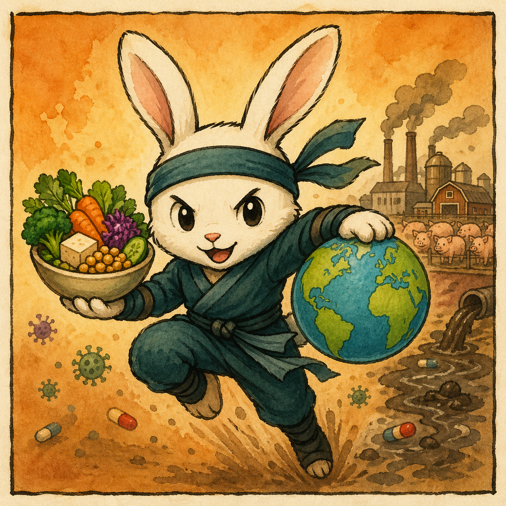
:::
::::

## 食物与气候 {#food-and-climate .t-split .t-split-light .s-climate-pie data-label="Food & Climate"}

:::: {.columns}
::: {.column .pad width="55%"}
::: {.eyebrow}
[]{.dot}🔥 我们的餐桌与气候
:::

### 全球温室气体排放中 —
[食物生产]{.hl} 🍽️ 占了 [26%]{.hl}。

::: {.intro .fragment fragment-index=1}
而在食物排放中，**动物饲养与渔业** 🐄🐟
又占了 [一半以上]{.hl}。
:::

::: {.source}
来源：[Our World in Data · Food and Greenhouse Gas Emissions](https://ourworldindata.org/food-ghg-emissions)
:::
:::

::: {.column .pie-col .fragment width="45%" fragment-index=1}
```{=html}
<div class="pie-chart">
  <div class="pie-disc"></div>
  <div class="pie-legend">
    <div class="legend-item leg-food"><span class="sw"></span><span class="pct">26%</span> 🍽️ 食物生产</div>
    <div class="legend-item leg-other"><span class="sw"></span><span class="pct">74%</span> ⚡ 其他行业</div>
  </div>
</div>
```
:::
::::

::: {.notes}
**温室气体排放 (greenhouse gas emissions)** 不只来自发电、开车和飞机，食物系统本身就是一个大来源。

这里的 26% 包括种植、养殖、土地利用变化、运输、包装和零售。运输常被高估，真正的大头往往在生产端，尤其是动物性食物需要先种饲料、再养动物、再处理粪污，能量转换效率很低。

:::

## 成都、苏州与上海的高温 {#extreme-heat .t-bars .s-extreme-heat data-label="Extreme Heat"}

::: {.pad}
::: {.swap-stack}
::: {.eyebrow .fragment .fade-out fragment-index="5"}
[]{.dot}🌡️ 成都 · 截至 2026-10-10 · 2026 年累计 [23 个高温日](https://open-meteo.com/en/docs/historical-weather-api)
:::

::: {.fragment fragment-index="5"}
::: {.eyebrow .fragment .fade-out fragment-index="6"}
[]{.dot}🌡️ 苏州 · 截至 2026-10-10 · 2026 年累计 [15 个高温日](https://open-meteo.com/en/docs/historical-weather-api)
:::
:::

::: {.eyebrow .fragment fragment-index="6"}
[]{.dot}🌡️ 上海 · 截至 2026-10-10 · 2026 年累计 [19 个高温日](https://open-meteo.com/en/docs/historical-weather-api)
:::
:::

::: {.swap-stack}
::: {.fragment .fade-out fragment-index="5"}
### 过去 70 年，成都的极端高温
从 [几乎没有]{.hl}，变成 [每年十几天]{.hl}。
:::

::: {.fragment fragment-index="5"}
::: {.fragment .fade-out fragment-index="6"}
### 苏州也一样 — 而且底子更热
从 [每年五六天]{.hl}，变成 [每年近二十天]{.hl}。
:::
:::

::: {.fragment fragment-index="6"}
### 上海也一样 — 而且纪录刚被刷新
从 [每年两三天]{.hl}，变成 [每年近二十天]{.hl}。
:::
:::

:::: {.columns}
::: {.column width="58%"}
::: {.intro}
高温日 = 日最高气温 ≥ 35℃ · 各年代 [年均天数]{.hl}：
:::

::: {.swap-stack}

```{=html}
<div class="bars fragment fade-out" data-fragment-index="5">
  <div class="bar plant"><div class="bar-label">1950 年代</div><div class="bar-track"><div class="bar-fill" style="width:0.8%"></div></div><div class="bar-value">0.2</div></div>
  <div class="bar plant"><div class="bar-label">1960 年代</div><div class="bar-track"><div class="bar-fill" style="width:5.2%"></div></div><div class="bar-value">1.3</div></div>
  <div class="bar plant"><div class="bar-label">1970 年代</div><div class="bar-track"><div class="bar-fill" style="width:1.2%"></div></div><div class="bar-value">0.3</div></div>
  <div class="bar plant"><div class="bar-label">1980 年代</div><div class="bar-track"><div class="bar-fill" style="width:0.8%"></div></div><div class="bar-value">0.2</div></div>
  <div class="bar plant"><div class="bar-label">1990 年代</div><div class="bar-track"><div class="bar-fill" style="width:2%"></div></div><div class="bar-value">0.5</div></div>
  <div class="bar fragment" data-fragment-index="1"><div class="bar-label">2000 年代</div><div class="bar-track"><div class="bar-fill" style="width:22%"></div></div><div class="bar-value">5.5</div></div>
  <div class="bar fragment" data-fragment-index="1"><div class="bar-label">2010 年代</div><div class="bar-track"><div class="bar-fill" style="width:10.4%"></div></div><div class="bar-value">2.6</div></div>
  <div class="bar fragment" data-fragment-index="1"><div class="bar-label">2020 年代</div><div class="bar-track"><div class="bar-fill" style="width:54.7%"></div></div><div class="bar-value">13.7</div></div>
  <div class="bar fragment" data-fragment-index="2"><div class="bar-label">🔥 2022</div><div class="bar-track"><div class="bar-fill" style="width:96%"></div></div><div class="bar-value">24</div></div>
  <div class="bar fragment" data-fragment-index="3"><div class="bar-label">⚠️ 2026 ✱</div><div class="bar-track"><div class="bar-fill" style="width:92%"></div></div><div class="bar-value">23</div></div>
</div>

<div class="fragment" data-fragment-index="5">
<div class="bars fragment fade-out" data-fragment-index="6">
  <div class="bar plant"><div class="bar-label">1950 年代</div><div class="bar-track"><div class="bar-fill" style="width:16.6%"></div></div><div class="bar-value">6.4</div></div>
  <div class="bar plant"><div class="bar-label">1960 年代</div><div class="bar-track"><div class="bar-fill" style="width:17.1%"></div></div><div class="bar-value">6.6</div></div>
  <div class="bar plant"><div class="bar-label">1970 年代</div><div class="bar-track"><div class="bar-fill" style="width:10.6%"></div></div><div class="bar-value">4.1</div></div>
  <div class="bar plant"><div class="bar-label">1980 年代</div><div class="bar-track"><div class="bar-fill" style="width:8%"></div></div><div class="bar-value">3.1</div></div>
  <div class="bar plant"><div class="bar-label">1990 年代</div><div class="bar-track"><div class="bar-fill" style="width:15%"></div></div><div class="bar-value">5.8</div></div>
  <div class="bar"><div class="bar-label">2000 年代</div><div class="bar-track"><div class="bar-fill" style="width:18.9%"></div></div><div class="bar-value">7.3</div></div>
  <div class="bar"><div class="bar-label">2010 年代</div><div class="bar-track"><div class="bar-fill" style="width:20%"></div></div><div class="bar-value">7.7</div></div>
  <div class="bar"><div class="bar-label">2020 年代</div><div class="bar-track"><div class="bar-fill" style="width:46.7%"></div></div><div class="bar-value">18.0</div></div>
  <div class="bar"><div class="bar-label">🔥 2022</div><div class="bar-track"><div class="bar-fill" style="width:96%"></div></div><div class="bar-value">37</div></div>
  <div class="bar"><div class="bar-label">⚠️ 2026 ✱</div><div class="bar-track"><div class="bar-fill" style="width:38.9%"></div></div><div class="bar-value">15</div></div>
</div>
</div>

<div class="bars fragment" data-fragment-index="6">
  <div class="bar plant"><div class="bar-label">1950 年代</div><div class="bar-track"><div class="bar-fill" style="width:8.5%"></div></div><div class="bar-value">3.0</div></div>
  <div class="bar plant"><div class="bar-label">1960 年代</div><div class="bar-track"><div class="bar-fill" style="width:7.9%"></div></div><div class="bar-value">2.8</div></div>
  <div class="bar plant"><div class="bar-label">1970 年代</div><div class="bar-track"><div class="bar-fill" style="width:5.4%"></div></div><div class="bar-value">1.9</div></div>
  <div class="bar plant"><div class="bar-label">1980 年代</div><div class="bar-track"><div class="bar-fill" style="width:3.7%"></div></div><div class="bar-value">1.3</div></div>
  <div class="bar plant"><div class="bar-label">1990 年代</div><div class="bar-track"><div class="bar-fill" style="width:5.6%"></div></div><div class="bar-value">2.0</div></div>
  <div class="bar"><div class="bar-label">2000 年代</div><div class="bar-track"><div class="bar-fill" style="width:11%"></div></div><div class="bar-value">3.9</div></div>
  <div class="bar"><div class="bar-label">2010 年代</div><div class="bar-track"><div class="bar-fill" style="width:15%"></div></div><div class="bar-value">5.3</div></div>
  <div class="bar"><div class="bar-label">2020 年代</div><div class="bar-track"><div class="bar-fill" style="width:55.1%"></div></div><div class="bar-value">19.5</div></div>
  <div class="bar"><div class="bar-label">🔥 2022</div><div class="bar-track"><div class="bar-fill" style="width:96%"></div></div><div class="bar-value">34</div></div>
  <div class="bar"><div class="bar-label">⚠️ 2026 ✱</div><div class="bar-track"><div class="bar-fill" style="width:53.6%"></div></div><div class="bar-value">19</div></div>
</div>
```

:::

::: {.swap-stack}
::: {.source .fragment .fade-out fragment-index="5"}
[Open-Meteo 再分析](https://open-meteo.com/en/docs/historical-weather-api) · 成都格点 · ✱ 2026 = 至 10-10 · 全年尚未结束
:::

::: {.fragment fragment-index="5"}
::: {.source .fragment .fade-out fragment-index="6"}
[Open-Meteo 再分析](https://open-meteo.com/en/docs/historical-weather-api) · 苏州格点 · ✱ 2026 = 至 10-10 · 全年尚未结束<br>
高温日较少：[台风外围风雨 + 副高位置变化](https://www.suzhou.gov.cn/szsrmzf/mszx/202608/739529ff6a8c45d1a23a72b9c3419e9a.shtml)；但峰值 **39.6℃**，高于 2024 年的 **38.7℃**。
:::
:::

::: {.source .fragment fragment-index="6"}
[Open-Meteo 再分析](https://open-meteo.com/en/docs/historical-weather-api) · 上海格点 · ✱ 2026 = 至 10-10 · 全年尚未结束<br>
有记录以来高温日最多的三年 — **2024（35 天）、2022（34 天）、2025（33 天）** — 全部落在最近四年。
:::
:::
:::

::: {.column width="42%"}
::: {.stat-cards}
::: {.card-dark .fragment fragment-index="4"}
::: {.card-tag}
🇨🇳 中国 · 2022 年热浪
:::
::: {.card-main}
6.3 万人
:::
::: {.card-desc}
模型估计热浪归因超额死亡 **62,961 人**；那一年四川的热浪死亡风险，是过去 20 年平均的 **2 倍多**。高温不只是难受 — 是会死人的。
:::
::: {.sources}
[Military Medical Research · PMC](https://pmc.ncbi.nlm.nih.gov/articles/PMC12703895/)
:::
:::
:::
:::
::::
:::

::: {.notes}
所有数字由 `tools/fetch-heat-days.py` 生成：运行后把输出的天数、峰值和 `.bar` 行贴回本页即可更新。

高温日按中国气象标准取日最高气温 ≥35℃。数据来自 Open-Meteo 再分析在成都附近格点（30.67°N, 104.07°E）的逐日最高气温；年代柱为该十年的年均高温日数，2020 年代为 2020–2025 平均。再分析对城市站点往往偏保守：2022 年成都站实测高温日为 [29 天](http://sc.people.com.cn/n2/2025/0807/c379471-41314901.html)，再分析格点为 24 天，但趋势方向一致。

2022 年单独标出：中国气象局称那年夏天是 [1961 年有完整记录以来最强的高温热浪](https://news.cgtn.com/news/2022-08-17/China-witnessing-the-strongest-heatwave-since-1961-1czMhI7ceRy/index.html)（强度、持续时间、范围）。2026 年一柱 = 至 10 月 7 日的 23 个高温日，8 月 15 日之后再无新增。7 月 20–26 日这轮高温有四天最高气温超过 40℃，22 日达 41.0℃ — 是该格点 1950 年以来第二热的一天（纪录为 2025 年的 41.2℃）；8 月 12–15 日又连续四天 36℃ 以上。23 天已与 2025 年并列有完整记录以来第二（仅次于 2022 年的 24 天）。

6.3 万人是统计模型估计的 2022 年中国热浪归因超额死亡 (heat-attributable excess deaths)，口径比死亡证明直接记录更广。“2 倍多”的精确说法：2022 年四川的热浪归因死亡比例较 2000–2021 年均值高约 134%，即约 2.3 倍。2022 年这类中国热浪在人类影响下约变得 [7 倍更可能](https://www.sciencedirect.com/science/article/pii/S2212094724000689)；这是控制相似环流条件后得到的归因结果。

苏州一柱（第 5 个 fragment）用同一套方法换成苏州格点（31.30°N, 120.62°E）：年代柱同样是年均高温日数，2020 年代为 2020–2025 平均。苏州的故事和成都不同 — 江南本来就热，1950–1990 年代年均已有 3–7 天，但 2020 年代跳到 18 天，是此前任何十年的两倍以上；2022 年 37 天、2025 年 33 天、2024 年 29 天，都排在有记录以来前三。2026 年到 10 月 7 日只有 15 天，比前几年温和，但仍高于 2020 年以前任何一个十年的年均值；最后一个高温日是 8 月 7 日（35.2℃）。8 月 2 日达到 39.6℃，是该格点 1950 年以来第三热的一天。

上海一柱（第 6 个 fragment）用同一套方法换成上海格点（31.23°N, 121.47°E）：年代柱同样是年均高温日数，2020 年代为 2020–2025 平均。上海的故事和成都不同 — 1950–1990 年代年均只有一到三天，2000、2010 年代也只有四五天，但 2020 年代跳到 19.5 天，是此前任何一个十年的三倍以上。有记录以来高温日最多的三年依次是 2024（35 天）、2022（34 天）、2025（33 天），全部落在最近四年。2026 年到 10 月 7 日已有 19 个高温日，与 2013 年并列历史第四；分两轮 — 7 月 14–19 日六天，7 月 23 日至 8 月 4 日连续十三天，最后一个高温日是 8 月 4 日（36.4℃）。7 月 17 日达 40.4℃，与 2022 年 7 月 14 日并列该格点 1950 年以来最热的一天。再分析对城市站点往往偏保守，趋势方向一致。

讲这一页时依次切换成都、苏州、上海：结论一样 — 极端高温已经不是别处的事。

空调不是完整答案：美国 [88%](https://www.eia.gov/todayinenergy/detail.php?id=52558) 的家庭使用空调，2023 年仍有 [2,325 份死亡证明](https://jamanetwork.com/journals/jama/fullarticle/2822854) 把高温列为基础或促成死因 — 户外暴露、停电、夜间高温和脆弱人群的风险依然存在。
:::

## 热浪不像灾难 {#heat-comics .t-split .t-split-light .s-heat-comics data-label="Heat Comics"}

:::: {.columns}
::: {.column .pad width="55%"}
::: {.tag}
🎬 科普短片 · 1 分 38 秒
:::

::: {.line-1}
🌡️ 热浪不像灾难 —
:::

::: {.line-2}
但它 [会杀人]{.hl}。
:::

::: {.small}
它不推倒树，也不摇晃地面 — 街道甚至一动不动。
热先包围一个普通人，再从皮肤、心脏到大脑一点点向里进攻：心跳加快、大量出汗，可身体不是空调，它有极限。
改编自 Jeff Goodell《The Heat Will Kill You First》。
:::
:::

::: {.column .art width="45%"}
```{=html}
<video
  src="images/climate-change/heat-comics-01.mp4"
  poster="images/climate-change/heat-comics-01-poster.jpg"
  style="height:100%;width:auto;max-width:100%;object-fit:contain;border-radius:12px;box-shadow:0 18px 48px rgba(20,18,15,0.18);"
  controls
  playsinline
  preload="metadata"></video>
```
:::
::::

::: {.notes}
放这段短片前先说一句：上一张图是数字，这一张是数字背后的身体感受。片子有配音和字幕，约 1 分 40 秒，点播放后可以让它自己走完。

片中的几个节点：高温红色预警常被当成“不就是热一点吗”；台风看得见、地震感觉得到，热浪却安静地包围整座城市 — 这正是它最危险的地方。接着镜头推近到身体：为了散热，心跳加快、血液涌向皮肤、汗一滴接一滴，但身体不是空调，散热能力有极限。头晕、恶心、脚步发飘不是“忍一忍就过去”，可能是热射病 (heat stroke) 的前兆。

最后一点最重要：风险从来不平均。独居老人、户外工作者、婴幼儿和动物往往先被击中 — 同样的 40℃，有人只是难受，有人可能熬不过这一天。这一点接着可以引到后面的厄尔尼诺与粮食：受伤最重的，总是最没有缓冲的人。

灵感来源：Jeff Goodell《The Heat Will Kill You First》。
:::

## 什么是厄尔尼诺 {#what-is-el-nino .t-bars .s-enso-anim data-label="What Is El Nino"}

::: {.pad}
::: {.eyebrow}
[]{.dot}🌊 厄尔尼诺 (El Niño) · 地球气候的心跳
:::

### 信风一旦松手，太平洋的暖水就向东回荡 —
这就是 [厄尔尼诺]{.hl}，它会改写全球的天气。

```{=html}
<style>
.enso-anim {
  width: 100%;
  max-width: 1650px;
  height: 600px;
  position: relative;
  overflow: hidden;
  border: 1px solid rgba(20,18,15,0.12);
  border-radius: 8px;
  background: #F4EDDF;
  color: #14120F;
  box-sizing: border-box;
}
.enso-anim *, .enso-anim *::before, .enso-anim *::after { box-sizing: border-box; }
.enso-anim .sky {
  position: absolute;
  inset: 0 0 54% 0;
  background: linear-gradient(180deg, #FBF7EC 0%, #F4EDDF 100%);
}
.enso-anim .ocean {
  position: absolute;
  inset: 46% 0 0 0;
  background: linear-gradient(180deg, #143A2A 0%, #0A2418 100%);
}
.enso-anim .ocean::before {
  content: "";
  position: absolute;
  inset: 0;
  background: repeating-linear-gradient(170deg, transparent 0 42px, rgba(244,237,223,0.025) 43px 45px);
}
.enso-anim .warm-water {
  position: absolute;
  z-index: 3;
  left: 0;
  top: 45.5%;
  width: 100%;
  height: 230px;
  background: linear-gradient(180deg, #E8764F 0%, #D94F30 48%, #A13719 100%);
  clip-path: polygon(0 0, 57% 0, 82% 10%, 100% 20%, 100% 34%, 78% 31%, 54% 40%, 28% 73%, 0 100%);
  transform-origin: 50% 0;
  animation: enso-warm 14s ease-in-out infinite;
}
.enso-anim .surface {
  position: absolute;
  z-index: 7;
  left: 0;
  right: 0;
  top: 45.5%;
  height: 5px;
  background: rgba(244,237,223,0.72);
  box-shadow: 0 3px 12px rgba(20,18,15,0.16);
}
.enso-anim .thermocline {
  position: absolute;
  z-index: 6;
  left: 4%;
  top: 68%;
  width: 93%;
  height: 0;
  border-top: 4px dashed rgba(244,237,223,0.7);
  transform: rotate(-12deg) scaleX(1.03);
  transform-origin: center;
  animation: enso-thermocline 14s ease-in-out infinite;
}
.enso-anim .land {
  position: absolute;
  z-index: 10;
  bottom: 0;
  background: #2E6B4A;
  filter: drop-shadow(0 0 12px rgba(10,36,24,0.22));
}
.enso-anim .land-west {
  left: -1px;
  width: 105px;
  height: 330px;
  clip-path: polygon(0 0, 72% 7%, 51% 23%, 82% 39%, 58% 55%, 91% 73%, 72% 100%, 0 100%);
}
.enso-anim .land-east {
  right: -1px;
  width: 115px;
  height: 370px;
  clip-path: polygon(29% 0, 100% 0, 100% 100%, 0 100%, 32% 80%, 18% 61%, 48% 42%, 22% 22%);
}
.enso-anim .coast-label {
  position: absolute;
  z-index: 12;
  bottom: 28px;
  color: #F4EDDF;
  font-size: 22px;
  font-weight: 700;
  letter-spacing: 0.08em;
  writing-mode: vertical-rl;
}
.enso-anim .coast-west { left: 23px; }
.enso-anim .coast-east { right: 29px; }
.enso-anim .state {
  position: absolute;
  z-index: 20;
  top: 28px;
  right: 34px;
  padding: 10px 16px;
  border: 1px solid rgba(20,18,15,0.18);
  border-radius: 5px;
  background: rgba(251,247,236,0.82);
  font-family: 'JetBrains Mono', monospace;
  font-size: 28px;
  font-weight: 700;
  letter-spacing: 0.04em;
}
.enso-anim .state-normal { animation: enso-state-normal 14s ease-in-out infinite; }
.enso-anim .state-nino { opacity: 0; animation: enso-state-nino 14s ease-in-out infinite; }
.enso-anim .wind {
  position: absolute;
  z-index: 8;
  left: 25%;
  top: 118px;
  width: 55%;
  height: 80px;
  animation: enso-wind 14s ease-in-out infinite;
}
.enso-anim .wind-arrow {
  position: absolute;
  right: 0;
  height: 5px;
  width: 100%;
  border-radius: 3px;
  background: #2E6B4A;
  transform-origin: right center;
}
.enso-anim .wind-arrow::before {
  content: "";
  position: absolute;
  left: -2px;
  top: -10px;
  width: 24px;
  height: 24px;
  border-left: 6px solid #2E6B4A;
  border-bottom: 6px solid #2E6B4A;
  transform: rotate(45deg);
}
.enso-anim .wind-arrow:nth-child(1) { top: 6px; width: 84%; }
.enso-anim .wind-arrow:nth-child(2) { top: 40px; width: 100%; }
.enso-anim .wind-arrow:nth-child(3) { top: 74px; width: 68%; }
.enso-anim .wind-label {
  position: absolute;
  top: -35px;
  left: 45%;
  font-size: 22px;
  font-weight: 700;
  letter-spacing: 0.12em;
}
.enso-anim .warm-label {
  position: absolute;
  z-index: 9;
  left: 19%;
  top: 51%;
  color: #F4EDDF;
  font-size: 22px;
  font-weight: 700;
  text-shadow: 0 1px 3px rgba(20,18,15,0.3);
  animation: enso-warm-label 14s ease-in-out infinite;
}
.enso-anim .upwelling {
  position: absolute;
  z-index: 8;
  right: 9%;
  top: 55%;
  width: 150px;
  height: 185px;
  animation: enso-upwelling 14s ease-in-out infinite;
}
.enso-anim .up-arrow {
  position: absolute;
  bottom: 0;
  width: 5px;
  height: 112px;
  border-radius: 3px;
  background: #F4EDDF;
}
.enso-anim .up-arrow::before {
  content: "";
  position: absolute;
  left: -8px;
  top: -1px;
  width: 17px;
  height: 17px;
  border-left: 5px solid #F4EDDF;
  border-top: 5px solid #F4EDDF;
  transform: rotate(45deg);
}
.enso-anim .up-arrow:nth-child(1) { left: 22px; height: 88px; }
.enso-anim .up-arrow:nth-child(2) { left: 67px; height: 125px; }
.enso-anim .up-arrow:nth-child(3) { left: 112px; height: 103px; }
.enso-anim .up-label {
  position: absolute;
  top: 0;
  left: -7px;
  width: 165px;
  color: #F4EDDF;
  font-size: 22px;
  font-weight: 700;
  text-align: center;
}
.enso-anim .cloud {
  position: absolute;
  z-index: 15;
  left: 13%;
  top: 76px;
  width: 220px;
  height: 116px;
  animation: enso-cloud 14s ease-in-out infinite;
}
.enso-anim .cloud-body {
  position: absolute;
  left: 20px;
  top: 25px;
  width: 180px;
  height: 62px;
  border-radius: 45px;
  background: rgba(255,255,255,0.9);
  box-shadow: inset 0 -15px 0 rgba(20,18,15,0.12), 0 8px 20px rgba(20,18,15,0.1);
}
.enso-anim .cloud-body::before, .enso-anim .cloud-body::after {
  content: "";
  position: absolute;
  border-radius: 50%;
  background: rgba(255,255,255,0.92);
}
.enso-anim .cloud-body::before { width: 82px; height: 82px; left: 27px; top: -34px; }
.enso-anim .cloud-body::after { width: 66px; height: 66px; right: 27px; top: -22px; }
.enso-anim .rain {
  position: absolute;
  top: 91px;
  width: 4px;
  height: 25px;
  border-radius: 2px;
  background: #2E6B4A;
  transform: rotate(8deg);
  animation: enso-rain 0.9s linear infinite;
}
.enso-anim .rain:nth-child(2) { left: 52px; animation-delay: -0.2s; }
.enso-anim .rain:nth-child(3) { left: 93px; animation-delay: -0.55s; }
.enso-anim .rain:nth-child(4) { left: 135px; animation-delay: -0.35s; }
.enso-anim .rain:nth-child(5) { left: 174px; animation-delay: -0.7s; }
.enso-anim .cloud-label {
  position: absolute;
  left: 78px;
  top: -30px;
  font-size: 22px;
  font-weight: 700;
  white-space: nowrap;
}
@keyframes enso-warm {
  0%, 40%, 100% { clip-path: polygon(0 0, 57% 0, 82% 10%, 100% 20%, 100% 34%, 78% 31%, 54% 40%, 28% 73%, 0 100%); }
  50%, 90% { clip-path: polygon(0 0, 82% 0, 100% 2%, 100% 4%, 100% 37%, 78% 37%, 54% 38%, 28% 40%, 0 44%); }
}
@keyframes enso-thermocline {
  0%, 40%, 100% { top: 68%; transform: rotate(-12deg) scaleX(1.03); }
  50%, 90% { top: 64%; transform: rotate(-1deg) scaleX(1.03); }
}
@keyframes enso-wind {
  0%, 40%, 100% { opacity: 1; transform: scaleX(1); }
  50%, 90% { opacity: 0.28; transform: scaleX(0.42); }
}
@keyframes enso-upwelling {
  0%, 40%, 100% { opacity: 1; transform: translateY(0); }
  50%, 90% { opacity: 0; transform: translateY(25px); }
}
@keyframes enso-cloud {
  0%, 40%, 100% { transform: translateX(0); }
  50%, 90% { transform: translateX(760px); }
}
@keyframes enso-warm-label {
  0%, 40%, 100% { transform: translateX(0); }
  50%, 90% { transform: translateX(480px); }
}
@keyframes enso-state-normal {
  0%, 40%, 100% { opacity: 1; }
  47%, 93% { opacity: 0; }
}
@keyframes enso-state-nino {
  0%, 40%, 100% { opacity: 0; }
  50%, 90% { opacity: 1; }
}
@keyframes enso-rain {
  0% { opacity: 0; transform: translateY(-8px) rotate(8deg); }
  25% { opacity: 0.9; }
  100% { opacity: 0; transform: translateY(18px) rotate(8deg); }
}
@media (prefers-reduced-motion: reduce) {
  .enso-anim .warm-water, .enso-anim .thermocline, .enso-anim .wind,
  .enso-anim .upwelling, .enso-anim .cloud, .enso-anim .warm-label,
  .enso-anim .state-normal, .enso-anim .state-nino, .enso-anim .rain {
    animation-play-state: paused;
  }
}
</style>
<div class="enso-anim" role="img" aria-label="赤道太平洋从正常年份到厄尔尼诺年的循环动画：信风减弱，暖水东移，温跃层变平，冷水上涌消失，雨云向东移动。">
  <div class="sky"></div>
  <div class="ocean"></div>
  <div class="warm-water"></div>
  <div class="surface"></div>
  <div class="thermocline"></div>
  <div class="land land-west"></div>
  <div class="land land-east"></div>
  <div class="coast-label coast-west">印尼</div>
  <div class="coast-label coast-east">秘鲁</div>
  <div class="state state-normal">正常年份</div>
  <div class="state state-nino">厄尔尼诺年</div>
  <div class="wind">
    <div class="wind-arrow"></div><div class="wind-arrow"></div><div class="wind-arrow"></div>
    <div class="wind-label">信风</div>
  </div>
  <div class="warm-label">暖水</div>
  <div class="upwelling">
    <div class="up-arrow"></div><div class="up-arrow"></div><div class="up-arrow"></div>
    <div class="up-label">冷水上涌</div>
  </div>
  <div class="cloud">
    <div class="cloud-body"></div>
    <div class="rain"></div><div class="rain"></div><div class="rain"></div><div class="rain"></div>
    <div class="cloud-label">雨云</div>
  </div>
</div>
```

::: {.source}
赤道太平洋剖面（示意动画）· 信风减弱 → 暖水东移 → 冷水上涌停止 · [NOAA · What is ENSO?](https://www.climate.gov/enso)
:::
:::

::: {.notes}
正常年份：信风（东南信风，从东向西吹）把被太阳晒热的表层海水推向西太平洋，印尼一侧暖水堆积、多雨；秘鲁一侧深层冷水上涌 (upwelling)，带来营养、渔场丰产。

厄尔尼诺年：信风减弱甚至反转，堆积的暖水向东回荡，铺满整个赤道太平洋；温跃层 (thermocline) 变平，冷水上涌停止，雨带跟着暖水东移 — 全球大气环流被改写：有的地方暴雨洪水，有的地方干旱热浪。

拉尼娜 (La Niña) 则是反向的极端：信风更强，冷水上涌更猛。这个循环统称 ENSO（厄尔尼诺–南方涛动），是地球年际气候波动的最大来源 — 下一张会讲 2026 年这次为什么非同寻常。
:::

## 厄尔尼诺 {#el-nino-map .t-bars .s-el-nino-map data-label="El Nino Map"}

::: {.pad}
::: {.eyebrow}
[]{.dot}🌊 厄尔尼诺 (El Niño) · 太平洋的「暖水澡盆」往东一晃
:::

### 赤道太平洋东边，海水 [热得发红]{.hl}。

::: {.intro}
9 月 25 日已比常年高 [3.2℃]{.hl}，超过 2015–16 年的纪录；年底预测 3.6℃。
:::

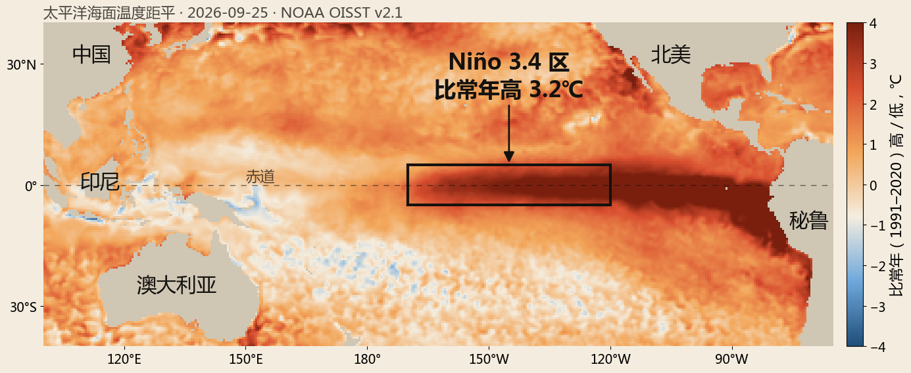{height="540" fig-alt="2026 年 9 月 25 日太平洋海面温度距平图：赤道东太平洋一条深红色暖水带"}

::: {.source}
[NOAA OISST v2.1](https://www.ncei.noaa.gov/products/optimum-interpolation-sst) · 相对 1991–2020 平均 · 由 `tools/plot-pacific-sst.py` 生成
:::
:::

::: {.notes}
**厄尔尼诺 (El Niño)** 是赤道太平洋海温的周期性振荡（ENSO），被称为地球气候系统的「心跳」，会改写全球的大气环流。

**怎么看这张图**：颜色是海面温度比常年高（红）还是低（蓝）。正常年份信风把暖水推向西边的印尼；厄尔尼诺年信风变弱，暖水向东铺开，所以赤道东边、秘鲁外海那条深红色的带子，就是厄尔尼诺。注意整片海几乎都偏暖 —— 这是下一页要讲的气候变化。

**强弱怎么量**：看方框里的 Niño 3.4 区比常年高多少。高 0.5℃ 以上算厄尔尼诺，高 2℃ 以上俗称「超强」。过去的超强事件 1877–78、1982–83、1997–98、2015–16 大致同属一档（约 2.7–2.8℃）；1877 年那次是重建出来的，误差很大（[NOAA 研究](https://repository.library.noaa.gov/view/noaa/46581)）。

**今年已经破纪录**：9 月 25 日的单日读数是 +3.2℃（这是日值，官方指数用三个月平均，会低一些）。7、8 月 Niño 3.4 区海温一直在 29℃ 以上，有记录以来从没有过；8 月 22 日全球海表温度 21.1℃ 创纪录（[NYT 2026-08-25](https://www.nytimes.com/2026/08/25/climate/el-nino-temperature-charts.html)）。3.6℃ 是多个气候模型的中位数预测（[The Climate Brink](https://www.theclimatebrink.com/p/the-strongest-el-nino-ever)），有不确定性，预计 12 月前后到顶。
:::

## 气候变化给厄尔尼诺垫高 {#el-nino-warming .t-split .t-split-light .s-el-nino-warming data-label="El Nino and Warming"}

:::: {.columns}
::: {.column .pad width="56%"}
::: {.tag}
🔥 气候变化 × 厄尔尼诺
:::

::: {.line-1}
同样一跳，[起跳点更高]{.hl}。
:::

::: {.small}
- 🌊 厄尔尼诺本来就有，是太平洋自然的起伏。

- 🌡️ 人类排放困住的多余热量，九成以上进了海洋，整片海的「底温」被抬高了。

- 🪸 珊瑚记录：近 40 年的厄尔尼诺，是 [千年来最强]{.hl} 的。

- 📈 最近两次强厄尔尼诺之后，全球气温都创了纪录：2016、2024，下一个很可能是 2027。
:::
:::

::: {.column .art width="44%"}
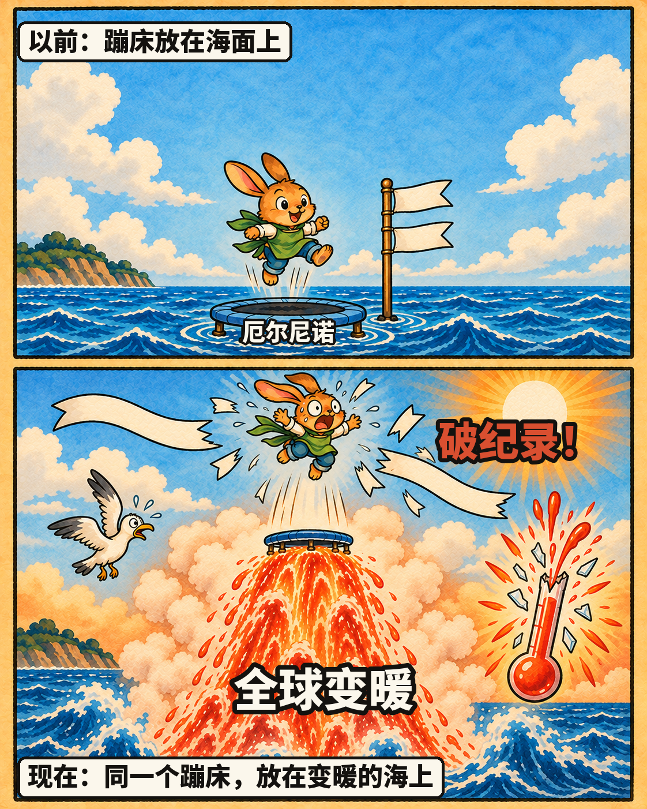{height="900" fig-alt="两格漫画：兔子在海面的蹦床上只跳了一点高；蹦床放到滚烫的海水高塔上，兔子被弹上云霄"}
:::
::::

::: {.notes}
**一句话**：厄尔尼诺是蹦床，全球变暖是把蹦床搬到了高台上 —— 同样一跳，落点更高。

- **海洋吸热**：IPCC 第六次评估报告，气候系统多出来的热量约 91% 储存在海洋里。所以上一页那张图，几乎整片太平洋都偏暖。
- **为什么全世界都会变热**：太平洋表层积攒的热量会慢慢释放到大气里，全球气温滞后厄尔尼诺峰值 3–5 个月。2015–16 之后 2016 年创纪录，2023–24 之后 2024 年创纪录；这次预计 12 月前后到顶，所以最热的很可能是 2027 年。
- **珊瑚研究**：Cole 等 2026 年 8 月发表于 *Science*，用加拉帕戈斯群岛 13 块珊瑚的骨骼化学重建近千年海温（珊瑚像树一样逐年长层，记下当年水温）。近 40 年的厄尔尼诺比此前千年任何时期都强，比工业化前（约 1850 年以前）强约 40%，和全球变暖同步（[UCSB 新闻稿](https://news.ucsb.edu/2026/022779/el-nino-has-become-more-intense-over-last-40-years-previous-1000-years)）。
- **和 1877 年那次矛盾吗？不矛盾。** 论文比的是一段时期里厄尔尼诺的整体强度，不是单次最强的事件。1877–78 是一次孤立的大事件；近 40 年则接连来了 1982–83、1997–98、2015–16、2023–24 好几次。
- **别说过头**：论文没有测今年这一次。「2026 可能是千年最强」是其他科学家的评论。也有学者质疑珊瑚能否把厄尔尼诺和整体海洋变暖分开。
:::

## 厄尔尼诺与粮食 {#el-nino-food .t-split .t-split-light .s-el-nino-food data-label="El Nino and Food"}

:::: {.columns}
::: {.column .pad width="58%"}
::: {.tag}
🌾 厄尔尼诺 · 落到餐桌上
:::

::: {.line-1}
[4,900 万人]{.hl}，\
可能因此严重缺粮。
:::

::: {.small}
- 🌽 南部非洲的玉米、萨赫勒、埃塞俄比亚：干旱减产；索马里、肯尼亚：洪水。

- 🌾 中美洲「干旱走廊」玉米歉收；澳大利亚小麦预计减产约 15%。

- 📜 1876–79 年也是一次超强厄尔尼诺：华北「丁戊奇荒」，常见估计死亡 900–1,300 万人 —— 当时没有人口普查，这是事后推算的，误差很大。
:::
:::

::: {.column .art width="42%"}
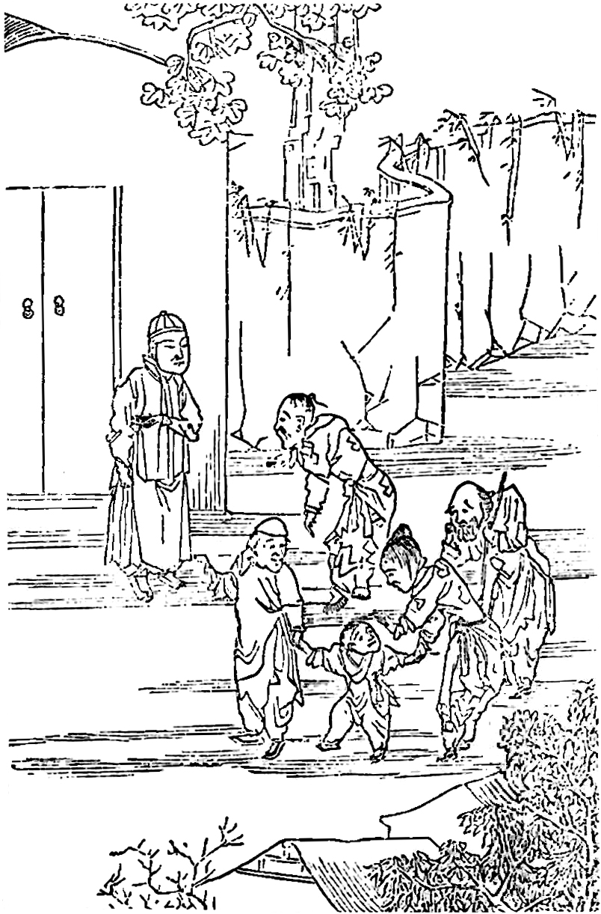{height="820" fig-alt="1878 年饥荒募捐画册中的木刻：灾民卖儿鬻女"}

::: {.cap}
1878 年为饥荒募捐印行的画册：灾民卖儿鬻女 · 公有领域
:::
:::
::::

::: {.notes}
- **4,900 万**：联合国世界粮食计划署 2026 年 8 月 5 日的初步估计，45 个国家里到 2027 年底，陷入「急性粮食不安全」（IPC 3 级及以上，也就是严重缺粮、要靠援助）的人可能多出至少 4,900 万，从约 2.25 亿增加到 2.74 亿。是缺粮人数，不是死亡人数（[WFP](https://www.wfp.org/news/world-food-programme-ramps-preparedness-and-response-plans-el-nino-threatens-push-tens)）。
- **哪里受影响**（[FEWS NET 2026 年 10 月报告](https://fews.net/global/special-report/october-2026)）：南部非洲（津巴布韦、莫桑比克、马拉维等）玉米干旱，最难熬的是 2027 年底到 2028 年初；萨赫勒、埃塞俄比亚、苏丹雨季少雨；索马里、肯尼亚洪水；中美洲「干旱走廊」；巴基斯坦干旱。澳大利亚小麦预计减产 14%（USDA）到 17%（ABARES）。
- **全球总产量其实变化不大**：1980 年以来的强厄尔尼诺年，全球玉米、小麦、稻米总产量最多只降过 3.9%。受苦的是本来就紧的地方和买不起涨价粮食的人。
- **中国**：常见「南涝北旱」—— 1998 年长江特大洪水，就在 1997–98 超强厄尔尼诺之后。
- **1876–79 年的数字要谨慎**：华北「丁戊奇荒」常见估计 950–1,300 万人死亡，以山西最重；但这是从人口损失事后推算的，没有当年的普查，各家差别很大。全球范围，有研究（Singh 等 2018，*Journal of Climate*）估计亚洲、巴西、非洲同时大旱，死亡超过 5,000 万，同样是粗略估计。死亡不全是天灾：赈灾跟不上、交通闭塞、殖民政策（英属印度饥荒期间照样出口粮食）都放大了灾难。今天的粮食储备和救灾体系强得多，没人预测会重演。
- **图**：出自 1878 年在伦敦出版的 *The Famine in China: Illustrations by a Native Artist*，翻印当年江南士绅为华北灾区募捐印行的画册（《铁泪图》一类）。
- **收尾**：这场厄尔尼诺我们拦不住，但它落在一个多热的地球上，我们说了算。食物生产占全球排放 26%，其中一半以上来自动物性食品 —— 接下一页，牛肉 vs 豆腐。
:::

## 牛肉 vs 豆腐 {#beef-vs-tofu .t-bars .s-climate-bars data-label="Beef vs Tofu"}

::: {.pad}
::: {.eyebrow}
[]{.dot}🐄 同等蛋白质，碳排截然不同
:::

### 牛肉的碳排放是豆腐的 [16 倍]{.hl}。

::: {.intro}
改吃全食物植物性饮食 🌱，可减少高达 [75%]{.hl} 的个人碳排放。
:::

```{=html}
<div class="bars">
  <div class="bar animal fragment" data-fragment-index="1"><div class="bar-label">🐄 牛肉</div><div class="bar-track"><div class="bar-fill" style="width:100%"></div></div><div class="bar-value">25</div></div>
  <div class="bar animal fragment" data-fragment-index="1"><div class="bar-label">🐑 羊肉</div><div class="bar-track"><div class="bar-fill" style="width:80%"></div></div><div class="bar-value">20</div></div>
  <div class="bar animal fragment" data-fragment-index="1"><div class="bar-label">🦐 虾</div><div class="bar-track"><div class="bar-fill" style="width:40%"></div></div><div class="bar-value">10</div></div>
  <div class="bar animal fragment" data-fragment-index="1"><div class="bar-label">🧀 奶酪</div><div class="bar-track"><div class="bar-fill" style="width:33.6%"></div></div><div class="bar-value">8.4</div></div>
  <div class="bar animal fragment" data-fragment-index="1"><div class="bar-label">🐖 猪肉</div><div class="bar-track"><div class="bar-fill" style="width:26%"></div></div><div class="bar-value">6.5</div></div>
  <div class="bar animal fragment" data-fragment-index="1"><div class="bar-label">🐔 鸡肉</div><div class="bar-track"><div class="bar-fill" style="width:17.2%"></div></div><div class="bar-value">4.3</div></div>
  <div class="bar animal fragment" data-fragment-index="1"><div class="bar-label">🥚 鸡蛋</div><div class="bar-track"><div class="bar-fill" style="width:15.2%"></div></div><div class="bar-value">3.8</div></div>
  <div class="bar animal fragment" data-fragment-index="1"><div class="bar-label">🐟 鱼</div><div class="bar-track"><div class="bar-fill" style="width:14%"></div></div><div class="bar-value">3.5</div></div>
  <div class="bar plant fragment" data-fragment-index="2"><div class="bar-label">🥡 豆腐</div><div class="bar-track"><div class="bar-fill" style="width:6.4%"></div></div><div class="bar-value">1.6</div></div>
  <div class="bar plant fragment" data-fragment-index="2"><div class="bar-label">🫘 豆类</div><div class="bar-track"><div class="bar-fill" style="width:2.6%"></div></div><div class="bar-value">0.65</div></div>
  <div class="bar plant fragment" data-fragment-index="2"><div class="bar-label">🫛 豌豆</div><div class="bar-track"><div class="bar-fill" style="width:1.4%"></div></div><div class="bar-value">0.36</div></div>
  <div class="bar plant fragment" data-fragment-index="2"><div class="bar-label">🥜 坚果</div><div class="bar-track"><div class="bar-fill" style="width:3.2%"></div></div><div class="bar-value">0.8</div></div>
</div>
```

::: {.source}
每 100g 蛋白质产生的 kg CO₂ 当量 · 来源：[Our World in Data · Less Meat or Sustainable Meat?](https://ourworldindata.org/less-meat-or-sustainable-meat)
:::
:::

::: {.notes}
按 **每 100 克蛋白质** 比较，而不是按每公斤食物比较，会更公平：比较的是“获得同样蛋白质要付出多少碳排”。

牛肉特别高，主要因为反刍动物会产生甲烷，饲养周期长，占用大量土地和饲料；如果森林或草地被转为牧场，土地利用变化也会把排放推高。

豆腐、豆类、豌豆这些植物蛋白直接把植物给人吃，中间少了一层动物转换，所以排放低很多。
:::

## 水污染 {#water-pollution .t-takeaway .tone-ember .s-water data-label="Water Pollution"}

::: {.pad}
::: {.eyebrow}
[]{.dot}💧 集约化养殖的代价 · 水污染
:::

### 工厂化养殖每天产生 [海量液态粪污]{.hl} 💩 —
一旦泄漏，便污染我们的淡水与海洋。

::: {.stat-row}
::: {.stat .fragment}
::: {.n}
🐷 370 万升
:::

::: {.u}
2020 年北卡罗来纳州一家猪场，向附近溪流泄漏粪尿 ([NC Newsline](https://ncnewsline.com/2021/01/12/hog-farm-that-spilled-1-million-gallons-of-feces-urine-into-waterways-had-been-warned-of-lagoon-problems))。
:::
:::

::: {.stat .fragment}
::: {.n}
🌊 4,500 km²
:::

::: {.u}
氮、磷富集推动致命藻华 — 2025 年澳大利亚南部藻华覆盖该面积，已致超 13,000 只海洋动物死亡 ([Guardian](https://www.theguardian.com/australia-news/2025/jul/20/sas-toxic-algal-bloom-is-twice-the-size-of-the-act-has-killed-12000-animals-and-is-filling-even-the-experts-with-dread))。
:::
:::
:::
:::

::: {.notes}
工厂化养殖的粪污不是普通农家肥，而是高度集中、数量巨大的液态废物。一个大型养殖场附近的粪污量，可能超过一座小城市，但处理标准和基础设施往往完全不同。

氮、磷进入河流湖海后，会造成**富营养化 (eutrophication)**：藻类暴发，水中氧气被耗尽，鱼虾和贝类窒息死亡。有些藻类还会释放毒素，影响饮用水和海产品安全。

这里的两个例子不是孤立事故，而是说明高密度养殖把污染风险集中化了：一旦泄漏、暴雨冲刷或管理失灵，影响会迅速外溢到公共水体。
:::

## 人兽共患病 {#zoonoses .t-takeaway .tone-forest .s-zoonoses data-label="Zoonoses"}

::: {.pad}
::: {.eyebrow}
[]{.dot}🦠 栖息地压力 · 跨物种感染温床
:::

### 栖息地破坏与密集养殖，让病毒[更容易跨物种传播]{.hl} —
下一场大流行的隐患，正在累积。

::: {.stat-row}
::: {.stat .fragment}
::: {.n}
🐖 尼帕病毒
:::

::: {.u}
1998–99 年马来西亚尼帕病毒 (Nipah virus) 疫情 — 养猪场扩张至果蝠栖息地，蝙蝠→猪→人传播链造成逾百人死亡，逾百万头猪被扑杀 ([WHO](https://www.who.int/news-room/fact-sheets/detail/nipah-virus))。
:::
:::

::: {.stat .fragment}
::: {.n}
🐔 2 亿+
:::

::: {.u}
自 2022 年 H5N1 传入美国，被扑杀的禽类累计已超 **2 亿只**（截至 2026 年）；密集养殖正是流感病毒变异的温床 ([WATT · Poultry](https://www.wattagnet.com/poultry-meat/diseases-health/avian-influenza/news/15819454/202226-us-poultry-losses-to-hpai-surpass-200-million-birds))。
:::
:::
:::
:::

::: {.notes}
**人畜共患病 (zoonotic diseases)**
指可以在动物和人之间传播的疾病。
很多新发传染病都和野生动物、家养动物、土地利用变化、密集养殖有关。

集约化养殖的问题不是单纯“动物多”，
而是大量基因相近、免疫压力相似的动物被关在高密度空间里。
病毒一旦进入，就有很多复制和变异机会；
再通过工人、运输、市场和粪污扩散出去。

尼帕病毒和禽流感是两个互补的例子，
都直接指向动物农业本身：

尼帕病毒疫情是一个教科书式的案例——
马来西亚的养猪场扩张到果蝠栖息地附近，
猪舍旁种植的果树吸引了蝙蝠，
蝙蝠的唾液和粪便污染饲料，
病毒先在密集饲养的猪群中放大，
再通过猪传给工人和屠宰场员工。
后续疫情致死率高达 40–75%。
这条传播链的每一环——
土地利用变化、密集饲养、人畜近距离接触——
都是工业化动物农业的特征。

H5N1 则显示高密度禽类生产
本身就是流感病毒持续演化的温床：
大量基因相近、免疫压力相似的禽类被关在高密度空间里，
病毒一旦进入就有大量复制和变异机会，
再通过工人、运输、市场和粪污扩散出去。

更大的背景：UNEP 2020 年的报告指出，
栖息地破坏、不可持续农业和气候变化
会持续增加动物源疾病溢出的机会
([NPR Illinois](https://www.nprillinois.org/generationlisten/2020-07-06/u-n-predicts-rise-in-diseases-that-jump-from-animals-to-humans))。
食品系统不只是碳排放问题，
也会改变病原体溢出的生态条件。
:::

## 抗生素 {#antibiotics .t-takeaway .tone-ember .s-antibiotics data-label="Antibiotics"}

::: {.pad}
::: {.eyebrow}
[]{.dot}💉 畜牧业的抗生素滥用
:::

### 全球 [过半]{.hl} 抗菌药物流向 [畜牧业]{.hl} 🐄 —
不是治病，而是 **促生长** 与 **群体预防**。

::: {.stat-row}
::: {.stat .fragment}
::: {.n}
⚠️ 超级细菌
:::

::: {.u}
WHO 已将抗菌药物耐药性 (AMR) 列为人类重大健康威胁之一 ([WHO](https://www.who.int/news-room/fact-sheets/detail/antimicrobial-resistance))。
:::
:::

::: {.stat .fragment}
::: {.n}
🐷 MRSA
:::

::: {.u}
起源于集约化猪场的超级细菌 **MRSA CC398**，已扩散到农场之外的人群之中 ([Wikipedia](https://en.wikipedia.org/wiki/CC398))。
:::
:::
:::
:::

::: {.notes}
- **MRSA**：耐甲氧西林金黄色葡萄球菌，最早出现在医院里的“超级细菌”。CC398 是新出现的牲畜源亚型，从猪场跳到工人，再扩散到社区。
- **抗菌药物耐药性 (AMR)**：最新预测来自 2024 年 Lancet GRAM 研究——**2025–2050 年间全球将有约 3,900 万人直接死于细菌耐药感染**，并与约 1.69 亿人的死亡相关；旧的"2050 年每年 1000 万人"是更早的估算，遇到提问时用新数字（来源：[Lancet GRAM 2024](https://www.thelancet.com/article/S0140-6736(24)01885-3/abstract)）。
- 幻灯片的"约 73% 抗生素用于畜牧业"出自 2015 年 Van Boeckel 等的常被引用估计，主要用于"亚治疗剂量"促生长和群体预防；近年数字有争议，部分分析给出约 50–70% 的范围，WOAH 也报告兽用抗生素近年下降约 13%——所以稳妥说法是"大部分（过半）抗生素用于动物"。🇨🇳 中国是世界最大抗生素生产和使用国，畜牧业占很大份额（来源：[WOAH 2023](https://www.woah.org/en/new-report-reveals-global-decrease-in-antimicrobial-use-in-animals/)，[Nature Sustainability 2025](https://www.nature.com/articles/s41893-025-01751-1)）。
:::

## 第四部分 {#section-part-iv .t-section .s-section data-label="Section · Part IV"}

:::: {.columns}
::: {.column .center width="62.5%"}
::: {.num}
第 04 部分
:::

::: {.kicker}
餐盘之外 — 另一种生命的处境
:::

::: {.section-title}
🐷 也会
感到疼痛
:::

::: {.sub}
接下来会有一些不太舒服的数字。不是为了让谁内疚 — 只是因为，我们有权知道盘子里的东西是怎么来的。
:::
:::

::: {.column .art width="37.5%"}
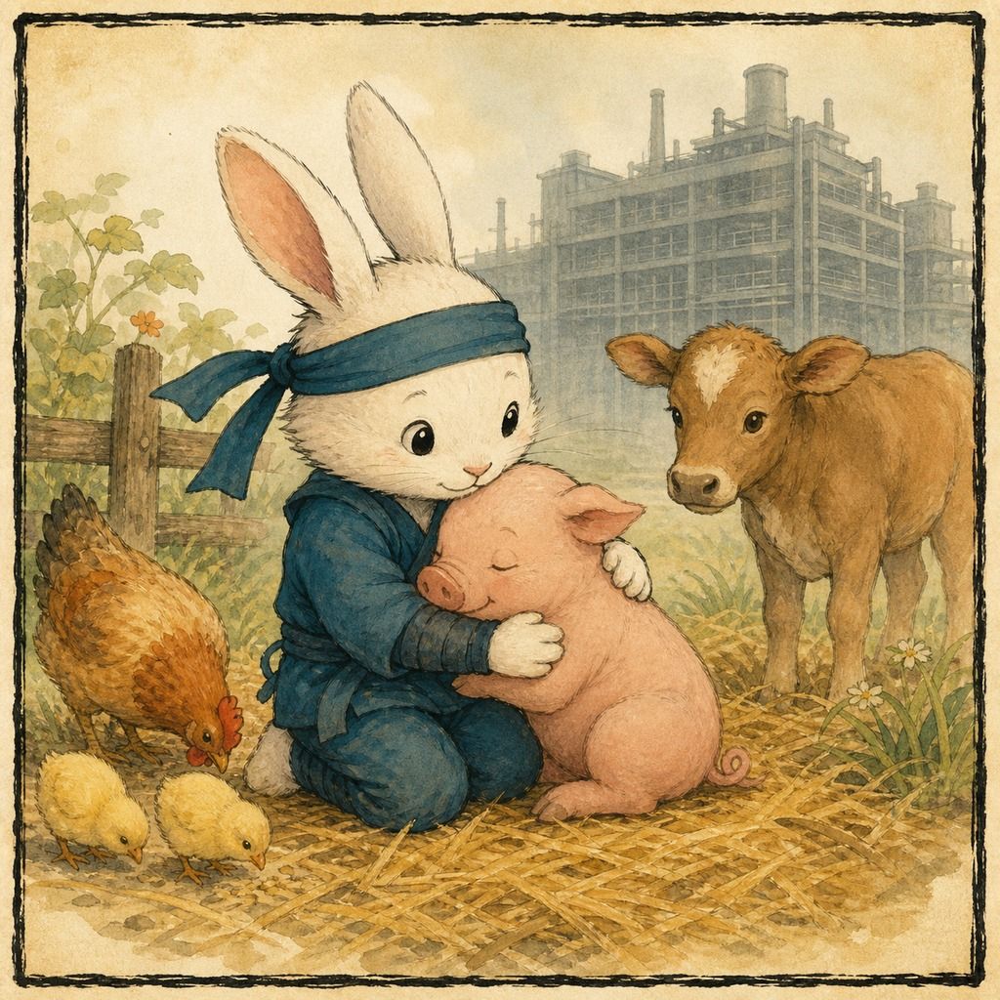
:::
::::

::: {.notes}
这一部分的语气要放软。前面讲健康、讲环境，都是「对我们有什么影响」；这一段讲的是「对它们有什么影响」。

开场先给听众一个心理准备，也给一个台阶：不要求任何人当场改变，只要求看一眼。讲之前可以说一句：如果有人觉得不舒服，随时可以移开视线，这很正常 — 不舒服本身就是信息。

节奏建议：先讲规模（冷），然后四类动物各一页（具体），最后用辛格那句话收尾（回到原则）。
:::

## 消失的后院 {#vanishing-backyard .t-stat-cards .t-stat-cards-dark .cards-3 .s-farm-scale data-label="Vanishing Backyard"}

::: {.pad}
::: {.eyebrow}
[]{.dot}🏭 从后院到高楼 · 规模化
:::

### 农家的后院，正在消失

::: {.intro}
猪没有变少 — 变少的是养猪的人家。养殖搬进了没有窗户的大楼，于是也搬出了我们的视线。
:::

::: {.stat-cards}
::: {.card-dark .fragment fragment-index=1}
::: {.card-tag}
🚪 小农户退出
:::
::: {.card-desc}
2012–2021 年间，六大畜牧业中的小农户单位减少约一半 — 约 6,250 万个退出这些行业
:::
::: {.card-main}
−50%
:::
:::

::: {.card-dark .fragment fragment-index=2}
::: {.card-tag}
🏢 一栋楼
:::
::: {.card-desc}
湖北一座 26 层「养猪大楼」的设计年出栏量（头）
:::
::: {.card-main}
100 万
:::
:::

::: {.card-light .hi .fragment fragment-index=3}
::: {.card-tag}
🇨🇳 每年出栏
:::
::: {.card-desc}
2024 年中国出栏生猪约 7.03 亿头，约占全球的一半
:::
::: {.card-main}
7.03 亿头
:::
:::
:::
:::

::: {.notes}
- **小农户退出**：2012–2021 年，六大畜牧业中最小规模的小农户单位减少约一半，共约 6,250 万个单位退出这些行业；这不等于这些家庭完全退出农业（来源：[Journal of Peasant Studies 2024](https://www.tandfonline.com/doi/full/10.1080/03066150.2024.2392688)）。
- **养猪大楼**：湖北鄂州的 26 层楼房猪场，设计年出栏 100 万头以上（来源：[The Guardian](https://www.theguardian.com/environment/2022/nov/25/chinas-26-storey-pig-skyscraper-ready-to-produce-1-million-pigs-a-year)）。所谓「超大规模」在中国的定义是年出栏 5 万头猪、100 万只鸡，或 50 万只种雏。
- **出栏量**：国家统计局数据，2024 年生猪出栏 70,256 万头，即约 7.03 亿头；2023 年为 72,662 万头。
- 另外可以提一句法律背景：中国目前**没有一部综合性的动物福利法**。2022 年修订的《畜牧法》关注的是生产、防疫和遗传资源，只提供间接的福利保护；行业协会 ICCAW 有自愿性福利标准，但不具强制力。
- 非洲猪瘟期间（2018–2022），中国有**超过 1 亿头**猪被扑杀（来源：[The Guardian](https://www.theguardian.com/environment/2022/oct/20/scientists-rush-to-create-vaccine-for-worlds-biggest-animal-disease-outbreak)）。
:::

## 蛋鸡 {#laying-hens .t-split .t-split-light .s-laying-hens data-label="Laying Hens"}

:::: {.columns}
::: {.column .pad width="55%"}
::: {.tag}
🥚 蛋鸡 · Laying Hens
:::

::: {.line-1}
中国有 [12.8 亿只]{.hl} 蛋鸡 🐔
:::

::: {.line-2}
其中公开统计的非笼养约 [千分之一]{.hl}。
:::

::: {.small}
- 2024 年中国在产蛋鸡存栏约 **12.8 亿只**；截至 2025 年，已公开汇总的「非笼养」项目约 **130 万只**。
- 一只笼养蛋鸡终生的活动空间，还不到一张 A4 纸大 — 一辈子无法完全展开翅膀。
- 为防止拥挤引发的互啄，雏鸡的喙尖会被切除（断喙），商业生产中**通常不使用任何止痛措施**。
- 公雏不下蛋、也不适合长肉 — 出生当天即被处理掉，全球每年以**十亿只**计。
:::
:::

::: {.column .art width="45%"}
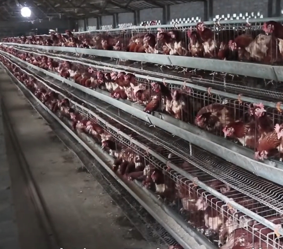{fig-alt="中国某蛋鸡场的层叠笼"}

::: {.cap}
中国某蛋鸡养殖场 [来源：YouTube](https://youtu.be/X5H2pMJVuuY){.src}
:::
:::
::::

::: {.notes}
**层叠笼 (battery cage)**：把蛋鸡关在多层铁丝笼中的饲养方式。

🇨🇳 中国数据：2024 年 12 月在产蛋鸡存栏约 **12.8 亿只**（中国畜牧业协会监测）；2025 年目前能查到的非笼养项目汇总约 **130 万只**，不应当当作全国完整普查（[新浪财经 · 2025 非笼养蛋鸡项目汇总](https://finance.sina.com.cn/roll/2025-12-25/doc-inhczaki8933458.shtml)）。按这两个口径相除约为 **千分之一**。中国鸡蛋产量已连续四十年居世界第一，2024 年禽蛋产量 3,588 万吨（[国家统计局 2024 年统计公报](https://www.stats.gov.cn/sj/zxfb/202502/t20250228_1958817.html)）。中国目前没有关于动物福利或非笼养生产的法律法规，只有自愿性标准与企业承诺。

空间对比：A4 纸约 623 平方厘米；美国蛋品生产者协会 (UEP) 认证为「达标」的笼子每只鸡 **432 平方厘米** — 也就是说，连认证标准都比一张 A4 纸小。现场举一张 A4 纸做对比，比念数字有效得多。

断喙的争议不在于是否必要，而在于疼痛处理。辛格引用的行业文献承认：局部麻醉或止痛药可以减轻断喙后的行为改变，但商业生产中鸡不会得到任何止痛。

公雏的处理是整个鸡蛋产业最难辩解的一环。近年欧洲已有国家立法禁止，并推动**蛋内性别鉴定 (in-ovo sexing)** 技术，在孵化前就识别性别 — 这说明问题是可以解决的，只是需要有人要求。
:::

## 肉鸡 {#broiler-chickens .t-takeaway .tone-ember .s-broilers data-label="Broiler Chickens"}

::: {.pad}
::: {.eyebrow}
[]{.dot}🐣 肉鸡 · Broilers
:::

### 上世纪七十年代，一只肉鸡长到出栏要 [80 天]{.hl}
今天，只要 [40 天]{.hl}。

::: {.stat-row}
::: {.stat .fragment}
::: {.n}
🐔 148 亿只
:::

::: {.u}
2024 年中国出栏肉鸡 **148 亿只**，其中白羽肉鸡 90 亿只 — 平均每天约 **4,000 万只**走上餐桌。
:::
:::

::: {.stat .fragment}
::: {.n}
🦴 慢性疼痛
:::

::: {.u}
身体长得比骨骼快。一项商业肉鸡调查发现约 **90%** 出现可检测的步态异常，其中约 **26%** 严重到足以影响福利；John Webster 曾判断，肉鸡在生命的**最后 20%** 可能持续处于慢性疼痛之中。
:::
:::
:::
:::

::: {.notes}
🇨🇳 中国数据：2024 年肉鸡出栏 **148.42 亿只**，其中白羽肉鸡 90.31 亿只、黄羽 33.34 亿只、小型白羽 24.77 亿只；全国家禽出栏 173.4 亿只（中国畜牧业协会 / [鸡病专业网汇总](https://www.jbzyw.com/view/430064)）。148 亿除以 365 天，约等于每天 4,000 万只。生长速度：白羽肉鸡上世纪七十年代出栏约需 80 天，八十年代 70 天，如今 40–42 天即可长到 2.5 公斤左右（中国农科院 / [新京报报道](https://caas.cn/xwzx/mtxw/6ef8c3ae3f704315ba830f9c8c5f77dd.htm)）。顺带回应一个常见误解：这是**育种**的结果，不是打激素。

这一页的核心不是「养得快」，而是**快到身体跟不上**。肉鸡被选育成胸肉极大、生长极快的品种，骨骼和心肺却没有同步长大，于是腿病、腹水、猝死都成为常态。

「90% 步态异常、26% 严重到影响福利」来自一项商业肉鸡调查（[Kestin et al. 1992](https://pubmed.ncbi.nlm.nih.gov/1441174/)）；这是特定调查和年代的结果，不应当理解成每个国家、每一批肉鸡的固定比例。

福利学者 John Webster 的原话大意是：肉鸡是唯一在生命最后 20% 时间里持续处于慢性疼痛中的畜禽 — 它们不走动，不是因为太挤，而是因为关节太痛。

另外两个可以补充的点：
- 鸡舍里的氨浓度常在 50–110 ppm，远高于人的职业暴露限值，而鸡一生都在这样的空气里，慢性呼吸道病、足垫皮炎、甚至失明都很常见。
- 数量级提醒：即使按 5% 的死亡率估算，148.42 亿只的基数也相当于约 7.4 亿只；实际比例会随品种、农场和统计口径变化，不能把某一地区的数字直接套到中国全国。

如果听众问「那不吃鸡蛋和鸡肉，蛋白质怎么办」，先记下，留到第五部分的蛋白质那一页统一回答。
:::

## 母猪 {#sows .t-split .t-split-light .s-sows data-label="Sows"}

:::: {.columns}
::: {.column .pad width="55%"}
::: {.tag}
🐖 母猪 · Sows
:::

::: {.line-1}
中国有 [4,078 万头]{.hl} 母猪
:::

::: {.line-2}
孕期在 [转不了身]{.hl} 的铁栏里度过。
:::

::: {.small}
- 猪的孕期是 **114 天**。妊娠母猪被关进定位栏 — 约 60 × 180 厘米，只比它自己的身体大一点。
- 分娩后转入产床，被铁架固定成侧卧的姿势 — 猪本来会在产前花上一整天做窝。
- 为抑制拥挤引发的咬尾，仔猪的尾巴常被刀割、烙断或用胶圈勒断，**通常不做麻醉**。
- 2024 年中国出栏生猪 7 亿头，约占全球一半；而中国至今没有一部综合性的动物福利法。
:::
:::

::: {.column .art width="45%"}
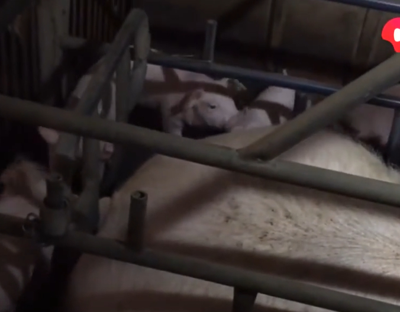{fig-alt="产床上被铁架固定的母猪"}

::: {.cap}
中国某养猪场的产床 [来源：YouTube](https://youtu.be/eWnbfTCVRUY){.src}
:::
:::
::::

::: {.notes}
**定位栏 (gestation stall / sow stall)** 与 **产床 (farrowing crate)**：两种把母猪固定住的金属围栏。前者用于整个妊娠期，后者用于分娩和哺乳期，理由是防止母猪压死仔猪。

要讲清楚的一点：猪的智力通常被认为不低于狗。母猪在自然条件下会在产前用嘴和蹄子花上大半天筑一个窝 — 定位栏里没有任何材料，也没有任何空间，这种被彻底阻断的本能行为，是福利科学中判断痛苦的关键指标之一。

法律背景：2022 年修订的《中华人民共和国畜牧法》关注生产、防疫与遗传资源，只有间接的福利条款；中国畜牧业协会 (ICCAW) 制定了自愿性的农场动物福利标准，涵盖饲养、运输和评估，但不具法律强制力。屠宰前致晕的技术规范确实存在，但只覆盖猪，且并未完全落实。

🇨🇳 中国数据：2024 年末全国能繁母猪存栏 **4,078 万头**（[农业农村部 2025 年 3 月发布的数据](https://jhs.moa.gov.cn/jjyx/202503/t20250320_6472045.htm)）；2024 年生猪出栏 **70,256 万头**（[国家统计局 2024 年统计公报](https://www.stats.gov.cn/sj/zxfb/202502/t20250228_1958817.html)），约占全球的一半。中国规模化猪场中，妊娠母猪绝大多数采用限位栏饲养；欧盟、加拿大、美国多州已在逐步淘汰，中国尚无相关规定。

数据来源：辛格《动物解放（新版）》第三章；定位栏尺寸与断尾方式引自该书及美国兽医协会的技术文献综述。
:::

## 奶牛 {#dairy-cows .t-takeaway .tone-forest .s-dairy data-label="Dairy Cows"}

::: {.pad}
::: {.eyebrow}
[]{.dot}🐄 奶牛与小牛 · Dairy
:::

### 2024 年，中国产出 [4,079 万吨]{.hl} 牛奶
每一滴，都以一次怀孕和一次[母子分离]{.hl}为前提。

::: {.stat-row}
::: {.stat .fragment}
::: {.n}
🍼 出生当天
:::

::: {.u}
小牛通常在出生后很快与母亲分离，母牛会连续数天不停地呼唤它。德国常规奶业中，能留在母亲身边的只是**极少数**。
:::
:::

::: {.stat .fragment}
::: {.n}
⏳ 5 年
:::

::: {.u}
奶牛的自然寿命可达约 20 年；高强度的怀孕与泌乳循环，让商业奶牛从出生到淘汰通常只有约 **4.5–6 年** — 约为自然寿命的四分之一至三分之一。
:::
:::
:::
:::

::: {.notes}
🇨🇳 中国数据：2024 年牛奶产量 **4,079 万吨**，比上年下降 2.8%（[国家统计局 2024 年统计公报](https://www.stats.gov.cn/sj/zxfb/202502/t20250228_1958817.html)）。

- 德国常规奶业通常在出生后立即或很快将小牛与母牛分开（[German dairy-farm survey](https://pmc.ncbi.nlm.nih.gov/articles/PMC7799592/)）。商业奶牛从出生到淘汰常约 4.5–6 年，自然寿命约 20 年（[productive-lifespan review](https://www.sciencedirect.com/science/article/pii/S1751731119003264)）。

这一页最容易被听众忽略，因为牛奶看上去是「不用杀生」的动物产品。要点是：**牛奶产业和肉产业不是两件事**。

- 泌乳需要怀孕。奶牛几乎终生处在怀孕—分娩—泌乳—再受孕的循环里。
- 小牛必须被移走，牛奶才能进入产线。母子分离时母牛持续鸣叫数天，是最直观、也最难否认的痛苦表现。
- 公犊没有产奶价值，一部分被养成小牛肉 (veal)。传统小牛肉生产会把小牛关在转不了身的箱栏里约十六周，并**刻意维持在贫血的边缘** — 因为铁会让肉变红，卖不出好价。
- 高产奶牛在产奶高峰期日产可达 60 升；乳房炎、蹄病、代谢病是常见的淘汰原因。

如果听众问钙怎么办，同样留到第五部分的钙那一页。
:::

## 鱼 {#farmed-fish .t-takeaway .tone-ember .s-farmed-fish data-label="Farmed Fish"}

::: {.pad}
::: {.eyebrow}
[]{.dot}🐟 鱼 · 最容易被忘记的动物
:::

### 2024 年，中国养殖水产品约 [6,060 万吨]{.hl} — 约占全球养殖水生动物的 [一半以上]{.hl}
我们几乎从不问，它们是怎么死的。

::: {.stat-row}
::: {.stat .fragment}
::: {.n}
🛁 一个浴缸
:::

::: {.u}
集约养殖中，体长可达 75 厘米的三文鱼被高密度地养在网箱里；水体流动和养殖密度直接决定它们的生存环境。
:::
:::

::: {.stat .fragment}
::: {.n}
🍽️ 鱼粉鱼油
:::

::: {.u}
三文鱼是肉食性的 — 它的饲料通常含有鱼粉和鱼油，但具体比例会随年份、产地和配方变化。
:::
:::
:::
:::

::: {.notes}
🇨🇳 中国数据：农业农村部发布的最终统计为：2024 年全国水产品总产量 **7,357.59 万吨**，其中**养殖产量 6,060.03 万吨**、捕捞 1,297.56 万吨（[2024 年全国渔业经济统计公报](https://yyj.moa.gov.cn/gzdt/202507/t20250707_6475475.htm)）。FAO 2026 年报告估计，2024 年全球养殖水生动物产量为 1.03 亿吨，中国为 5,760 万吨，约占 **56%**；这里的统计口径与中国“水产品”总量并不完全相同（[FAO SOFIA 2026](https://www.fao.org/newsroom/detail/sofia-2026--global-fisheries-and-aquaculture-production-reaches-new-highs/en)）。

鱼几乎从不出现在动物福利的讨论里，一部分原因是我们数的是「吨」，不是「条」。改成数「条」，数量级立刻变了：辛格引用的旧估算是全球养殖鱼约 1,240 亿条／年；这是数量级估计，不是当前官方统计，野捕鱼的数量则更难估算。

近二十年的研究已经相当明确：鱼有伤害感受器，会对止痛药有反应，会形成回避记忆 — 也就是说，**痛觉不是哺乳动物的专利**。

几个可以补充的细节（辛格《动物解放（新版）》）：
- 有些鱼种在育苗阶段，业界预期的死亡率就是 **70–80%**。
- 上市前的鱼会被断食，有时长达 **14 天**，为了排空消化道。
- 鲤鱼、罗非鱼、鳗鱼、泥鳅常常在**完全无水**的状态下运输。
- 鳗鱼常用撒盐（渗透脱水）的方式致死，行为学数据显示失去意识可能需要**超过 25 分钟**。

三文鱼饲料中的鱼粉鱼油把动物伦理和上一部分的环境问题接上了：养肉食性鱼，可能把一部分捕捞压力转移到饲料鱼身上；但具体比例不能用一个固定的「147 条换 1 条」概括。
:::

## 如果它会痛 {#if-it-suffers .t-quote .s-quote-singer data-label="If It Suffers"}

::: {.mark}
“
:::

> 如果一个存在 [会感到痛苦]{.hl}，
> 那么拒绝把这份痛苦 [纳入考量]{.hl}，
> 就没有任何道德上的理由。

::: {.cite}
彼得 · 辛格 ·《动物解放》
:::

::: {.notes}
原文：If a being suffers, there can be no moral justification for refusing to take that suffering into consideration.

这句话是辛格全部论证的支点，也是这一部分的收尾。它没有要求任何人爱动物，也没有说人和动物平等 — 它只要求一件事：**把痛苦算进去**。算进去之后怎么权衡，仍然是每个人自己的判断。

讲完这句就可以过渡到下一部分：不必一步到位，少一点就是少一点。少吃一顿肉，不是零和一的问题，而是几十亿分之几的问题 — 而这几十亿，每一个都是单数的。
:::

## 第五部分 {#section-part-v .t-section .s-section data-label="Section · Part V"}

:::: {.columns}
::: {.column .center width="62.5%"}
::: {.num}
第 05 部分
:::

::: {.kicker}
行动起来 · 从这一餐开始
:::

::: {.section-title}
改变 🍽️
就在下一餐
:::

::: {.sub}
理解了 健康、环境 与 动物 的连结，剩下的就是 — 把它落到每一顿饭里。
:::
:::

::: {.column .art width="37.5%"}
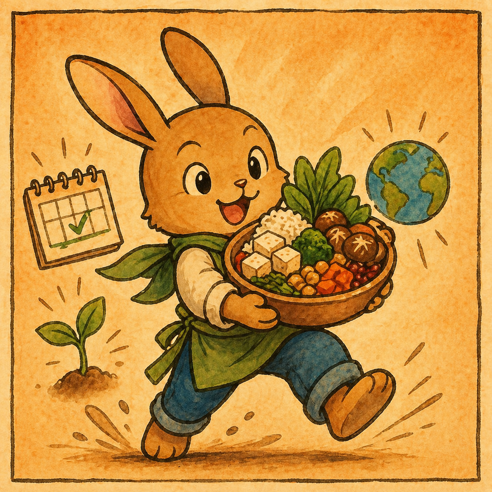
:::
::::

## 行动召唤 {#call-to-action .t-cta .s-cta data-label="Call to Action"}

::: {.cta-main}
::: {.cta-copy}
::: {.eyebrow}
[]{.dot}行动起来 · 从这一餐开始
:::

### 尝试在本周内 —
至少吃 [一顿]{.hl} 🥗 完全不含
动物性食材的丰盛餐食 🌱。

::: {.sub .fragment fragment-index=1}
无需长期承诺，
仅仅是一次对更健康生活方式的小小尝试。
:::
:::

::: {.cta-photo .fragment fragment-index=1}
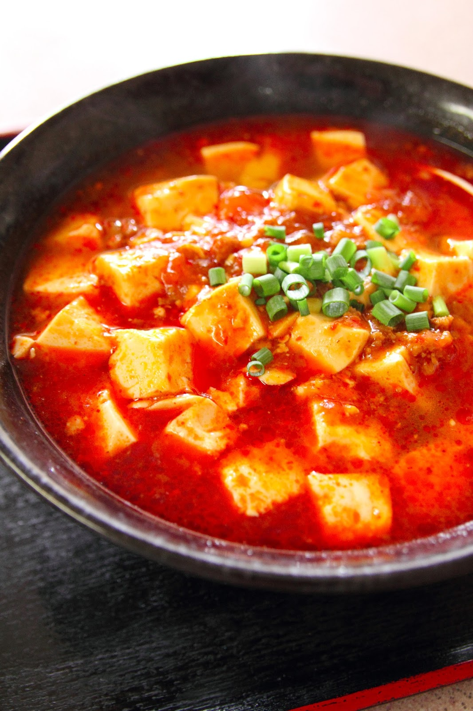
:::
:::

::: {.impact}
::: {.col .fragment fragment-index=2}
::: {.n}
1 / 21
:::

::: {.d}
每周 21 顿饭里的一顿 🍽️ — 改变并不困难，你只需要一份尝试的好奇心。
:::
:::

::: {.col .fragment fragment-index=3}
::: {.n}
🌏
:::

::: {.d}
若全球 80 亿人每周都替换掉一顿高碳排餐食，其累积的环保与健康效应将是巨大的。
:::
:::
:::

## 阅读这本书 {#read-the-book .t-resource .s-read data-label="Read the Book"}

::: {.eyebrow}
[]{.dot}📗 阅读《救命》
:::

### 想读全书？
[纸质书]{.ember} 与 [免费有声书]{.ember} 🎧 都触手可得。

::: {.qr-row .cols-2}
::: {.qr}
[{.code}](https://book.douban.com/subject/30335005/)

::: {.label}
[🇨🇳 中文版 · 纸质书](https://book.douban.com/subject/30335005/)
:::
:::

::: {.qr}
[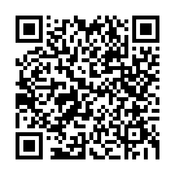{.code}](https://www.ximalaya.com/album/67071366)

::: {.label}
[{.img-emoji} 喜马拉雅 · 免费有声书](https://www.ximalaya.com/album/67071366)
:::
:::
:::

## 营养事实 {#nutrition-facts .t-resource .s-nutrition-social data-label="Nutrition Facts"}

::: {.eyebrow}
[]{.dot}📱 关注「能救命的饮食」
:::

### 在中文社交媒体 —
追踪 [格雷格医生团队]{.ember} 的最新研究科普 ❤️。

::: {.qr-row .cols-3}
::: {.qr}
[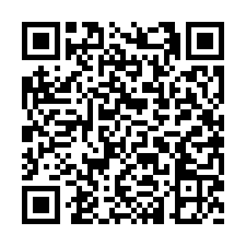{.code}](http://weixin.qq.com/r/FyikvLvEhub5rf-f930F)

::: {.label}
[{.img-emoji} 微信](http://weixin.qq.com/r/FyikvLvEhub5rf-f930F)
:::
:::

::: {.qr}
[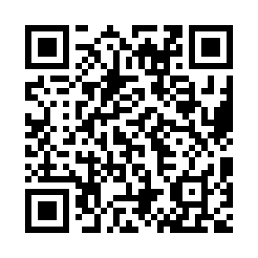{.code}](http://www.weibo.com/p/1005056379994699)

::: {.label}
[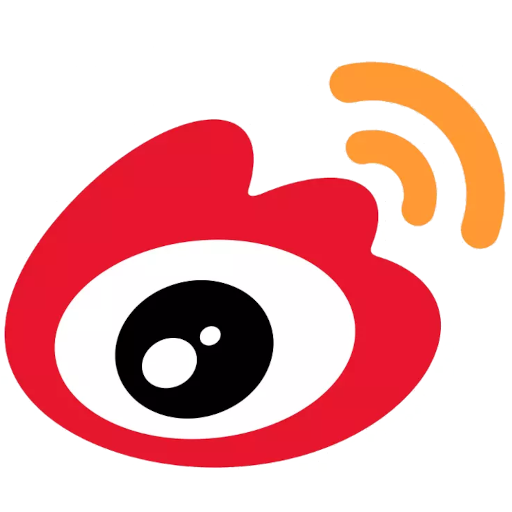{.img-emoji} 微博](http://www.weibo.com/p/1005056379994699)
:::
:::

::: {.qr}
[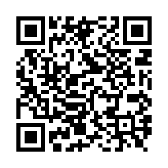{.code}](https://space.bilibili.com/1164349753)

::: {.label}
[{.img-emoji} 哔哩哔哩](https://space.bilibili.com/1164349753)
:::
:::
:::

## 每日十二种食物应用 {#daily-dozen-app .t-resource .s-dozen data-label="Daily Dozen App"}

::: {.eyebrow}
[]{.dot}📖《救命》第二部分 · 每日十二项
:::

### 每天打勾 —
《救命》下半部从「为什么」转向「怎么吃」，给出格雷格医生的 [每日健康植物食物清单]{.ember}。

::: {.dozen-grid}
::: {.daily-list}
::: {.daily-item}
[🫘]{.emoji} 豆类
:::

::: {.daily-item}
[🫐]{.emoji} 浆果
:::

::: {.daily-item}
[🍎]{.emoji} 其他水果
:::

::: {.daily-item}
[🥦]{.emoji} 十字花科
:::

::: {.daily-item}
[🥬]{.emoji} 绿叶菜
:::

::: {.daily-item}
[🥕]{.emoji} 其他蔬菜
:::

::: {.daily-item}
[🌾]{.emoji} 亚麻籽
:::

::: {.daily-item}
[🥜]{.emoji} 坚果
:::

::: {.daily-item}
[🫚]{.emoji} 香料
:::

::: {.daily-item}
[🍚]{.emoji} 全谷物
:::

::: {.daily-item}
[💧]{.emoji} 饮品
:::

::: {.daily-item}
[🏃]{.emoji} 运动
:::
:::

::: {.qr}
[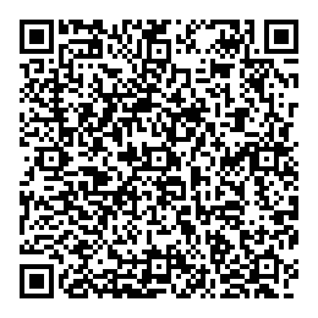{.code}](https://apps.apple.com/us/app/dr-gregers-daily-dozen/id1023170509)

::: {.label}
[<svg viewBox="0 0 384 512" style="height:0.85em;width:auto;fill:currentColor;vertical-align:-0.08em;margin-right:0.15em" aria-hidden="true"><path d="M318.7 268.7c-.2-36.7 16.4-64.4 50-84.8-18.8-26.9-47.2-41.7-84.7-44.6-35.5-2.8-74.3 20.7-88.5 20.7-15 0-49.4-19.7-76.4-19.7C63.3 141.2 4 184.8 4 273.5q0 39.3 14.4 81.2c12.8 36.7 59 126.7 107.2 125.2 25.2-.6 43-17.9 75.8-17.9 31.8 0 48.3 17.9 76.4 17.9 48.6-.7 90.4-82.5 102.6-119.3-65.2-30.7-61.7-90-61.7-91.9zm-56.6-164.2c27.3-32.4 24.8-61.9 24-72.5-24.1 1.4-52 16.4-67.9 34.9-17.5 19.8-27.8 44.3-25.6 71.9 26.1 2 49.9-11.4 69.5-34.3z"/></svg> 苹果应用商店](https://apps.apple.com/us/app/dr-gregers-daily-dozen/id1023170509)
:::
:::

::: {.qr}
[{.code}](https://play.google.com/store/apps/details?id=org.nutritionfacts.dailydozen)

::: {.label}
[<svg viewBox="0 0 512 512" style="height:0.85em;width:auto;fill:currentColor;vertical-align:-0.08em;margin-right:0.15em" aria-hidden="true"><path d="M325.3 234.3L104.6 13l280.8 161.2-60.1 60.1zM47 0C34 6.8 25.3 19.2 25.3 35.3v441.3c0 16.1 8.7 28.5 21.7 35.3l256.6-256L47 0zm425.2 225.6l-58.9-34.1-65.7 64.5 65.7 64.5 60.1-34.1c18-14.3 18-46.5-1.2-60.8zM104.6 499l280.8-161.2-60.1-60.1L104.6 499z"/></svg> 谷歌应用商店](https://play.google.com/store/apps/details?id=org.nutritionfacts.dailydozen)
:::
:::
:::

::: {.notes}
**每日十二项 (Daily Dozen)** 详细分量参考：

- 🫘 豆类：3 份/天（一份 ≈ 半杯熟豆/扁豆/豆腐/豆豉，1 杯鲜豌豆或发芽扁豆，或 1/4 杯鹰嘴豆泥）
- 🫐 浆果：1 份（半杯新鲜或 1/4 杯干）
- 🍎 其他水果：3 份
- 🥦 十字花科：1 份（半杯西兰花、卷心菜、芥蓝）
- 🥬 绿叶菜：2 份
- 🥕 其他蔬菜：2 份
- 🌾 亚麻籽：1 汤匙磨碎
- 🥜 坚果种子：1 份（1/4 杯坚果或 2 汤匙坚果酱）
- 🫚 香料：1/4 茶匙姜黄，加任何其他喜欢的无盐香草香料
- 🍚 全谷物：3 份（糙米、燕麦、藜麦等）
- 💧 饮品：5 杯/天（共 60 oz，约 1.8 升；水、绿茶、洛神花茶等）
- 🏃 运动：90 分钟中等强度，或 40 分钟高强度
- 💊 当前 NutritionFacts.org 信息图另列 B12：每周至少 2,000 µg 氰钴胺，或每天至少 50 µg；全食物植物性饮食者不要忽略。
不必每天打满，循序渐进。这是可调整的目标清单，不是处方食谱。
:::

## 每日十二种 · 豆类 {#dozen-beans .t-chapter .s-chapter data-label="Dozen · Beans"}

::: {.head}
<h3><span class="emj">🫘</span>每日十二项 — 豆类</h3>

::: {.ch}
01 · 每天 3 份（½ 杯熟豆 = 1 份）
:::
:::

::: {.body}
::: {.item .fragment}
::: {.stat .leaf}
-8%
:::

::: {.desc}
🕯️ 每多吃 **20 克豆类**（约两汤匙），过早死亡风险下降 8% — 豆类被认为是全球老年人「最强的长寿预测因子」。
:::
:::

::: {.item .fragment}
::: {.stat .leaf}
-19
:::

::: {.desc}
🫀 每天 **半杯斑豆**，两个月可使胆固醇下降约 19 点 — 接近部分他汀药物的效果。
:::
:::

::: {.item .fragment}
::: {.stat}
每一餐
:::

::: {.desc}
🌾 全球最权威的防癌报告建议：**每一餐** 都搭配全谷物和/或豆类（豆、扁豆、鹰嘴豆、豌豆）。
:::
:::

::: {.item .fragment}
::: {.stat}
🌬️
:::

::: {.desc}
怕胀气？多数人加豆后并无症状，胀气通常在第 2–3 周消退 — 「人们对豆类胀气的担忧被夸大了」。
:::
:::

:::

::: {.notes}
- **分量**：1 份 = ¼ 杯豆泥 / ½ 杯熟豆、扁豆、豆腐、豆豉 / 1 杯鲜豌豆或发芽扁豆；每天 3 份。
- 豆类同时拥有「蛋白质组」（蛋白、铁、锌）和「蔬菜组」（纤维、叶酸、钾）的营养，且天然低脂、无胆固醇。
- 大豆做成豆腐会流失约一半营养，但豆类太健康，丢掉一半仍是好食物；选含钙豆腐（配料表有钙）。
- **罐装豆**和现煮一样健康，唯一差别是钠 — 选无盐添加款，或冲洗掉约一半的盐。
- 扁豆有「第二餐效应」：一餐吃扁豆能压平数小时后那一餐的血糖峰值。
- 胀气对策：扁豆/豌豆/罐装豆产气较少；丁香、肉桂、大蒜最能减少产气；α-半乳糖苷酶补剂可分解豆糖。臭味主要来自含硫食物（肉、蛋），而非豆类。
:::

## 每日十二种 · 浆果 {#dozen-berries .t-chapter .s-chapter .dark data-label="Dozen · Berries"}

::: {.head}
<h3><span class="emj">🫐</span>每日十二项 — 浆果</h3>

::: {.ch}
02 · 每天 1 份（½ 杯新鲜或冷冻）
:::
:::

::: {.body}
::: {.item .fragment}
::: {.stat .leaf}
10×
:::

::: {.desc}
✨ 浆果的抗氧化物平均是其他果蔬的近 **10 倍**，是动物性食物的 **50 倍** 以上。
:::
:::

::: {.item .fragment}
::: {.stat .leaf}
黑莓
:::

::: {.desc}
🖤 论抗氧化含量，**黑莓**（约 650 单位）约为草莓的两倍 — 性价比最高的一份。
:::
:::

::: {.item .fragment}
::: {.stat .leaf}
🫀
:::

::: {.desc}
近 **10 万人** 的研究：吃浆果最多的人，死于心血管病的风险显著更低。
:::
:::

::: {.item .fragment}
::: {.stat .leaf}
🍬
:::

::: {.desc}
水果里的糖无须担心 — 连同浆果一起摄入糖，血糖反而不再飙升，胰岛素峰值被削平。
:::
:::

:::

::: {.notes}
- **分量**：1 份 = ½ 杯新鲜或冷冻、¼ 杯干浆果；每天至少 1 份。
- 「颜色就是抗氧化物」：红洋葱比白洋葱多 76%，紫甘蓝比绿甘蓝多 8 倍 — 越深越好。
- **冷冻浆果**与新鲜的营养相当，且更便宜、全年可得；做成果酱却会损失高达 97% 的花青素。
- **酸樱桃**抗炎，可缓解痛风、降低 C 反应蛋白，并含褪黑素助眠；**枸杞**的玉米黄质是鸡蛋的 50 倍，护视网膜。
- 一个有趣实验：每天吃 20 份水果（≈ 8 罐汽水的糖）持续数月，体重、血压、血脂均无不良影响。
:::

## 每日十二种 · 其他水果 {#dozen-other-fruits .t-chapter .s-chapter data-label="Dozen · Other Fruits"}

::: {.head}
<h3><span class="emj">🍎</span>每日十二项 — 其他水果</h3>

::: {.ch}
03 · 每天 3 份（1 个中等大小水果 = 1 份）
:::
:::

::: {.body}
::: {.item .fragment}
::: {.stat}
⚠️
:::

::: {.desc}
史上最大规模的疾病风险研究发现：美国饮食 **最糟糕的一点**，就是水果吃得太少。
:::
:::

::: {.item .fragment}
::: {.stat .leaf}
-24%
:::

::: {.desc}
🍎 每天约一打 **苹果干**，3 个月内坏胆固醇 (LDL) 下降 16%，6 个月达 24%。
:::
:::

::: {.item .fragment}
::: {.stat}
🥤
:::

::: {.desc}
吃 **完整水果** 可降低糖尿病风险，**喝果汁** 反而升高 — 榨汁丢掉了纤维和附着其上的营养。
:::
:::

::: {.item .fragment}
::: {.stat .leaf}
🍊
:::

::: {.desc}
吃 **柑橘** 2 小时内，DNA 对损伤的抵抗力显著增强，与乳腺癌风险下降相关。
:::
:::

:::

::: {.notes}
- **分量**：1 份 = 1 个中等水果 / 1 杯切块水果 / ¼ 杯干果；每天 3 份。
- **橄榄油是黄灯食物**：营养大多在压榨中丢失，1 汤匙 100+ 卡却不顶饱；作者把它比作「脂肪界的白糖」，连特级初榨也会短暂损伤动脉舒张功能。
- **枣**是绝佳的绿灯甜味来源；**奇异果**两个睡前吃可改善失眠，也缓解便秘型肠易激。
- **西柚警示**：会抑制清除半数常用药物的酶，使药物浓度升高 — 常吃西柚者请告知医生。
- 柑橘 **皮（zest）** 含独特植物营养素，可擦入菜中；但橙汁可能反而升高皮肤癌风险，坚持吃完整水果。
:::

## 每日十二种 · 十字花科蔬菜 {#dozen-cruciferous .t-chapter .s-chapter .dark data-label="Dozen · Cruciferous"}

::: {.head}
<h3><span class="emj">🥦</span>每日十二项 — 十字花科</h3>

::: {.ch}
04 · 每天 1 份（½ 杯切碎）
:::
:::

::: {.body}
::: {.item .fragment}
::: {.stat .leaf}
🥦
:::

::: {.desc}
抗癌成分 **萝卜硫素** 几乎只在十字花科蔬菜里生成 — 因此它独占每日清单一席。
:::
:::

::: {.item .fragment}
::: {.stat .leaf}
40 分钟
:::

::: {.desc}
✂️ 「先切后等」：切碎后静置 **40 分钟** 再烹饪，萝卜硫素已生成，之后随便怎么煮都不怕。
:::
:::

::: {.item .fragment}
::: {.stat .leaf}
芥末粉
:::

::: {.desc}
🌭 给煮熟或冷冻的西兰花撒一点 **芥末粉**，能重新激活萝卜硫素的生成。
:::
:::

::: {.item .fragment}
::: {.stat .leaf}
多重
:::

::: {.desc}
🧠 萝卜硫素不止防癌，还护脑、护眼、减轻过敏炎症，并有助控制二型糖尿病。
:::
:::

:::

::: {.notes}
- **分量**：1 份 = ½ 杯切碎 / ¼ 杯西兰花芽 / 1 汤匙辣根；每天 1 份。
- **萝卜硫素 (sulforaphane)** 由前体与酶「黑芥子酶 (myrosinase)」相遇生成，酶遇热失活，故生切静置或加芥末粉是关键。
- **冷冻西兰花**因焯水灭酶，无法生成萝卜硫素；但前体耐热，撒芥末粉即可补救。
- **西兰花芽**是便宜、浓缩的萝卜硫素来源；书中比较中，一杯鲜芽让血中萝卜硫素水平远高于商业补剂（如 BroccoMax），且成本低得多。
- 安全上限：每天约 1.5 杯芽苗无不良反应，4 杯以上可能有害。
:::

## 每日十二种 · 绿叶菜 {#dozen-greens .t-chapter .s-chapter data-label="Dozen · Greens"}

::: {.head}
<h3><span class="emj">🥬</span>每日十二项 — 绿叶菜</h3>

::: {.ch}
05 · 每天 2 份（1 杯生 / ½ 杯熟）
:::
:::

::: {.body}
::: {.item .fragment}
::: {.stat .leaf}
营养之王
:::

::: {.desc}
🌍 深绿叶菜是地球上 **每卡路里营养最高** 的食物。
:::
:::

::: {.item .fragment}
::: {.stat .leaf}
-20%
:::

::: {.desc}
🫀 每天多一份绿叶菜，心梗与中风风险 **各下降约 20%**（哈佛研究）。
:::
:::

::: {.item .fragment}
::: {.stat .leaf}
🥑
:::

::: {.desc}
绿叶菜的多种营养是脂溶性的 — 配一点坚果或牛油果，吸收率大增；零脂酱料则几乎吸收不到。
:::
:::

::: {.item .fragment}
::: {.stat}
⚠️
:::

::: {.desc}
正在服用 **华法林**（warfarin，血液稀释药）者，绿叶菜的维生素 K 会削弱药效，请先咨询医生再增量。
:::
:::

:::

::: {.notes}
- **分量**：1 份 = 1 杯生 / ½ 杯熟；每天 2 份（作者建议每周 12 份以上）。
- **叶绿素 (chlorophyll)** 是天然「拦截分子」，能结合致癌物、阻止其嵌入 DNA；6 杯菠菜量的叶绿素可阻断约 40% 黄曲霉毒素。
- 「风味-风味条件反射」：用少量甜味掩盖苦味，可重塑味觉，让人逐渐爱上绿叶菜；绿色奶昔是好入口。
- **唯一要避开的「绿叶」是苜蓿芽**：易被沙门菌污染，连自发芽也不安全（作者本人因此中过招）。
- 焯水会让部分营养溶进水里，但若因此多吃一倍绿叶菜，仍然划算。
:::

## 每日十二种 · 其他蔬菜 {#dozen-other-vegetables .t-chapter .s-chapter .dark data-label="Dozen · Other Vegetables"}

::: {.head}
<h3><span class="emj">🥕</span>每日十二项 — 其他蔬菜</h3>

::: {.ch}
06 · 每天 2 份（½ 杯生或熟）
:::
:::

::: {.body}
::: {.item .fragment}
::: {.stat .leaf}
多样性
:::

::: {.desc}
🌈 蔬菜 **种类** 比数量更能预测低炎症；每周多吃两种果蔬，二型糖尿病风险降 8%。
:::
:::

::: {.item .fragment}
::: {.stat .leaf}
🍄
:::

::: {.desc}
**蘑菇** 含麦角硫因（ergothioneine）— 一种植物界没有、可能堪称「新维生素」的抗氧化物。
:::
:::

::: {.item .fragment}
::: {.stat .leaf}
💜
:::

::: {.desc}
每天 6–8 个小 **紫薯**（或紫土豆），一个月内可显著降低血压。
:::
:::

::: {.item .fragment}
::: {.stat .leaf}
🛑
:::

::: {.desc}
体外实验中，**花椰菜、抱子甘蓝与大蒜** 能「彻底终止」乳腺癌细胞的生长。
:::
:::

:::

::: {.notes}
- **分量**：1 份 = ½ 杯生或熟非叶菜 / ½ 杯蔬菜汁 / ¼ 杯干蘑菇；每天 2 份。
- 「吃彩虹」：不同蔬菜含不同植物营养素并结合不同受体，需多样化才能全面受益；变化比总量更重要。
- **蘑菇要煮熟吃**：生蘑菇含毒素胼（agaritine），加热或微波可大幅减少；冷冻也能减少，多数干蘑菇入汤仍建议煮至少 5 分钟。菌类的麦角硫因耐热。
- **红薯**带皮吃，皮的抗氧化力是果肉近 10 倍；紫薯兼具紫色花青素与红薯营养。
- 番茄籽周围的黄色汁液能抑制血小板活化 — 选整粒/碎丁番茄，而非去籽的番茄酱。
:::

## 每日十二种 · 亚麻籽 {#dozen-flaxseeds .t-chapter .s-chapter data-label="Dozen · Flaxseeds"}

::: {.head}
<h3><span class="emj">🌾</span>每日十二项 — 亚麻籽</h3>

::: {.ch}
07 · 每天 1 汤匙（磨碎）
:::
:::

::: {.body}
::: {.item .fragment}
::: {.stat}
磨碎
:::

::: {.desc}
🌰 整粒亚麻籽会原样排出 — **必须磨碎** 才能释放其中的营养。
:::
:::

::: {.item .fragment}
::: {.stat .leaf}
100×
:::

::: {.desc}
亚麻籽的 **木酚素 (lignans)** 含量约为其他食物的 100 倍，与防治乳腺癌、前列腺癌相关。
:::
:::

::: {.item .fragment}
::: {.stat .leaf}
✅
:::

::: {.desc}
每天 **一汤匙** 就能满足身体对短链 omega-3（ALA）的需求。
:::
:::

::: {.item .fragment}
::: {.stat .leaf}
💢
:::

::: {.desc}
研究中，磨碎的亚麻籽对 **顽固性高血压** 显示出强大的降压效果。
:::
:::

:::

::: {.notes}
- **分量**：1 份 = 1 汤匙磨碎；每天 1 份（另加一份坚果或种子）。
- 磨碎后靠自身抗氧化物，室温可保存至少 4 个月；可烘焙而不破坏木酚素或 omega-3（亚麻籽油则不耐热）。
- **木酚素**是植物雌激素，亚麻是迄今含量最高的食物来源，与乳腺、前列腺癌的预防和生存改善相关。
- 「亚麻蛋」：1 汤匙磨碎亚麻籽 + 3 汤匙水搅成胶状，可替代烘焙中的一个鸡蛋，且无胆固醇、富含可溶性纤维。
- 想直接补长链 omega-3（EPA/DHA），可每天加 250 mg 无污染的藻油 — 见「鱼与海鲜」一页。
:::

## 每日十二种 · 坚果 {#dozen-nuts .t-chapter .s-chapter .dark data-label="Dozen · Nuts"}

::: {.head}
<h3><span class="emj">🥜</span>每日十二项 — 坚果</h3>

::: {.ch}
08 · 每天 1 份（¼ 杯坚果 / 2 汤匙坚果酱）
:::
:::

::: {.body}
::: {.item .fragment}
::: {.stat .leaf}
+2 年
:::

::: {.desc}
⏳ 每周 5 天、每天一把坚果，可能为你的寿命增加约 **两年**。
:::
:::

::: {.item .fragment}
::: {.stat .leaf}
1 / 2
:::

::: {.desc}
🌰 PREDIMED 试验：每周吃三份以上 **核桃**，死于癌症的风险减半。
:::
:::

::: {.item .fragment}
::: {.stat .leaf}
-50%
:::

::: {.desc}
PREDIMED 中相当于每天多 **半盎司坚果** 的干预，中风风险约减半。
:::
:::

::: {.item .fragment}
::: {.stat .leaf}
⚖️
:::

::: {.desc}
约 20 项试验均未见预期的增重 — 坚果增强饱腹感、并提高身体的脂肪代谢。
:::
:::

:::

::: {.notes}
- **分量**：1 份 = ¼ 杯坚果或种子 / 2 汤匙坚果或种子酱（含花生酱）；每天 1 份。
- 全球疾病负担研究：坚果种子吃太少是 **第三大** 致死致残饮食因素，杀死的人远超加工肉。
- **核桃**抗氧化与 omega-3 含量居前，体外抑癌也最强；PREDIMED 中坚果组中风约减半，坚果摄入较高者总死亡风险更低。
- 坚果不增重的机制：约 70% 热量因饱腹感而在别处少吃、约 10% 随粪便排出、其余靠提高脂肪燃烧抵消。
- 花生其实是豆类；憩室病患者也可放心吃坚果（旧建议已被推翻，反而有保护作用）。
:::

## 每日十二种 · 香料 {#dozen-spices .t-chapter .s-chapter data-label="Dozen · Spices"}

::: {.head}
<h3><span class="emj">🫚</span>每日十二项 — 香料</h3>

::: {.ch}
09 · 每天 ¼ 茶匙姜黄，外加无盐香草香料
:::
:::

::: {.body}
::: {.item .fragment}
::: {.stat .leaf}
🟡
:::

::: {.desc}
关于 **姜黄素**（curcumin，姜黄的黄色色素）的医学论文已超过 5000 篇。
:::
:::

::: {.item .fragment}
::: {.stat .leaf}
1 / 2
:::

::: {.desc}
🧬 每天 1/8 茶匙姜黄、连吃一周，血细胞中受损 DNA 的数量可减少一半。
:::
:::

::: {.item .fragment}
::: {.stat .leaf}
+2000%
:::

::: {.desc}
🌶️ 配一撮 **黑胡椒**（胡椒碱 piperine），姜黄素的血液浓度可飙升 2000%。
:::
:::

::: {.item .fragment}
::: {.stat .leaf}
50%
:::

::: {.desc}
溃疡性结肠炎试验中，姜黄素让超过 **半数患者** 一个月内缓解，安慰剂组为零。
:::
:::

:::

::: {.notes}
- **分量**：每天 ¼ 茶匙姜黄粉（≈ ¼ 英寸新鲜姜黄根），再加任意你喜欢的无盐香草香料。
- 「风味就是抗氧化物」：许多香料的香气分子本身就是强抗氧化剂；多国膳食指南已鼓励用香料替代盐。
- 姜黄素吸收差，黑胡椒中的胡椒碱可抑制其代谢清除；配脂肪也能提升吸收 7–8 倍。
- 安全剂量：人体研究剂量从 1/16 茶匙到近 2 汤匙不等，但长期高剂量安全性未知，故只建议「烹饪剂量」。
- 印度传统用酥油 (ghee) 配咖喱，其饱和脂肪可能是该国心脏病偏高的原因之一 — 改用坚果等绿灯脂肪。
:::

## 每日十二种 · 全谷物 {#dozen-whole-grains .t-chapter .s-chapter .dark data-label="Dozen · Whole Grains"}

::: {.head}
<h3><span class="emj">🍚</span>每日十二项 — 全谷物</h3>

::: {.ch}
10 · 每天 3 份（½ 杯熟谷物 = 1 份）
:::
:::

::: {.body}
::: {.item .fragment}
::: {.stat .leaf}
🌍
:::

::: {.desc}
多吃全谷物的人寿命显著更长；全球每年或可因此 **挽救上百万人**。
:::
:::

::: {.item .fragment}
::: {.stat .leaf}
-7%
:::

::: {.desc}
🔥 每天一份全谷物，炎症指标 **C 反应蛋白 (CRP)** 约下降 7%。
:::
:::

::: {.item .fragment}
::: {.stat .leaf}
×2
:::

::: {.desc}
吃 **「完整」谷物**（而非磨成粉）能让排便量翻倍，喂养肠道益生菌。
:::
:::

::: {.item .fragment}
::: {.stat .leaf}
5 : 1
:::

::: {.desc}
**五比一法则**：包装食品的碳水与纤维之比 ≤ 5，才是真正的全谷物。
:::
:::

:::

::: {.notes}
- **分量**：1 份 = ½ 杯热麦片/熟谷物/熟意面 / 1 杯冷麦片 / 1 片面包或玉米饼 / 3 杯爆米花；每天 3 份。
- 「全谷物致炎」是网络谣言：实测多项炎症指标（CRP、IL-6、TNF-α 等）均被全谷物改善。
- **麸质 (gluten)**：仅约 1% 人有乳糜泻、约 1% 有小麦敏感；其余 98% 无证据需要无麸质饮食，盲目无麸质反而可能损害肠道菌群。怀疑敏感应先查乳糜泻，别自行戒麸。
- **完整谷物**优于磨粉：磨成粉后淀粉在小肠就被吸收完，留给肠道菌群的「剩饭」变少。
- **燕麦**含独有的抗炎成分燕麦蒽酰胺；选有色谷物（红/黑米、蓝玉米）抗氧化更高。
:::

## 每日十二种 · 饮料 {#dozen-beverages .t-chapter .s-chapter data-label="Dozen · Beverages"}

::: {.head}
<h3><span class="emj">💧</span>每日十二项 — 饮品</h3>

::: {.ch}
11 · 每天 5 杯（共 60 oz ≈ 1.8 升）
:::
:::

::: {.body}
::: {.item .fragment}
::: {.stat .leaf}
💧
:::

::: {.desc}
专家饮品排行榜：**水** 居首，茶与咖啡并列第二，汽水垫底，全脂牛奶与啤酒同列（建议 0）。
:::
:::

::: {.item .fragment}
::: {.stat .leaf}
-50%
:::

::: {.desc}
🚽 哈佛研究：每天多喝一杯水，膀胱癌风险降 7%；约 8 杯可降低一半。
:::
:::

::: {.item .fragment}
::: {.stat .leaf}
1 / 2
:::

::: {.desc}
🫀 安息日会研究：每天 5 杯以上水的人，死于心脏病的风险约为只喝 2 杯者的 **一半**。
:::
:::

::: {.item .fragment}
::: {.stat .leaf}
🍵
:::

::: {.desc}
作者首选 **绿茶** — 「每一杯咖啡，都是错过一杯更健康绿茶的机会」。
:::
:::

:::

::: {.notes}
- **分量**：书中为 5 杯、每杯 12 oz（共 60 oz，约 1.8 升），在食物天然含水之外；当前 NutritionFacts.org 信息图也写作 60 oz/天。
- 「每天 8 杯水」其实缺乏科学依据，源自 1921 年一篇仅以作者本人尿汗量推算的论文；权威推荐女性约 4–7 杯、男性 6–11 杯饮用水。
- 轻度脱水会让大脑「缩水」、影响认知与情绪；近 2/3 儿童到校时处于轻度脱水。
- **咖啡**整体与小幅延寿相关（每天每杯约 -3% 死亡风险），但 GERD、孕妇、青光眼、失眠者需留意；非滤纸冲煮（法压、土耳其式）的咖啡醇会升胆固醇。
- **绿茶**植物营养素强大，与防多种癌症、降胆固醇/血压/血糖、护脑相关；全脂牛奶因 IGF-1 与前列腺癌等相关而被列为「建议 0」。
:::

## 每日十二种 · 运动 {#dozen-exercise .t-chapter .s-chapter .dark data-label="Dozen · Exercise"}

::: {.head}
<h3><span class="emj">🏃</span>每日十二项 — 运动</h3>

::: {.ch}
12 · 每天 90 分钟中等强度 / 40 分钟高强度
:::
:::

::: {.body}
::: {.item .fragment}
::: {.stat}
+40%
:::

::: {.desc}
🪑 每天久坐 6 小时以上，死亡率男性高 20%、女性高 40% — 即使你也按时去健身房。
:::
:::

::: {.item .fragment}
::: {.stat .leaf}
🏃
:::

::: {.desc}
每天 **站着办公 3 小时**，一年多消耗约 3 万卡，相当于跑 10 场马拉松。
:::
:::

::: {.item .fragment}
::: {.stat .leaf}
-24%
:::

::: {.desc}
🚶 每天步行 **1 小时**，总死亡率下降 24%；90 分钟效果更佳。
:::
:::

::: {.item .fragment}
::: {.stat .leaf}
🫐
:::

::: {.desc}
训练期加入 **樱桃、蓝莓** 能减轻炎症、加速恢复（力量流失从 22% 降到 4%）。
:::
:::

:::

::: {.notes}
- **分量**：1 份 = 90 分钟中等强度（如快走 4 mph）或 40 分钟高强度；每天 1 份，可分次完成。
- 作者强调：**饮食才是头号杀手**，运动不足在美国仅列第五；不能靠运动抵消糟糕的饮食。
- 「久坐之害」即使每天锻炼一小时也难完全抵消；可用站立桌/跑步机桌（本书大半在跑步机桌上写成）、每隔一段起身活动。
- 官方推荐每天 20 分钟其实偏低 — 数据显示 60 分钟降死亡率 24%、90 分钟更佳，作者主张如实告知公众。
- 全食物植物性饮食者抗氧化防御更强，能抵消运动产生的自由基；西洋菜、浆果可减轻运动氧化应激与肌肉酸痛，胜过维生素 C 补剂。
:::

## 长寿游戏 {#dozen-game .t-game .s-game data-label="Dozen · Game"}

```{=html}
<style>
.reveal .slides section.slide.s-game {
  background:
    radial-gradient(1400px 900px at 72% -12%, #1B4A36 0%, var(--forest) 46%, var(--forest-deep) 100%);
  color: var(--cream);
  padding: 48px 80px 0;
  text-align: center;
}
.s-game .g-tag {
  display: inline-block;
  font-family: 'JetBrains Mono', monospace;
  font-size: 24px;
  letter-spacing: 0.3em;
  color: var(--cream-2);
  border: 1px solid rgba(244, 237, 223, 0.35);
  border-radius: 999px;
  padding: 8px 26px 8px 32px;
}
.s-game .g-title {
  font-family: 'Noto Serif SC', serif;
  font-weight: 900;
  font-size: 64px;
  line-height: 1.15;
  margin-top: 18px;
}
.s-game .g-title .hl { color: var(--ember); }
.s-game .g-sub {
  font-size: 29px;
  color: rgba(244, 237, 223, 0.78);
  margin-top: 10px;
}
.s-game canvas {
  margin-top: 24px;
  width: 1600px;
  height: 700px;
  border-radius: 18px;
  box-shadow: 0 30px 80px rgba(0, 0, 0, 0.45);
  cursor: pointer;
  user-select: none;
  touch-action: none;
}
.s-game .g-hint {
  font-family: 'JetBrains Mono', monospace;
  font-size: 23px;
  color: rgba(244, 237, 223, 0.62);
  margin-top: 16px;
}
</style>

<div class="g-tag">🎮 复习小游戏</div>
<div class="g-title">多活 <span class="hl">31</span> 年</div>
<div class="g-sub">65 岁的兔子被死神盯上了 — 把它喂到 96 岁！接住的每一口，都会弹出《救命》里的一条真实研究。</div>
<canvas id="hntd-game" width="3200" height="1400"></canvas>
<div class="g-hint">🖱️ 移动鼠标 / ← → 键 / 📱 手指拖动控制兔子 · 点击画面开始 · ESC 退出 · 图标 Twemoji (CC-BY 4.0)</div>

<script>
(function () {
  var canvas = document.getElementById('hntd-game');
  if (!canvas) return;
  var slide = canvas.closest('section.slide');
  var ctx = canvas.getContext('2d');
  var W = 1600, H = 700;

  var START_AGE = 65, WIN_AGE = 96, MAX_HEARTS = 3;
  // icons: local Twemoji SVGs (CC-BY 4.0) in images/game/ — see ATTRIBUTION.md;
  // facts quote the evidence on the deck's own Dozen / chapter slides
  var HEALTHY = [
    { i: 'beans', y: 3, e: '🫘', n: '豆类', f: '每多吃 20 克豆类，过早死亡风险下降 8% — 最强的「长寿预测因子」' },
    { i: 'peas', y: 2, e: '🫛', n: '斑豆', f: '每天半杯斑豆，两个月内胆固醇下降约 19 点 — 接近部分他汀的效果' },
    { i: 'strawberry', y: 1, e: '🍓', n: '浆果', f: '连糖一起吃，血糖反而不飙升 — 胰岛素峰值被削平' },
    { i: 'blueberries', y: 2, e: '🫐', n: '蓝莓', f: '每天一杯半蓝莓，长跑运动员的 NK 免疫细胞不降反升' },
    { i: 'apple', y: 1, e: '🍎', n: '苹果', f: '每天约一打苹果干，6 个月内坏胆固醇 (LDL) 下降 24%' },
    { i: 'tangerine', y: 1, e: '🍊', n: '柑橘', f: '常吃柑橘类水果，与中风风险下降密切相关' },
    { i: 'broccoli', y: 2, e: '🥦', n: '十字花科', f: '抗癌成分萝卜硫素，几乎只在西兰花等十字花科蔬菜里生成' },
    { i: 'leafy-green', y: 3, e: '🥬', n: '绿叶菜', f: '每天多一份绿叶菜，心梗与中风风险各下降约 20%' },
    { i: 'mushroom', y: 1, e: '🍄', n: '蘑菇', f: '含麦角硫因 — 植物界之外没有的「新维生素」' },
    { i: 'tomato', y: 1, e: '🍅', n: '番茄', f: '籽周围的黄色汁液能抑制血小板活化 — 选整粒番茄，别去籽' },
    { i: 'avocado', y: 1, e: '🥑', n: '牛油果', f: '绿叶菜的营养多是脂溶性的 — 配点牛油果或坚果，吸收率大增' },
    { i: 'sweet-potato', y: 1, e: '🍠', n: '紫薯', f: '每天 6–8 个小紫薯，一个月内可显著降低血压' },
    { i: 'flax', y: 2, e: '🌾', n: '亚麻籽', f: '整粒会原样排出，必须磨碎 — 每天一汤匙就满足 omega-3 (ALA)' },
    { i: 'peanuts', y: 2, e: '🥜', n: '坚果', f: '每周 5 天、每天一把坚果，可能为寿命增加约两年' },
    { i: 'chestnut', y: 2, e: '🌰', n: '坚果与种子', f: 'PREDIMED 研究：每天多半盎司坚果，中风风险约减半' },
    { i: 'ginger', y: 2, e: '🫚', n: '姜黄', f: '每天 ⅛ 茶匙姜黄连吃一周，血细胞中受损 DNA 减少一半' },
    { i: 'rice', y: 2, e: '🍚', n: '全谷物', f: '每天一份全谷物，炎症指标 C 反应蛋白 (CRP) 约下降 7%' },
    { i: 'bread', y: 1, e: '🍞', n: '五比一法则', f: '包装食品的碳水与纤维之比 ≤ 5，才是真正的全谷物' },
    { i: 'oats', y: 1, e: '🥣', n: '燕麦', f: '护肝食物之一 — 与蓝莓、紫薯、不加糖的咖啡同列' },
    { i: 'tea', y: 1, e: '🍵', n: '饮品', f: '每天 5 杯以上水或茶，心脏病死亡风险约为少喝者的一半' },
    { i: 'coffee', y: 1, e: '☕', n: '咖啡', f: '不加糖的咖啡与小幅延寿相关 — 每天每杯约 −3% 死亡风险' },
    { i: 'hibiscus', y: 1, e: '🌺', n: '洛神花茶', f: '试验中的降压效果，可媲美一线降压药' }
  ];
  var JUNK = [
    { i: 'bacon', y: 3, e: '🥓', n: '加工肉', f: 'WHO 一类致癌物 — 与香烟、石棉同级（指证据确凿）' },
    { i: 'hotdog', y: 3, e: '🌭', n: '热狗', f: '每天 50 克加工肉，结肠癌风险上升约 18%' },
    { i: 'steak', y: 2, e: '🥩', n: '红肉', f: '每天多吃 100 克红肉，结肠癌风险上升约 17%' },
    { i: 'burger', y: 2, e: '🍔', n: '快餐', f: '连续一周每天两顿快餐，75% 的受试者肝酶异常' },
    { i: 'fries', y: 2, e: '🍟', n: '反式脂肪', f: '推高坏胆固醇 (LDL) 的头号饮食成分之一' },
    { i: 'chicken', y: 1, e: '🍗', n: '禽肉', f: '食源性感染重灾区 — 美国超市鸡肉 97% 检出致病菌' },
    { i: 'egg', y: 1, e: '🥚', n: '鸡蛋', f: '促炎的花生四烯酸主要来源之一，与抑郁风险相关' },
    { i: 'salt', y: 3, e: '🧂', n: '盐', f: '家庭人均每天做饭用盐 9.3 克 — 接近 WHO 上限（5 克）的两倍' },
    { i: 'soda', y: 2, e: '🥤', n: '含糖汽水', f: '每天多喝一罐，脂肪肝的长期风险 +45%' },
    { i: 'donut', y: 2, e: '🍩', n: '精制糖', f: '果糖与精制碳水，会在肝脏里直接转化成脂肪' },
    { i: 'butter', y: 2, e: '🧈', n: '黄油', f: '饱和脂肪大户 — 直接推高坏胆固醇 (LDL)' },
    { i: 'beer', y: 3, e: '🍺', n: '酒精', f: 'WHO 认定的乳腺致癌物 — 即便少量摄入也会增加风险' },
    { i: 'cigarette', y: 4, e: '🚬', n: '香烟', f: '烟雾中含 70 多种已知致癌物 — 戒烟 20 分钟后身体就开始恢复' }
  ];
  var CONFETTI = [
    { i: 'popper', e: '🎉' }, { i: 'confetti', e: '🎊' }, { i: 'seedling', e: '🌱' },
    { i: 'green-heart', e: '💚' }, { i: 'sparkles', e: '✨' }
  ];
  // goofy one-liners — pure flavour, the science stays on the fact cards
  var GOOD_QUIPS = [
    '真香！', '嘎嘣脆！', '细胞：谢谢老板！', '血管在唱歌～',
    '兔子直呼内行', '外祖母点了个赞', '好吃到跺脚', '肠道菌群狂欢中'
  ];
  var BAD_QUIPS = [
    '胃：你礼貌吗？', '血管堵车了…', '肝：我不干了！', '兔子眼前一黑',
    '死神偷笑中', '这口有点上头…', '体检报告瑟瑟发抖'
  ];
  var TAUNTS = [
    '来嘛，就一口 🍔', '96 岁？想得美', '我等得起～', '培根在向你招手',
    '喝一杯不算喝吧？', '你的红心看起来很好吃', '加班的兔子我见多了'
  ];
  var COMBO_QUIPS = { 3: '3 连击 · 开胃了！', 5: '5 连击 · 沙拉自由！', 8: '8 连击 · 蔬菜狂魔！', 12: '12 连击 · 长寿之光！' };
  // preload icon images; fall back to system emoji glyphs until loaded
  var IMG = {};
  function preload(name) {
    if (IMG[name]) return;
    var im = new Image();
    im.src = 'images/game/' + name + '.svg';
    IMG[name] = im;
  }
  HEALTHY.concat(JUNK).concat(CONFETTI).forEach(function (o) { preload(o.i); });
  ['bunny', 'skull', 'heart', 'heart-off'].forEach(preload);
  function imgOk(im) { return im && im.complete && im.naturalWidth > 0; }
  function icon(name, x, y, size, fallback, fallbackPx) {
    var im = IMG[name];
    if (imgOk(im)) {
      ctx.drawImage(im, x - size / 2, y - size / 2, size, size);
    } else {
      ctx.fillStyle = '#14120F';
      ctx.font = sans(400, fallbackPx || size);
      ctx.textAlign = 'center'; ctx.textBaseline = 'middle';
      ctx.fillText(fallback, x, y);
    }
  }

  var state = 'idle'; // idle | playing | won | lost
  var running = false;
  var age, hearts, items, popups, confetti, elapsed, overlayT;
  var fact = null, learned = [], m75 = false, m85 = false;
  var bunnyX = W / 2, targetX = W / 2, keyL = false, keyR = false;
  var spawnT = 0, shake = 0, flash = 0, lastT = 0;
  // goofy bits: combo streak, chomp squash, dizzy spin, sparkle trail,
  // and a reaper that floats after the bunny throwing shade
  var combo = 0, munch = 0, dizzy = 0, trail = [];
  var reaperX = W / 2, taunt = null, tauntT = 3;

  // same system stacks as theme.css — canvas cannot read a CSS custom property
  const SANS = '"Noto Sans SC", "Noto Sans CJK SC", "PingFang SC", "Microsoft YaHei", "Twemoji Mozilla", sans-serif';
  const SERIF = '"Noto Serif SC", "Noto Serif CJK SC", "Songti SC", "SimSun", "Twemoji Mozilla", serif';
  const MONO = '"JetBrains Mono", "DejaVu Sans Mono", Menlo, Consolas, "Twemoji Mozilla", monospace';
  function sans(w, s) { return w + ' ' + s + 'px ' + SANS; }
  function serif(w, s) { return w + ' ' + s + 'px ' + SERIF; }
  function mono(w, s) { return w + ' ' + s + 'px ' + MONO; }

  // --- Reveal integration -------------------------------------------------
  // while playing, take over both keyboard and touch so arrows / swipes
  // steer the bunny instead of turning pages
  function revealKeys(on) {
    if (window.Reveal && Reveal.configure) {
      try { Reveal.configure({ keyboard: on, touch: on }); } catch (e) {}
    }
  }
  function hookReveal() {
    if (window.Reveal && Reveal.on) {
      Reveal.on('slidechanged', function (ev) {
        if (ev.currentSlide !== slide) quitGame();
      });
    } else {
      setTimeout(hookReveal, 300);
    }
  }
  window.addEventListener('load', hookReveal);

  // --- Audio (tiny WebAudio blips, created on first click) ----------------
  var actx = null;
  function initAudio() {
    if (!actx) {
      try { actx = new (window.AudioContext || window.webkitAudioContext)(); } catch (e) {}
    }
  }
  function beep(freq, dur, type, vol) {
    if (!actx) return;
    try {
      var o = actx.createOscillator(), g = actx.createGain();
      o.type = type; o.frequency.value = freq;
      g.gain.setValueAtTime(vol, actx.currentTime);
      g.gain.exponentialRampToValueAtTime(0.001, actx.currentTime + dur);
      o.connect(g); g.connect(actx.destination);
      o.start(); o.stop(actx.currentTime + dur);
    } catch (e) {}
  }
  function slideBeep(f0, f1, dur, type, vol) {
    if (!actx) return;
    try {
      var o = actx.createOscillator(), g = actx.createGain();
      o.type = type;
      o.frequency.setValueAtTime(f0, actx.currentTime);
      o.frequency.linearRampToValueAtTime(f1, actx.currentTime + dur);
      g.gain.setValueAtTime(vol, actx.currentTime);
      g.gain.exponentialRampToValueAtTime(0.001, actx.currentTime + dur);
      o.connect(g); g.connect(actx.destination);
      o.start(); o.stop(actx.currentTime + dur);
    } catch (e) {}
  }
  // pitch climbs with the combo — a little "do re mi" ladder
  function sndGood() { beep(620 + 42 * Math.min(combo, 12), 0.09, 'triangle', 0.10); }
  function sndBad() { beep(130, 0.28, 'sawtooth', 0.12); }
  function sndWin() {
    [523, 659, 784, 1047].forEach(function (f, i) {
      setTimeout(function () { beep(f, 0.22, 'triangle', 0.12); }, i * 130);
    });
  }
  function sndLose() {
    // sad trombone: wah… wah… waaah
    slideBeep(392, 370, 0.28, 'sawtooth', 0.09);
    setTimeout(function () { slideBeep(330, 311, 0.28, 'sawtooth', 0.09); }, 320);
    setTimeout(function () { slideBeep(277, 196, 0.7, 'sawtooth', 0.10); }, 640);
  }

  // --- Input ---------------------------------------------------------------
  canvas.addEventListener('pointermove', function (ev) {
    var r = canvas.getBoundingClientRect();
    targetX = (ev.clientX - r.left) / r.width * W;
  });
  canvas.addEventListener('click', function () {
    initAudio();
    if (state !== 'playing') startGame();
  });
  // touch: drag anywhere on the canvas to steer; keep the events away from
  // Reveal so a drag is never read as a swipe-to-navigate
  function touchX(ev) {
    if (!ev.touches.length) return;
    var r = canvas.getBoundingClientRect();
    targetX = (ev.touches[0].clientX - r.left) / r.width * W;
  }
  canvas.addEventListener('touchstart', function (ev) {
    ev.preventDefault();
    ev.stopPropagation();
    initAudio();
    if (state !== 'playing') startGame();
    touchX(ev);
  }, { passive: false });
  canvas.addEventListener('touchmove', function (ev) {
    ev.preventDefault();
    ev.stopPropagation();
    touchX(ev);
  }, { passive: false });
  canvas.addEventListener('touchend', function (ev) {
    ev.preventDefault();
    ev.stopPropagation();
  }, { passive: false });
  document.addEventListener('keydown', function (ev) {
    if (state !== 'playing') return;
    if (ev.key === 'ArrowLeft' || ev.key === 'a') keyL = true;
    else if (ev.key === 'ArrowRight' || ev.key === 'd') keyR = true;
    else if (ev.key === 'Escape') { quitGame(); drawIdle(); }
    else return;
    ev.preventDefault();
    ev.stopPropagation();
  }, true);
  document.addEventListener('keyup', function (ev) {
    if (ev.key === 'ArrowLeft' || ev.key === 'a') keyL = false;
    if (ev.key === 'ArrowRight' || ev.key === 'd') keyR = false;
  }, true);

  // --- Game state ----------------------------------------------------------
  function startGame() {
    age = START_AGE; hearts = MAX_HEARTS;
    items = []; popups = []; confetti = []; fact = null; learned = [];
    m75 = false; m85 = false;
    bunnyX = W / 2; targetX = W / 2;
    spawnT = 0.4; elapsed = 0; overlayT = 0; shake = 0; flash = 0;
    combo = 0; munch = 0; dizzy = 0; trail = [];
    reaperX = W / 2; taunt = null; tauntT = 3;
    state = 'playing';
    revealKeys(false);
    if (!running) { running = true; lastT = performance.now(); requestAnimationFrame(tick); }
  }
  function quitGame() {
    state = 'idle';
    running = false;
    revealKeys(true);
  }
  function endGame(result) {
    state = result;
    overlayT = 0;
    fact = null;
    // drop leftover mid-game effects so the end screen starts clean —
    // update() no longer runs, so anything left here would freeze on screen
    popups = []; trail = []; dizzy = 0; flash = 0; shake = 0; taunt = null;
    revealKeys(true);
    if (result === 'won') {
      sndWin();
      for (var i = 0; i < 90; i++) {
        var co = CONFETTI[(Math.random() * CONFETTI.length) | 0];
        confetti.push({
          x: Math.random() * W, y: -40 - Math.random() * H,
          vy: 220 + Math.random() * 260, vx: (Math.random() - 0.5) * 120,
          i: co.i, e: co.e,
          s: 30 + Math.random() * 34, r: Math.random() * 6.28, vr: (Math.random() - 0.5) * 4
        });
      }
    } else {
      sndLose();
    }
  }

  function difficulty() { return (age - START_AGE) / (WIN_AGE - START_AGE); }

  function spawn() {
    // aging = harder: more junk temptation, faster falls
    var junk = Math.random() < 0.30 + 0.22 * difficulty();
    var pool = junk ? JUNK : HEALTHY;
    items.push({
      o: pool[(Math.random() * pool.length) | 0],
      junk: junk,
      x: 70 + Math.random() * (W - 140),
      y: -50,
      vy: (230 + 330 * difficulty()) * (0.85 + Math.random() * 0.3),
      ph: Math.random() * 6.28
    });
  }

  function update(dt) {
    elapsed += dt;
    // bunny movement — reflexes slow down with age
    var spd = 950 - 260 * difficulty();
    if (keyL) targetX -= spd * dt;
    if (keyR) targetX += spd * dt;
    targetX = Math.max(60, Math.min(W - 60, targetX));
    bunnyX += (targetX - bunnyX) * Math.min(1, dt * (14 - 5 * difficulty()));

    munch = Math.max(0, munch - dt);
    dizzy = Math.max(0, dizzy - dt);
    // sparkle trail when the bunny is really scrambling
    if (Math.abs(targetX - bunnyX) > 180 && Math.random() < 0.5) {
      trail.push({ x: bunnyX - (targetX > bunnyX ? 55 : -55), y: H - 60 - Math.random() * 40, t: 0 });
    }
    for (var t = trail.length - 1; t >= 0; t--) {
      trail[t].t += dt;
      if (trail[t].t > 0.45) trail.splice(t, 1);
    }
    // the reaper drifts after the bunny, faster as the bunny ages
    reaperX += (bunnyX - reaperX) * Math.min(1, dt * (0.8 + 1.6 * difficulty()));
    tauntT -= dt;
    if (tauntT <= 0) {
      taunt = { text: TAUNTS[(Math.random() * TAUNTS.length) | 0], t: 0 };
      tauntT = 5 + Math.random() * 4;
    }
    if (taunt) {
      taunt.t += dt;
      if (taunt.t > 2.6) taunt = null;
    }

    spawnT -= dt;
    if (spawnT <= 0) {
      spawn();
      spawnT = (0.62 - 0.28 * difficulty()) * (0.75 + Math.random() * 0.5);
    }

    for (var i = items.length - 1; i >= 0; i--) {
      var it = items[i];
      it.y += it.vy * dt;
      if (it.y > H - 130 && it.y < H - 20 && Math.abs(it.x - bunnyX) < 82) {
        items.splice(i, 1);
        fact = { o: it.o, junk: it.junk, t: 0 };
        if (!learned.some(function (l) { return l.o.n === it.o.n; })) {
          learned.push({ o: it.o, junk: it.junk });
        }
        if (it.junk) {
          age -= it.o.y; hearts -= 1; shake = 0.35; flash = 0.5;
          combo = 0; dizzy = 1.1;
          taunt = { text: '嘿嘿嘿嘿嘿！', t: 0 };
          popups.push({ x: it.x, y: it.y, text: '−' + it.o.y + ' 岁', color: '#D94F30', t: 0 });
          popups.push({
            x: it.x, y: it.y - 48, t: 0, dur: 1.3, color: '#A13719',
            text: BAD_QUIPS[(Math.random() * BAD_QUIPS.length) | 0]
          });
          sndBad();
          if (hearts <= 0) { endGame('lost'); return; }
        } else {
          age += it.o.y;
          combo += 1; munch = 0.35;
          popups.push({ x: it.x, y: it.y, text: '+' + it.o.y + ' 岁', color: '#2E6B4A', t: 0 });
          popups.push({
            x: it.x, y: it.y - 48, t: 0, dur: 1.3, color: '#143A2A',
            text: GOOD_QUIPS[(Math.random() * GOOD_QUIPS.length) | 0]
          });
          if (COMBO_QUIPS[combo]) {
            popups.push({ x: W / 2, y: H / 2 - 60, text: '🔥 ' + COMBO_QUIPS[combo], color: '#D94F30', t: 0, dur: 1.8 });
            taunt = { text: '可恶……', t: 0 };
          }
          sndGood();
          if (age >= WIN_AGE) { endGame('won'); return; }
        }
        if (age >= 75 && !m75) {
          m75 = true;
          popups.push({ x: W / 2, y: H / 2, text: '⏳ 75 岁 — 老花眼上线，手脚开始慢半拍……', color: '#A13719', t: 0, dur: 2.2 });
        }
        if (age >= 85 && !m85) {
          m85 = true;
          popups.push({ x: W / 2, y: H / 2, text: '😈 85 岁 — 死神加大力度：垃圾食品买一送一！', color: '#A13719', t: 0, dur: 2.2 });
        }
      } else if (it.y > H + 50) {
        items.splice(i, 1);
      }
    }
    for (var j = popups.length - 1; j >= 0; j--) {
      popups[j].t += dt; popups[j].y -= 65 * dt;
      if (popups[j].t > (popups[j].dur || 0.9)) popups.splice(j, 1);
    }
    if (fact) {
      fact.t += dt;
      if (fact.t > 5) fact = null;
    }
    shake = Math.max(0, shake - dt);
    flash = Math.max(0, flash - dt * 1.4);
  }

  // --- Drawing ---------------------------------------------------------------
  function rounded(x, y, w, h, r) {
    ctx.beginPath();
    ctx.moveTo(x + r, y);
    ctx.arcTo(x + w, y, x + w, y + h, r);
    ctx.arcTo(x + w, y + h, x, y + h, r);
    ctx.arcTo(x, y + h, x, y, r);
    ctx.arcTo(x, y, x + w, y, r);
    ctx.closePath();
  }
  function drawBg() {
    ctx.fillStyle = '#F4EDDF';
    ctx.fillRect(0, 0, W, H);
    ctx.fillStyle = 'rgba(20, 18, 15, 0.05)';
    ctx.fillRect(0, H - 46, W, 46);
    ctx.strokeStyle = 'rgba(20, 18, 15, 0.15)';
    ctx.lineWidth = 2;
    ctx.beginPath(); ctx.moveTo(0, H - 46); ctx.lineTo(W, H - 46); ctx.stroke();
  }
  function badge(x, y, r, color) {
    ctx.fillStyle = color;
    ctx.beginPath(); ctx.arc(x, y, r, 0, 6.29); ctx.fill();
  }
  function bubble(x, y, text, dark) {
    // speech bubble whose tail points down at (x, y)
    ctx.font = sans(700, 26);
    var tw = ctx.measureText(text).width;
    var bw = tw + 44, bh = 52, bx = x - bw / 2, by = y - bh - 16;
    bx = Math.max(14, Math.min(W - bw - 14, bx));
    ctx.fillStyle = dark ? '#143A2A' : '#FFFDF6';
    rounded(bx, by, bw, bh, 16); ctx.fill();
    ctx.beginPath();
    ctx.moveTo(x - 10, by + bh - 2); ctx.lineTo(x + 10, by + bh - 2); ctx.lineTo(x, y - 2);
    ctx.closePath(); ctx.fill();
    ctx.fillStyle = dark ? '#F4EDDF' : '#14120F';
    ctx.textAlign = 'center'; ctx.textBaseline = 'middle';
    ctx.fillText(text, bx + bw / 2, by + bh / 2 + 1);
  }
  function drawIconRow(pool, y, tag, color) {
    var size = 40, gap = 9, tagGap = 20, tagW = 92;
    var rowW = pool.length * (size + gap) - gap;
    var x0 = (W - (tagW + tagGap + rowW)) / 2;
    ctx.fillStyle = color;
    ctx.font = mono(700, 26);
    ctx.textAlign = 'left'; ctx.textBaseline = 'middle';
    ctx.fillText(tag, x0, y);
    for (var i = 0; i < pool.length; i++) {
      icon(pool[i].i, x0 + tagW + tagGap + i * (size + gap) + size / 2, y, size, pool[i].e, 32);
    }
    ctx.textAlign = 'center'; ctx.textBaseline = 'middle';
  }
  function drawHud() {
    // life-expectancy bar
    var bx = 44, by = 40, bw = 470, bh = 26;
    ctx.fillStyle = 'rgba(20, 18, 15, 0.10)';
    rounded(bx, by, bw, bh, 13); ctx.fill();
    var frac = Math.max(0, Math.min(1, (age - START_AGE) / (WIN_AGE - START_AGE)));
    if (frac > 0) {
      ctx.fillStyle = '#2E6B4A';
      rounded(bx, by, Math.max(26, bw * frac), bh, 13); ctx.fill();
    }
    ctx.fillStyle = '#14120F';
    ctx.textAlign = 'left'; ctx.textBaseline = 'alphabetic';
    ctx.font = mono(700, 30);
    ctx.fillText('寿命 ' + age + ' 岁', bx, by + bh + 38);
    ctx.fillStyle = '#6E695E';
    ctx.font = mono(400, 24);
    ctx.fillText('目标 ' + WIN_AGE + ' 岁 🏁', bx + bw - 150, by + bh + 38);
    // hearts, top right (the Reaper now free-floats — see drawReaper)
    // NB: Chromium tints colour-emoji glyphs with the current fill's alpha,
    // so fillStyle must be opaque before every emoji fillText fallback.
    var hx = W - 44;
    for (var k = 0; k < MAX_HEARTS; k++) {
      icon(k < hearts ? 'heart' : 'heart-off',
        hx - 20 - (MAX_HEARTS - 1 - k) * 48, 62, 40, k < hearts ? '❤️' : '🖤');
    }
  }
  function drawReaper() {
    if (state !== 'playing') return; // end screens stage their own reaper
    // hovers after the bunny, grows with every heart it takes
    var s = 64 + 30 * (MAX_HEARTS - hearts) + Math.sin(elapsed * 3) * 5;
    var ry = 250 + Math.sin(elapsed * 2.2) * 14;
    ctx.save();
    ctx.translate(reaperX, ry);
    ctx.rotate(Math.sin(elapsed * 2.2 + 1) * 0.12);
    badge(0, 0, s * 0.68, '#143A2A');
    icon('skull', 0, 0, s, '💀');
    ctx.restore();
    if (taunt) {
      ctx.globalAlpha = Math.max(0, Math.min(1, taunt.t / 0.15, (2.6 - taunt.t) / 0.4));
      bubble(reaperX, ry - s * 0.62, taunt.text, true);
      ctx.globalAlpha = 1;
    }
  }
  function drawGame() {
    ctx.save();
    if (shake > 0) {
      ctx.translate((Math.random() - 0.5) * 22 * shake, (Math.random() - 0.5) * 22 * shake);
    }
    drawBg();
    ctx.textAlign = 'center'; ctx.textBaseline = 'middle';
    for (var i = 0; i < items.length; i++) {
      var it = items[i];
      ctx.save();
      // junk wiggles harder — it wants to be noticed
      ctx.translate(it.x + (it.junk ? Math.sin(elapsed * 5 + it.ph) * 9 : 0), it.y);
      ctx.rotate(Math.sin(elapsed * (it.junk ? 6 : 3) + it.ph) * (it.junk ? 0.3 : 0.14));
      icon(it.o.i, 0, 0, 64, it.o.e, 60);
      ctx.restore();
    }
    drawReaper();
    // sparkle trail when scrambling
    for (var t2 = 0; t2 < trail.length; t2++) {
      ctx.globalAlpha = Math.max(0, 1 - trail[t2].t / 0.45) * 0.8;
      icon('sparkles', trail[t2].x, trail[t2].y, 26, '✨', 22);
    }
    ctx.globalAlpha = 1;
    // bunny + shadow: hops when running, chomps on a catch, leans into turns
    var moving = Math.abs(targetX - bunnyX) > 8;
    var hop = moving ? Math.abs(Math.sin(elapsed * 11)) * 14 : Math.abs(Math.sin(elapsed * 2.5)) * 3;
    var lean = Math.max(-0.22, Math.min(0.22, (targetX - bunnyX) * 0.0012));
    ctx.fillStyle = 'rgba(20, 18, 15, 0.14)';
    ctx.beginPath(); ctx.ellipse(bunnyX, H - 26, 62 - hop * 0.6, 12, 0, 0, 6.29); ctx.fill();
    ctx.save();
    ctx.translate(bunnyX, H - 78 - hop);
    ctx.rotate(lean + (dizzy > 0 ? Math.sin(elapsed * 18) * 0.16 * Math.min(1, dizzy) : 0));
    ctx.scale(1 + munch * 0.5, 1 - munch * 0.35);
    badge(0, 0, 62, 'rgba(46, 107, 74, 0.28)');
    icon('bunny', 0, 0, 92, '🐰');
    ctx.restore();
    // dizzy stars after junk food
    if (dizzy > 0) {
      for (var d2 = 0; d2 < 3; d2++) {
        var ang = elapsed * 7 + d2 * 2.09;
        ctx.globalAlpha = Math.min(1, dizzy);
        icon('sparkles', bunnyX + Math.cos(ang) * 66, H - 128 + Math.sin(ang) * 18, 30, '✨', 26);
      }
      ctx.globalAlpha = 1;
    }
    // popups
    for (var j = 0; j < popups.length; j++) {
      var p = popups[j];
      ctx.globalAlpha = Math.max(0, 1 - p.t / (p.dur || 0.9));
      ctx.fillStyle = p.color;
      ctx.font = sans(900, 42);
      ctx.fillText(p.text, p.x, p.y);
      ctx.globalAlpha = 1;
    }
    drawHud();
    drawFactCard();
    ctx.restore();
    if (flash > 0) {
      ctx.fillStyle = 'rgba(217, 79, 48, ' + (0.25 * flash) + ')';
      ctx.fillRect(0, 0, W, H);
    }
  }
  function drawFactCard() {
    if (!fact) return;
    var a = Math.max(0, Math.min(1, fact.t / 0.18, (5 - fact.t) / 0.5));
    var cw = 1240, ch = 96, cx = (W - cw) / 2, cy = 118;
    ctx.globalAlpha = a;
    ctx.fillStyle = fact.junk ? '#A13719' : '#143A2A';
    rounded(cx, cy, cw, ch, 18); ctx.fill();
    icon(fact.o.i, cx + 58, cy + ch / 2, 56, fact.o.e, 52);
    ctx.textAlign = 'left'; ctx.textBaseline = 'middle';
    ctx.fillStyle = '#EADFC9';
    ctx.font = mono(700, 24);
    ctx.fillText((fact.junk ? '⚠ ' : '📖 ') + fact.o.n, cx + 110, cy + 30);
    // years chip, proportional to the food's benefit / harm
    var chip = (fact.junk ? '−' : '+') + fact.o.y + ' 岁';
    ctx.font = mono(700, 26);
    var chw = ctx.measureText(chip).width + 28;
    ctx.fillStyle = fact.junk ? '#D94F30' : '#2E6B4A';
    rounded(cx + cw - chw - 24, cy + ch / 2 - 21, chw, 42, 21); ctx.fill();
    ctx.fillStyle = '#F4EDDF';
    ctx.fillText(chip, cx + cw - chw - 10, cy + ch / 2 + 1);
    ctx.font = sans(500, 29);
    ctx.fillText(fact.o.f, cx + 110, cy + 66);
    ctx.globalAlpha = 1;
    ctx.textAlign = 'center';
  }
  function drawRecap(yHead, headColor, lineColor) {
    if (!learned.length) return;
    var recap = learned.slice(-3);
    ctx.textAlign = 'center'; ctx.textBaseline = 'middle';
    ctx.fillStyle = headColor;
    ctx.font = mono(700, 24);
    ctx.fillText('— 这局学到的证据 —', W / 2, yHead);
    for (var i = 0; i < recap.length; i++) {
      var l = recap[i];
      var line = l.o.n + ' — ' + l.o.f;
      var y = yHead + 44 + i * 42;
      ctx.font = sans(500, 28);
      var tw = ctx.measureText(line).width;
      var tx = W / 2 + 16;
      icon(l.o.i, tx - tw / 2 - 28, y, 34, l.o.e, 28);
      ctx.fillStyle = lineColor;
      ctx.font = sans(500, 28);
      ctx.textAlign = 'center'; ctx.textBaseline = 'middle';
      ctx.fillText(line, tx, y);
    }
  }
  function drawIdle() {
    ctx.setTransform(2, 0, 0, 2, 0, 0);
    drawBg();
    ctx.textAlign = 'center'; ctx.textBaseline = 'middle';
    badge(W / 2 - 190, 150, 58, 'rgba(46, 107, 74, 0.28)');
    badge(W / 2 + 190, 150, 58, '#143A2A');
    icon('bunny', W / 2 - 190, 150, 80, '🐰');
    icon('skull', W / 2 + 190, 150, 80, '💀');
    bubble(W / 2 - 190, 84, '救命啊！', false);
    bubble(W / 2 + 190, 84, '今晚就来接你 😈', true);
    ctx.fillStyle = '#14120F';
    ctx.font = serif(900, 76);
    ctx.textAlign = 'center'; ctx.textBaseline = 'middle';
    ctx.fillText('兔子今年 65 岁，死神已经上门。', W / 2, 268);
    ctx.font = sans(400, 34);
    ctx.fillStyle = '#4A463E';
    ctx.fillText('食物越有益，加的寿命越多 (+1~3 岁)；垃圾食品越有害，扣得越狠 (−1~4 岁)，还失去一颗红心', W / 2, 352);
    ctx.fillText('活到 96 岁就赢（外祖母活到的年纪）— 但年纪越大：食物掉得越快、诱惑越多、反应越慢！', W / 2, 404);
    drawIconRow(HEALTHY, 468, '加寿命', '#2E6B4A');
    drawIconRow(JUNK, 524, '减寿命', '#A13719');
    var pulse = 1 + Math.sin(performance.now() / 400) * 0.02;
    ctx.save();
    ctx.translate(W / 2, 604); ctx.scale(pulse, pulse);
    ctx.fillStyle = '#D94F30';
    rounded(-160, -38, 320, 76, 38); ctx.fill();
    ctx.fillStyle = '#F4EDDF';
    ctx.font = sans(700, 36);
    ctx.fillText('▶ 点击开始', 0, 2);
    ctx.restore();
  }
  function drawEnd() {
    drawGame();
    if (state === 'won') {
      ctx.fillStyle = 'rgba(244, 237, 223, 0.82)';
      ctx.fillRect(0, 0, W, H);
      ctx.textAlign = 'center'; ctx.textBaseline = 'middle';
      for (var i = 0; i < confetti.length; i++) {
        var c = confetti[i];
        ctx.save();
        ctx.translate(c.x, c.y); ctx.rotate(c.r);
        icon(c.i, 0, 0, c.s, c.e, Math.round(c.s));
        ctx.restore();
      }
      ctx.font = serif(900, 110);
      var tW = ctx.measureText('96 岁！').width;
      icon('popper', W / 2 - tW / 2 - 10, 246, 110, '🎉');
      ctx.fillStyle = '#D94F30';
      ctx.font = serif(900, 110);
      ctx.textAlign = 'center'; ctx.textBaseline = 'middle';
      ctx.fillText('96 岁！', W / 2 + 65, 250);
      ctx.fillStyle = '#14120F';
      ctx.font = sans(700, 44);
      ctx.fillText('你多活了 31 年 — 死神空手而归。', W / 2, 380);
      ctx.font = sans(400, 30);
      ctx.fillStyle = '#63605A';
      ctx.fillText('点击画面再来一局', W / 2, 450);
      // victory dance + one very sulky reaper
      var beat = overlayT * 9;
      ctx.save();
      ctx.translate(W / 2 - 560, 330 - Math.abs(Math.sin(beat)) * 34);
      ctx.rotate(Math.sin(beat) * 0.28);
      icon('bunny', 0, 0, 120, '🐰', 110);
      ctx.restore();
      ctx.save();
      ctx.translate(W / 2 + 560, 350 + Math.sin(overlayT * 2) * 6);
      ctx.rotate(3.3);
      icon('skull', 0, 0, 96, '💀', 90);
      ctx.restore();
      bubble(W / 2 + 560, 288, '说好的呢……', true);
      drawRecap(525, '#A13719', '#14120F');
    } else {
      // mostly dark from the very first frame — the texts need the backdrop
      ctx.fillStyle = 'rgba(10, 36, 24, ' + Math.min(0.88, 0.6 + overlayT * 1.6) + ')';
      ctx.fillRect(0, 0, W, H);
      ctx.textAlign = 'center'; ctx.textBaseline = 'middle';
      icon('skull', W / 2, 240, 150, '💀', 150);
      // ghost bunny drifting up to the great carrot patch in the sky
      var gx = W / 2 - 520, gy = 340 - Math.min(overlayT * 26, 110) + Math.sin(overlayT * 3) * 8;
      ctx.globalAlpha = 0.72;
      ctx.save();
      ctx.translate(gx, gy);
      ctx.rotate(Math.sin(overlayT * 2) * 0.1);
      icon('bunny', 0, 0, 110, '🐰', 100);
      ctx.restore();
      ctx.strokeStyle = '#F4EDDF'; ctx.lineWidth = 6;
      ctx.beginPath(); ctx.ellipse(gx, gy - 76, 40, 12, 0, 0, 6.29); ctx.stroke();
      ctx.globalAlpha = 1;
      ctx.fillStyle = '#F4EDDF';
      ctx.font = serif(900, 68);
      ctx.fillText('死神把兔子带走了……', W / 2, 400);
      ctx.font = sans(400, 32);
      ctx.fillStyle = '#C9C3B2';
      ctx.fillText('死因：没管住嘴 🍔 点击画面，再试一次！', W / 2, 468);
      drawRecap(540, '#C9C3B2', '#F4EDDF');
    }
  }

  // --- Main loop --------------------------------------------------------------
  function tick(now) {
    if (!running) return;
    var dt = Math.min((now - lastT) / 1000, 0.05);
    lastT = now;
    ctx.setTransform(2, 0, 0, 2, 0, 0);
    if (state === 'playing') {
      update(dt);
    }
    if (state === 'playing') {
      drawGame();
    } else if (state === 'won' || state === 'lost') {
      overlayT += dt;
      for (var i = 0; i < confetti.length; i++) {
        var c = confetti[i];
        c.y += c.vy * dt; c.x += c.vx * dt; c.r += c.vr * dt;
        if (c.y > H + 60) { c.y = -60; c.x = Math.random() * W; }
      }
      drawEnd();
      if (overlayT > 8) { running = false; return; }
    } else {
      running = false;
      drawIdle();
      return;
    }
    requestAnimationFrame(tick);
  }

  drawIdle();
  if (document.fonts && document.fonts.ready) {
    document.fonts.ready.then(function () { if (state === 'idle') drawIdle(); });
  }
  // debug/rehearsal handle
  window.__hntd = {
    start: startGame,
    quit: function () { quitGame(); drawIdle(); },
    end: endGame,
    pause: function () { running = false; },
    info: function () {
      var ni = null;
      if (items) {
        for (var i = 0; i < items.length; i++) {
          if (!ni || items[i].y > ni.y) ni = items[i];
        }
      }
      return {
        state: state, age: age, hearts: hearts,
        items: items ? items.length : 0, bunnyX: bunnyX,
        learned: learned.length,
        nearest: ni ? { x: ni.x, y: ni.y, junk: ni.junk } : null
      };
    }
  };
})();
</script>
```

::: {.notes}
互动环节：请一位观众上台玩一局（或演讲者自己玩，边玩边讲）。

规则呼应全书：兔子从 65 岁开始——正是格雷格医生的外祖母被宣告无药可救的年纪；接住「每日十二清单」里的食物加寿命，接到垃圾食品减寿命并失去红心；活到 96 岁获胜——外祖母实际活到的年纪，多活了 31 年。

教育设计：每接住一样食物，画面顶部会弹出一张知识卡，引用本套幻灯片里对应的研究结论（豆类 −8% 早亡、加工肉 WHO 一类致癌物等）；游戏结束时会回顾这一局学到的最后三条证据——可以借此顺势提问观众「刚才那条豆类的数据是多少」。

计分与证据强度挂钩（粗略的游戏化换算，不是字面预测）：豆类、绿叶菜 +3 岁；坚果、十字花科、蓝莓、亚麻籽、姜黄、全谷物等 +2 岁；其余 +1 岁。垃圾食品同理：香烟 −4 岁；加工肉、热狗、盐、酒精 −3 岁；红肉、快餐、汽水等 −2 岁。若观众问「为什么坚果是 +2」：书中原话是每天一把坚果约延寿两年。

难度随年龄增长：越接近 96 岁，食物下落越快、出现越密、垃圾食品比例越高（30% 升到约 52%），兔子的移动与反应速度也逐渐变慢——75 岁和 85 岁时会弹出提示。寓意留给观众自行体会：年纪越大，健康饮食越难也越重要。

搞笑元素（活跃气氛用）：死神会飘在场上追着兔子跑、随机说风凉话（接到垃圾食品时它会狂笑，连击时会说「可恶……」）；连吃健康食物有连击奖励（3/5/8/12 连击，音效音调逐级升高）；兔子接到食物会「吧唧嘴」，吃到垃圾食品会晕头转向冒星星；胜利时兔子跳舞、死神倒挂抱怨，失败时兔子化作带光环的小幽灵飘走，配长号「哇哇哇」音效。

素材：食物图标为本地打包的 Twemoji SVG（CC-BY 4.0，见 images/game/ATTRIBUTION.md），不依赖现场机器的 emoji 字体，共 22 种健康食物 + 13 种垃圾食品。

操作提示：点击画面开始后，方向键与触屏滑动都会被游戏接管（不会翻页）；手机上直接用手指在画面上拖动控制兔子。按 ESC 或翻页会自动退出游戏并恢复键盘与滑动翻页；画布上的触摸不会触发翻页，翻页请用角落的箭头或在画布外滑动。
:::

## 尝试植物性饮食 {#try-plant-cuisine .t-split .t-split-light .s-cuisine data-label="Try Plant Cuisine"}

:::: {.columns}
::: {.column .pad width="55%"}
::: {.tag}
😋 体验植物美食
:::

::: {.line-1}
🤔 想吃却不会做？
:::

::: {.line-2}
微信搜[「素食雷达」]{.hl}小程序，找到身边的纯植物餐厅 🥗
:::

::: {.small}
出国旅行，[Happy Cow](https://www.happycow.net) 应用能帮你找到附近的纯植物餐厅。
:::
:::

::: {.column .art width="45%"}
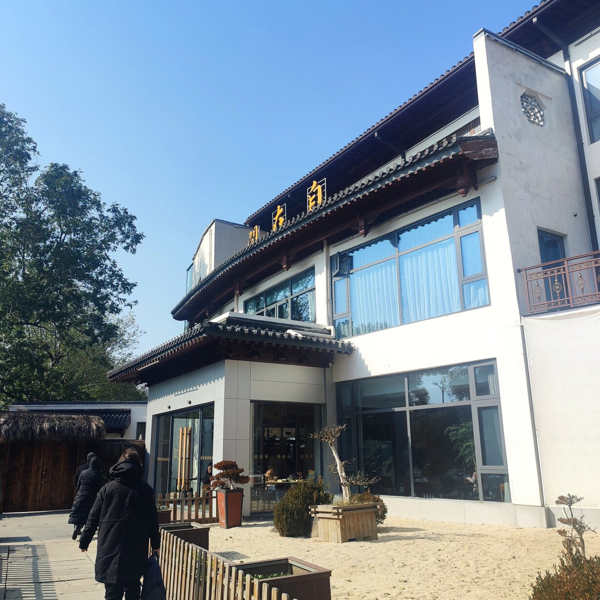
:::
::::

## 伦理 {#ethics .t-resource .s-ethics data-label="Ethics"}

::: {.eyebrow}
[]{.dot}😇 思考伦理
:::

### 食物之外的另一面 —
工业化养殖的真相，[值得我们看见]{.ember}。

::: {.qr-row .cols-4}
::: {.qr}
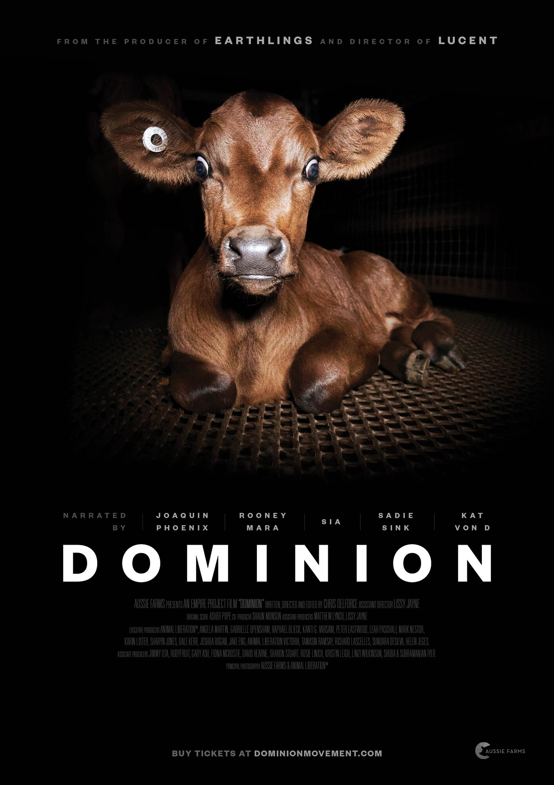{.code}

::: {.label}
🎬 [《统治》(Dominion)](https://www.dominionmovement.com)
:::
:::

::: {.qr}
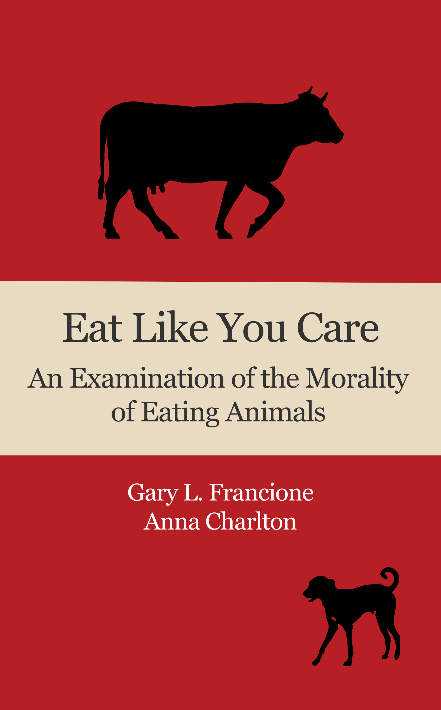{.code}

::: {.label}
📕 [《关怀的饮食》](https://book.douban.com/subject/25873528/)
:::
:::

::: {.qr}
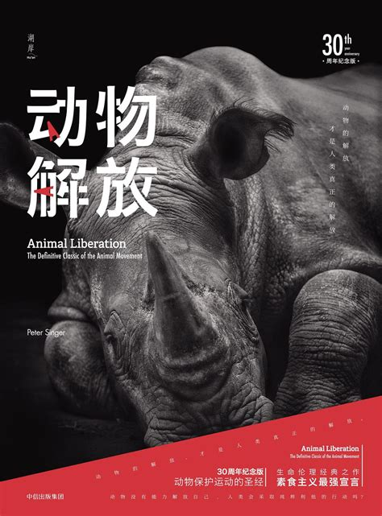{.code}

::: {.label}
📕 [《动物解放》](https://book.douban.com/subject/30278190/)
:::
:::

::: {.qr}
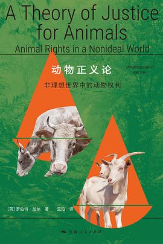{.code}

::: {.label}
📕 [《动物正义论》](https://book.douban.com/subject/37331627/)
:::
:::
:::

## 第六部分 {#section-part-vi .t-section .s-section data-label="Section · Part VI"}

:::: {.columns}
::: {.column .center width="62.5%"}
::: {.num}
第 06 部分
:::

::: {.kicker}
讨论 · 常见疑问
:::

::: {.section-title}
还有什么 🤔
让你犹豫？
:::

::: {.sub}
如果主要吃植物既能改善自身健康，又能守护地球健康，真正的阻力通常来自习惯、误解与现实约束。
:::
:::

::: {.column .art width="37.5%"}
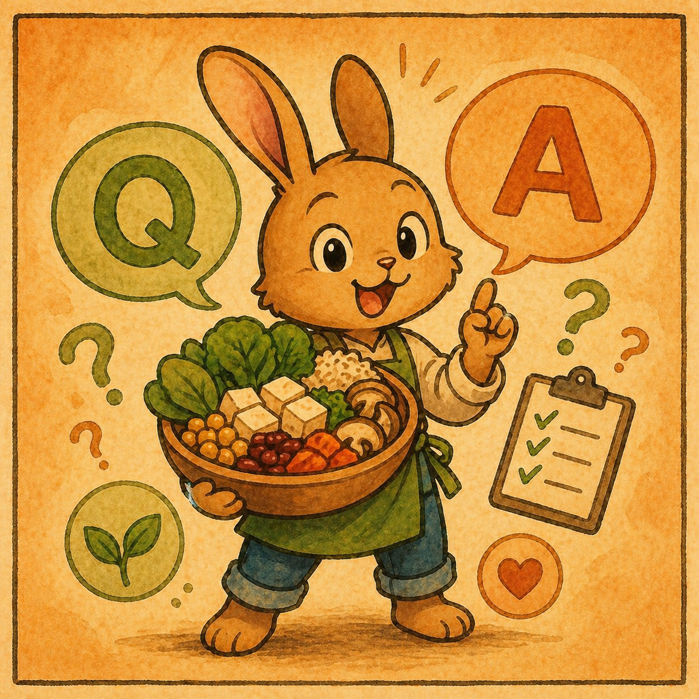
:::
::::

## 农药残留 {#pesticide-residues .t-card-grid .t-bars .cards-3 .s-pesticide-residues data-label="Pesticide Residues"}

::: {.eyebrow}
[]{.dot}🥬 蔬果农残怎么办？
:::

### “蔬果有农残，吃植物会不会更危险？”

::: {.intro}
担心农残可以理解，但别让它变成少吃蔬果的理由。
:::

::: {.grid}
::: {.card-light .p .fragment fragment-index=1}
::: {.card-tag}
01
:::
::: {.card-main}
有机更少
:::
::: {.card-desc}
有机食品可减少农药暴露，但[不等于零农残]{.hl}。
:::
:::

::: {.card-light .p .fragment fragment-index=2}
::: {.card-tag}
02
:::
::: {.card-main}
不要少吃菜
:::
::: {.card-desc}
蔬果带来的健康收益，远大于残留农药带来的小风险。
:::
:::

::: {.card-light .p .fragment fragment-index=3}
::: {.card-tag}
03
:::
::: {.card-main}
简单处理
:::
::: {.card-desc}
流水冲洗有帮助；10% 盐水浸泡后再冲洗，便宜有效。
:::
:::
:::

::: {.source .fragment fragment-index=3}
来源：《How Not to Die》· “How to Make Your Own Fruit and Vegetable Wash” / “Is Buying Organic Worth It?”
:::

::: {.notes}
- **农残**（pesticide residues）：农产品中残留的农药成分。它是现实问题，但风险要和“少吃蔬果”的风险放在一起比较。
- 有机食品通常农药残留更少，但不能完全消除农残；邻近非有机农田污染、运输交叉污染，以及土壤里残留的 DDT 等持久性污染物，都可能带来残留。
- 商业果蔬清洗剂不必迷信：测试中不少产品并不比清水更好。流水冲洗通常能去掉一部分残留，但往往不到一半。
- 实用做法：先流水冲洗；特别担心时，用 10% 盐水（1 份盐 + 9 份水）短时间浸泡，再用清水彻底冲掉盐分。
- 关键结论：能买有机当然好，但不要因为农残焦虑而少吃蔬果；从总体健康收益看，吃足蔬果更重要。
:::

## 蛋白质 {#protein .t-card-grid .t-bars .cards-3 .s-protein data-label="Protein"}

::: {.eyebrow}
[]{.dot}💪 植物性饮食，蛋白够吗？
:::

### “不吃肉怎么够蛋白质？”

::: {.intro}
蛋白质焦虑，常常来自过时的营养误解。
:::

::: {.grid}
::: {.card-light .p .fragment fragment-index=1}
::: {.card-tag}
01
:::
::: {.card-main}
日常足够
:::
::: {.card-desc}
豆类、全谷物、坚果里的蛋白质足以满足日常需要。
:::
:::

::: {.card-light .p .fragment fragment-index=2}
::: {.card-tag}
02
:::
::: {.card-main}
不必互补
:::
::: {.card-desc}
“植物蛋白不完整、必须搭配”的说法早已被科学界[推翻]{.hl}。
:::
:::

::: {.card-light .p .fragment fragment-index=3}
::: {.card-tag}
03
:::
::: {.card-main}
怎么吃
:::
::: {.card-desc}
推荐：豆腐、毛豆、小扁豆、燕麦、花生。
:::
:::
:::

::: {.source .fragment fragment-index=3}
来源：[NutritionFacts.org · Protein](https://nutritionfacts.org/topics/protein/)
:::

::: {.notes}
- 人均蛋白质需求约每公斤体重 0.8 克（60 公斤的人 ≈ 50 克/天）。豆腐 100 克 ≈ 8 克蛋白；100 克熟扁豆 ≈ 9 克；一杯燕麦 ≈ 11 克。
- “蛋白互补论”出处：1971 年 Frances Moore Lappé 的《Diet for a Small Planet》提出植物蛋白要“搭配”才完整。她本人 10 年后承认这是错误的——肝脏储存氨基酸池足够多，根本不需要每餐互补。
- 美国营养与饮食学会（AND）的立场文件确认规划得当的纯植物饮食营养充足：2016 年版明确涵盖各年龄段（含孕期、哺乳、婴幼儿、运动员），**2025 年更新版**聚焦成年人并强调心血管代谢益处（来源：[AND 2025](https://www.jandonline.org/article/S2212-2672(25)00042-5/fulltext)）。
- 一个值得注意的细节：**65 岁以上老人**蛋白质需求更高、吸收效率下降，纯植物饮食的老人要更主动地多吃豆制品、确保总蛋白足量——这是少数需要特别留意的人群。
- 反向问题更值得担心：发达国家普遍**蛋白过量**——动物蛋白过量与肾损伤、骨钙流失、IGF-1 升高（促癌）相关。
:::

## 铁 {#iron .t-card-grid .t-bars .cards-3 .s-iron data-label="Iron"}

::: {.eyebrow}
[]{.dot}🩸 不吃肉会不会缺铁？
:::

### “红肉补铁，不吃肉怎么办？”

::: {.intro}
铁很重要，但红肉不是唯一答案，也未必是更安全的答案。
:::

::: {.grid}
::: {.card-light .p .fragment fragment-index=1}
::: {.card-tag}
01
:::
::: {.card-main}
风险相近
:::
::: {.card-desc}
全食物植物性饮食女性的缺铁性贫血发生率，[并不高于]{.hl}肉食者。
:::
:::

::: {.card-light .p .fragment fragment-index=2}
::: {.card-tag}
02
:::
::: {.card-main}
血红素铁
:::
::: {.card-desc}
血红素铁（heme iron）与心脏病、中风、癌症风险上升相关。
:::
:::

::: {.card-light .p .fragment fragment-index=3}
::: {.card-tag}
03
:::
::: {.card-main}
提升吸收
:::
::: {.card-desc}
搭配维生素 C 可提升吸收。推荐：小扁豆、黑豆、菠菜、南瓜籽。
:::
:::
:::

::: {.source .fragment fragment-index=3}
来源：[NutritionFacts.org · Iron](https://nutritionfacts.org/topics/iron/)
:::

::: {.notes}
- 铁分两种：**血红素铁** (heme iron, 来自肉/血)，吸收率高但身体无法调节，过多则积累——与冠心病、糖尿病、结直肠癌相关。**非血红素铁** (non-heme, 来自植物)，吸收率较低但身体能调节。
- 提升植物铁吸收：搭配 **维生素 C**（柑橘、辣椒、番茄）吸收率提升 3-6 倍；避免与茶/咖啡同食（鞣酸抑制吸收）。
- **缺铁性贫血 (iron-deficiency anemia)**：体内铁不足，血红蛋白造不够，携氧能力下降——表现为乏力、头晕、面色苍白、怕冷。
- 缺铁性贫血在 🇨🇳 中国孕期和育龄女性中仍常见，但与饮食类型关系不大——多数因月经/孕期需求、失血与摄入不足。全食物植物性饮食女性贫血率与肉食者无显著差异（来源：[BMC Pregnancy Childbirth 2020](https://pubmed.ncbi.nlm.nih.gov/33160312/)，[BMC Public Health 2020](https://pubmed.ncbi.nlm.nih.gov/32928139/)）。
- 推荐铁源：扁豆、黑豆、菠菜、南瓜子、芝麻、藜麦、强化谷物。
:::

## 钙 {#calcium .t-card-grid .t-bars .cards-3 .s-calcium data-label="Calcium"}

::: {.eyebrow}
[]{.dot}🥛 不喝牛奶怎么补钙？
:::

### “不喝奶骨头会不会脆？”

::: {.intro}
补钙不等于必须喝奶，关键是可吸收的钙与整体饮食。
:::

::: {.grid}
::: {.card-light .p .fragment fragment-index=1}
::: {.card-tag}
01
:::
::: {.card-main}
吸收更高
:::
::: {.card-desc}
羽衣甘蓝、西兰花、小白菜里的钙，人体吸收率[明显高于牛奶]{.hl}（约 50% vs 30%）。
:::
:::

::: {.card-light .p .fragment fragment-index=2}
::: {.card-tag}
02
:::
::: {.card-main}
骨折数据
:::
::: {.card-desc}
大型人群追踪研究发现：喝牛奶[并不降低]{.hl}髋骨骨折率。
:::
:::

::: {.card-light .p .fragment fragment-index=3}
::: {.card-tag}
03
:::
::: {.card-main}
植物来源
:::
::: {.card-desc}
推荐：深绿叶菜、强化豆浆、石膏点制豆腐、芝麻。
:::
:::
:::

::: {.source .fragment fragment-index=3}
来源：[NutritionFacts.org · Calcium](https://nutritionfacts.org/topics/calcium/)
:::

::: {.notes}
- **骨质疏松 (osteoporosis)**：骨量流失、骨微结构变差，骨头变脆易折——这页说的"骨头脆"就是它。真正的终点指标不是骨密度数字，而是**髋骨骨折**率。
- 关键概念：**钙的可吸收率 (bioavailability)**。低草酸的十字花科蔬菜（西兰花、羽衣甘蓝、小白菜）吸收率约 50-60%，牛奶约 30%——所以低草酸绿叶菜的钙更易吸收。注意：菠菜、苋菜草酸高，钙基本吸收不了，别当补钙来源。（不同研究的具体数字有出入，稳妥说法是"不输牛奶、甚至更高"。）
- 牛奶悖论：牛奶钙含量高，但每天 3 杯以上的人群髋骨骨折率反而**更高**（瑞典 6 万女性研究）。可能机制：奶里 D-半乳糖促进炎症和氧化应激。
- 骨骼健康关键不只是钙——还要 **维生素 D**（晒太阳/补充剂）、**维生素 K**（绿叶菜）、负重运动、足够蛋白质，以及避免高盐和过量动物蛋白（会增加钙流失）。
- 🇨🇳 中国人钙摄入普遍偏低，全食物植物性饮食者特别要注意：每天一份强化豆浆 + 一份石膏豆腐 + 一份深绿叶菜，钙就够了（来源：[Nutrients 2022](https://pubmed.ncbi.nlm.nih.gov/36432400/)，[PLOS One 2018](https://journals.plos.org/plosone/article?id=10.1371%2Fjournal.pone.0205045)）。
:::

## 长寿轶事 {#longevity-anecdote .t-card-grid .t-bars .cards-3 .s-longevity-anecdote data-label="Longevity Anecdote"}

::: {.eyebrow}
[]{.dot}👴 爷爷啥都吃活到九十多
:::

### “我爷爷抽烟喝酒吃红烧肉，也活到九十多。”

::: {.intro}
个案故事有感染力，但健康决策更需要看总体概率。
:::

::: {.grid}
::: {.card-light .p .fragment fragment-index=1}
::: {.card-tag}
01
:::
::: {.card-main}
个案偏差
:::
::: {.card-desc}
个案不是证据 — 这叫[幸存者偏差]{.hl}。
:::
:::

::: {.card-light .p .fragment fragment-index=2}
::: {.card-tag}
02
:::
::: {.card-main}
组合效应
:::
::: {.card-desc}
不吸烟、健康饮食、规律运动，可使十几年内死亡风险下降约 82%。
:::
:::

::: {.card-light .p .fragment fragment-index=3}
::: {.card-tag}
03
:::
::: {.card-main}
概率选择
:::
::: {.card-desc}
目标不是赌自己是幸运儿，而是把概率拉向健康一侧。
:::
:::
:::

::: {.source .fragment fragment-index=3}
来源：[NutritionFacts.org · Longevity](https://nutritionfacts.org/topics/longevity/)
:::

::: {.notes}
- **幸存者偏差**：我们看到活到 90 多的爷爷，看不到同样饮食却已早逝的人。统计上，吸烟者也有少数活到 90 多——但这不能说明“吸烟无害”。
- 常被引用的**蓝色地带 (Blue Zones)**——冲绳、伊卡里亚、撒丁岛、尼科亚、罗马琳达——共同特点是饮食以植物为主、动物食品很少、社区紧密、规律运动。**但要谨慎**：2024 年 Saul Newman 的研究指出，部分蓝色地带的超高龄数据可能源于户籍与养老金记录误差，因此蓝色地带宜当作启发性例子，硬证据请以下面的 EPIC 队列为准。
- 也提一下“健康寿命” vs “总寿命”：吃错的人活到 90 也常常是带病躺床的最后十年；目标是活得久也活得好。
- 数据支撑：EPIC 研究（45 万欧洲人）——同时做到不吸烟、健康饮食、规律运动、控体重，14 年内死亡风险降低 78%。
:::

## 营养补充剂 {#supplements .t-card-grid .t-bars .cards-3 .s-supplements data-label="Supplements"}

::: {.eyebrow}
[]{.dot}💉 植物性饮食要不要吃补剂？
:::

### “全食物植物性饮食不就是什么都缺吗？”

::: {.intro}
补剂问题可以讲得很简单：别神化，也别忽视 B12。
:::

::: {.grid}
::: {.card-light .p .fragment fragment-index=1}
::: {.card-tag}
01
:::
::: {.card-main}
关键一项
:::
::: {.card-desc}
真正[必须]{.hl}补的其实只有一样：维生素 B12。
:::
:::

::: {.card-light .p .fragment fragment-index=2}
::: {.card-tag}
02
:::
::: {.card-main}
常见剂量
:::
::: {.card-desc}
65 岁以下全食物植物性饮食者：每周 2000 µg，或每天 50 µg。
:::
:::

::: {.card-light .p .fragment fragment-index=3}
::: {.card-tag}
03
:::
::: {.card-main}
不只植物性饮食
:::
::: {.card-desc}
50 岁以后不管吃什么，都建议通过强化食品或补剂补 B12。
:::
:::
:::

::: {.source .fragment fragment-index=3}
来源：[NutritionFacts.org · Vitamin B12](https://nutritionfacts.org/topics/vitamin-b12/)
:::

::: {.notes}
- **维生素 B12 (钴胺素)**：由细菌产生，植物里不含。缺乏会导致贫血、神经损伤、痴呆——而且早期症状不明显，等出现已经晚了。
- 为什么以前的人不补也没事？——B12 来自土壤里的细菌，传统农耕时代蔬菜上残留细菌足够；现代化卫生体系把它“洗掉了”。
- 其实**肉食者也可能缺 B12**——50 岁以上吸收能力下降，所以美国指南建议**所有 50+ 人群**通过强化食品或补剂获取 B12，无论吃不吃肉。
- 补 B12 简单又便宜：一年的剂量不超过几十块钱。这是全食物植物性饮食者**唯一**真正必须补的营养素。其他的（蛋白、铁、钙、ω-3）从食物搭配中就够。
- ω-3：每天一汤匙磨碎的亚麻籽或奇亚籽，或一小把核桃即可。鱼油不必。
:::

## 叶酸 {#folate .t-card-grid .t-bars .cards-3 .s-folate data-label="Folate"}

::: {.eyebrow}
[]{.dot}🥬 叶酸会不会吃过量？
:::

### “绿叶菜和豆类叶酸这么高，吃多了有害吗？”

::: {.intro}
先分清两件事：食物中的天然叶酸，和补剂中的合成叶酸。
:::

::: {.grid}
::: {.card-light .p .fragment fragment-index=1}
::: {.card-tag}
01
:::
::: {.card-main}
放心吃菜
:::
::: {.card-desc}
天然叶酸（folate）没有设定摄入上限；正常吃蔬菜、豆类不必担心过量。
:::
:::

::: {.card-light .p .fragment fragment-index=2}
::: {.card-tag}
02
:::
::: {.card-main}
留意补剂
:::
::: {.card-desc}
成人每日 1000 µg 上限只针对补剂和强化食品中的合成叶酸（folic acid）。
:::
:::

::: {.card-light .p .fragment fragment-index=3}
::: {.card-tag}
03
:::
::: {.card-main}
别漏掉 B12
:::
::: {.card-desc}
大剂量合成叶酸可掩盖 B12 缺乏造成的贫血，却不能阻止神经损伤。
:::
:::
:::

::: {.source .fragment fragment-index=3}
来源：[美国国立卫生研究院 · Folate](https://ods.od.nih.gov/factsheets/Folate-HealthProfessional/)
:::

::: {.notes}
- **叶酸**是维生素 B9 的统称：食物中的天然形式常称 **folate（天然叶酸）**，强化食品和多数补剂中的合成形式称 **folic acid（合成叶酸）**。
- 美国国家医学院没有为食物中的天然叶酸设定可耐受最高摄入量，因为尚无证据显示天然食物叶酸会造成不良反应。深绿叶菜、豆类、豌豆、坚果和柑橘类水果都可以放心吃。
- 成人每日 **1000 µg** 的可耐受最高摄入量，仅适用于补剂和强化食品中的合成叶酸，不包括天然食物叶酸；因医疗需要而在医生监督下使用高剂量者也不受这一上限约束。
- 真正需要警惕的是 **B12 缺乏**。大剂量合成叶酸可以纠正 B12 缺乏引起的巨幼红细胞性贫血，却不能修复其神经损伤，可能让问题不易被及时发现。
- 备孕和孕期是另一回事：无论吃什么，有怀孕可能的人通常都应按当地医疗指南补充合成叶酸，以降低胎儿神经管缺陷风险。
:::

## 大豆 {#soy .t-card-grid .t-bars .cards-3 .s-soy data-label="Soy"}

::: {.eyebrow}
[]{.dot}🥩 豆腐的雌激素有问题吗？
:::

### “听说吃豆腐雌激素高，会不会得乳腺癌？”

::: {.intro}
“植物雌激素”这个名字容易误导，关键在于它在人体内的实际作用。
:::

::: {.grid}
::: {.card-light .p .fragment fragment-index=1}
::: {.card-tag}
01
:::
::: {.card-main}
并非雌激素
:::
::: {.card-desc}
大豆异黄酮是植物雌激素（phytoestrogen），与人体雌激素不同。
:::
:::

::: {.card-light .p .fragment fragment-index=2}
::: {.card-tag}
02
:::
::: {.card-main}
相反作用
:::
::: {.card-desc}
在乳腺组织中，它反而表现出[抗雌激素]{.hl}作用。
:::
:::

::: {.card-light .p .fragment fragment-index=3}
::: {.card-tag}
03
:::
::: {.card-main}
保护因素
:::
::: {.card-desc}
也就是说：吃豆腐不是风险，而是保护因素。
:::
:::
:::

::: {.source .fragment fragment-index=3}
来源：[NutritionFacts.org · Soy](https://nutritionfacts.org/topics/soy/)
:::

::: {.notes}
- **大豆异黄酮 (isoflavones)** 和人体雌激素的区别：人体有两种雌激素受体——α (alpha) 和 β (beta)。α 受体激活会促进乳腺癌；β 受体激活反而抑制肿瘤。**异黄酮主要结合 β 受体**——所以表现为抗雌激素。
- 关键证据：**上海乳腺癌生存研究** (Shanghai Breast Cancer Survival Study, 5,000+ 患者)——吃豆制品最多的乳腺癌幸存者，复发率和死亡率最低。
- 男性吃豆腐也不会“变娘”——这是另一个常见误解。多项荟萃分析显示豆制品不影响男性睾酮或精子。
- 注意区分：**全大豆制品**（豆腐、豆浆、毛豆、纳豆、味噌）有益；**大豆分离蛋白补剂、加工“植物肉”**则不一定，最好别每天大量吃。
:::

## 减肥 {#weight-loss .t-card-grid .t-bars .cards-3 .s-weight-loss data-label="Weight Loss"}

::: {.eyebrow}
[]{.dot}🧘 植物性饮食能减肥吗？
:::

### “只吃植物，真的能瘦下来吗？”

::: {.intro}
体重管理不只看“少吃”，也看食物本身的热量密度与饱腹感。
:::

::: {.grid}
::: {.card-light .p .fragment fragment-index=1}
::: {.card-tag}
01
:::
::: {.card-main}
理想区间
:::
::: {.card-desc}
大规模对比研究显示：只有[全食物植物性饮食]{.hl}人群的平均 BMI 落在理想区间。
:::
:::

::: {.card-light .p .fragment fragment-index=2}
::: {.card-tag}
02
:::
::: {.card-main}
平均 BMI
:::
::: {.card-desc}
平均 BMI：肉食者 28.8，吃蛋奶不吃肉 25.7，纯植物 23.6。
:::
:::

::: {.card-light .p .fragment fragment-index=3}
::: {.card-tag}
03
:::
::: {.card-main}
容易吃饱
:::
::: {.card-desc}
全食物植物性饮食天然低热量密度、高纤维。
:::
:::
:::

::: {.source .fragment fragment-index=3}
来源：[NutritionFacts.org · Weight Loss](https://nutritionfacts.org/topics/weight-loss/)
:::

::: {.notes}
- **BMI**（体质指数）= 体重(kg) / 身高(m)²。🇨🇳 中国标准：< 18.5 偏瘦，18.5-24 正常，24-28 超重，> 28 肥胖（比 WHO 标准更严，因为亚洲人内脏脂肪倾向；来源：[China CDC](https://en.chinacdc.cn/in_focus/202208/t20220823_260921.html)，[Biomed Environ Sci 2004](https://pubmed.ncbi.nlm.nih.gov/15807475/)）。
- 关键概念：**热量密度 (caloric density)**——同样一斤食物，蔬菜约 100 卡，水果 300 卡，全谷物 500 卡，肉类 1000 卡，坚果/油 4000 卡。全食物植物性饮食可以“吃饱”而不超热量。
- 减肥的根本：不是计算卡路里、节食挨饿，而是改变食物结构，让身体自然达到平衡。
- BMRC 研究 (Berkeley)：完全不限量的全食物植物性饮食组比限制热量的传统饮食组减重更多——因为前者饱腹感强，依从性高。
- 别忘了：减肥不是终极目的，健康才是。健康吃法可能不会让你瘦成模特，但能让所有指标变好。
:::

## 便秘 {#constipation .t-card-grid .t-bars .cards-4 .s-constipation data-label="Constipation"}

::: {.eyebrow}
[]{.dot}🚽 植物性饮食会便秘吗？
:::

### "不吃肉、不吃黄油，会不会便秘？"

::: {.intro}
便秘 (constipation) 的核心原因是膳食纤维不足和肠道蠕动减弱——全食物植物性饮食恰恰是最佳解药。
:::

::: {.grid}
::: {.card-light .p .fragment fragment-index=1}
::: {.card-tag}
01
:::
::: {.card-main}
纤维冠军
:::
::: {.card-desc}
纯植物饮食者平均每天摄入纤维 [40–50 克]{.hl}，是杂食者的两倍多——充足纤维让粪便松软成型、易于排出。
:::
:::

::: {.card-light .p .fragment fragment-index=2}
::: {.card-tag}
02
:::
::: {.card-main}
肉类无纤维
:::
::: {.card-desc}
动物性食物（肉、蛋、奶酪）[不含任何膳食纤维]{.hl}——吃得越多，肠道推送越慢，便秘风险越高。
:::
:::

::: {.card-light .p .fragment fragment-index=3}
::: {.card-tag}
03
:::
::: {.card-main}
黄油润肠？
:::
::: {.card-desc}
"吃黄油/动物油润肠"是流行迷思——约翰·霍普金斯医学院指出高脂肪食物反而[延缓肠道蠕动]{.hl}，加重便秘。
:::
:::

::: {.card-light .p .fragment fragment-index=4}
::: {.card-tag}
04
:::
::: {.card-main}
正确姿势
:::
::: {.card-desc}
除了多吃植物：多喝水、别忍便、如厕时膝盖高于臀部（蹲姿或脚踏凳）有助排便。
:::
:::
:::

::: {.source .fragment fragment-index=4}
来源：[NPR Life Kit · 5 Tips to Help You Poop Better](https://www.npr.org/2025/04/08/1263505587/poop-better-constipation-tips) ｜ [Johns Hopkins Medicine · Foods for Constipation](https://www.hopkinsmedicine.org/health/wellness-and-prevention/foods-for-constipation)
:::

::: {.notes}
- 便秘是全球最常见的消化系统投诉之一——中国成人患病率 8–12%。
- 膳食纤维每日推荐量约 25–38 克，但绝大多数人只吃到 15 克。全食物植物性饮食的人轻松达到甚至超过推荐量。
- 流行迷思"吃黄油/猪油润肠通便"——Johns Hopkins Medicine 明确指出：高脂肪食物（黄油、油炸食品）消化缓慢，反而减慢肠道转运。真正润肠的是水溶性纤维（燕麦、奇亚籽）和充足水分。
- 牛津大学研究：纯植物饮食者排便频率 > 吃蛋奶不吃肉者 > 杂食者；随机对照试验 (PMC 10854443) 显示新采用纯植物饮食不会损害肠道健康，而富肉饮食组反而更多出现腹痛和便秘。
- Dr. Trisha Pasricha（NPR Life Kit 嘉宾、《You've Been Pooping All Wrong》作者）强调：不要忍便、不要在马桶上久坐玩手机、用脚凳把膝盖抬高模拟蹲姿。
- 过渡期注意：如果突然从低纤维饮食切换到高纤维全食物植物性饮食，可能短期内胀气或不适——建议逐步增加、同时多喝水。
:::

## 鱼类与海鲜 {#fish-and-seafood .t-card-grid .t-bars .cards-4 .s-fish data-label="Fish & Seafood"}

::: {.eyebrow}
[]{.dot}🐟 海鲜和养殖淡水鱼能吃吗？
:::

### "那海鲜，或者养殖的淡水鱼，总可以吧？"

::: {.intro}
鱼确实有 omega-3，但它也是污染物沿食物链[层层富集]{.hl}的终点——好在，益处可以保留、风险可以避开。
:::

::: {.grid}
::: {.card-light .p .fragment fragment-index=1}
::: {.card-tag}
01
:::
::: {.card-main}
益处其实有限
:::
::: {.card-desc}
鱼的招牌是 omega-3，但最新荟萃分析显示鱼油只[小幅]{.hl}降低心脏病风险（约 8%），早年多项大型试验甚至[没发现获益]{.hl}——鱼并非健康必需品。
:::
:::

::: {.card-light .p .fragment fragment-index=2}
::: {.card-tag}
02
:::
::: {.card-main}
汞与污染物
:::
::: {.card-desc}
大型肉食鱼（金枪鱼、剑鱼、鲨鱼）富集[甲基汞]{.hl} 🧠；脂肪鱼则富集 PCB、二噁英——[养殖三文鱼]{.hl}的 PCB 约为野生的 10 倍。
:::
:::

::: {.card-light .p .fragment fragment-index=3}
::: {.card-tag}
03
:::
::: {.card-main}
养殖 ≠ 更干净
:::
::: {.card-desc}
养殖（含淡水鱼）密度高、易生病，常依赖[抗生素]{.hl} 💊。中国一项调查：东南地区淡水鱼 [54%]{.hl} 检出抗生素残留，部分还是人用药。
:::
:::

::: {.card-light .p .fragment fragment-index=4}
::: {.card-tag}
04
:::
::: {.card-main}
直接找源头
:::
::: {.card-desc}
想要 omega-3，跳过"中间鱼"：[藻油]{.hl} 🌿 提供同样的 EPA/DHA，却没有汞和 PCB；再加每天一勺磨碎[亚麻籽 / 奇亚籽 / 核桃]{.hl}。
:::
:::
:::

::: {.source .fragment fragment-index=4}
来源：[NutritionFacts · Omega-3](https://nutritionfacts.org/topics/omega-3-fatty-acids/) ｜ [FDA/EPA 食鱼建议](https://www.fda.gov/food/consumers/advice-about-eating-fish) ｜ [Sci. Total Environ. 2022 · 东南淡水鱼抗生素](https://www.sciencedirect.com/science/article/abs/pii/S0889157522004392)
:::

::: {.notes}
**omega-3 的证据强度（这是答疑的重点）**

- 书中（2015）援引 JAMA 荟萃分析与 DART-2 试验，主张"鱼油基本无益"。但要诚实：**2024 年哈佛的更新荟萃分析**（13 项 RCT、约 12.7 万人，含迄今最大的 VITAL 试验）发现鱼油补充剂使心梗与冠心病死亡风险**小幅下降约 8%**，且呈剂量关系（来源：[Harvard Chan 2024](https://hsph.harvard.edu/news/in-major-meta-analysis-of-clinical-trials-omega-3-fish-oil-supplements-linked-with-lower-cardiovascular-disease-risk/)）。
- 综合来看：omega-3 的好处是**真实但有限**，主要见于高风险人群；它不是只有鱼才能提供，也不足以抵消下面的污染物代价。结论不是"鱼有毒"，而是"为了 omega-3 而每天吃鱼，并不划算"。

**汞与持久性污染物（为什么大鱼、肥鱼风险更高）**

- **甲基汞 (methylmercury)**：神经毒素，沿食物链放大，鱼越大、越老、越靠食物链顶端越高。FDA/EPA 明确建议**避免**鲨鱼、剑鱼、王鲭、方头鱼、大眼金枪鱼；孕妇、哺乳期、儿童最敏感（影响胎儿神经发育）。膳食纤维能结合汞并促其排出——这正是全食物植物性饮食的额外好处。
- **持久性有机污染物 (POPs)**：PCB（多氯联苯）、二噁英，脂溶性、难降解，在脂肪里**生物富集 (biomagnification)**。书中引用的超市调查中，三文鱼是污染最重的食物，**养殖三文鱼的 PCB 约为野生的 10 倍**；肥肉、奶酪、鱼油也是二噁英的主要来源。人体清除这些污染物可能要 50–75 年。

**养殖鱼（含淡水鱼）的特有问题**

- 中国是全球最大的水产养殖国。高密度养殖易爆发疾病，**抗生素**使用普遍：一项东南地区调查中，淡水鱼抗生素总检出率 **53.9%**，约 3.5% 超过最大残留限量，并检出本该只给人用的阿奇霉素——这既是食品安全问题，也助推**抗菌药物耐药性 (AMR)**（来源：[Sci. Total Environ. 2022](https://www.sciencedirect.com/science/article/abs/pii/S0889157522004392)）。注意平衡：该研究估算的健康危害指数 < 1，即偶尔吃并非急性中毒，主要是长期与耐药性层面的担忧。
- 历史上中国养殖业还出现过孔雀石绿（可疑致癌物）等违规用药问题；此外水产（尤其贝类、滤食性动物）是**微塑料**的主要膳食来源之一。
- 环境角度（呼应第三部分）：过度捕捞、兼捕（误捕海豚海龟）、养殖场粪污与饲料（多由野生小鱼制成）都让"海鲜可持续"变得复杂。

**更聪明的替代方案**

- 格雷格医生的建议：每天 1 汤匙**磨碎的亚麻籽**（提供短链 omega-3 ALA），并考虑每天 **250 mg 无污染的藻类来源 EPA/DHA**（藻油在罐里培养，从不接触海洋，把鱼吃进体内的污染物这一环直接省掉）——拿到和鱼一样的长链 omega-3，却没有汞、PCB（来源：[NutritionFacts · Algae](https://nutritionfacts.org/topics/algae/)）。
- 人体能把亚麻籽里的 ALA 转化成 EPA/DHA，但转化率有限、未必够大脑所需，所以想稳妥就直接补藻油。核桃、奇亚籽也都是 ALA 来源。

**一句话答疑**：偶尔吃低汞的鱼不是"毒药"；但若是为了健康（omega-3）而把鱼当每日主食，从汞、PCB、抗生素到可持续性来看都不划算——直接从藻类和亚麻籽拿 omega-3，更干净也更安心。
:::

## 牛奶 {#milk .t-card-grid .t-bars .cards-4 .s-milk data-label="Milk"}

::: {.eyebrow}
[]{.dot}🥛 牛奶到底要不要喝？
:::

### “每天一斤奶，强壮中国人”？

::: {.intro}
牛奶本来是给小牛长身体的食物。骨头的问题见「钙」那一页，这里说说别的。
:::

::: {.grid}
::: {.card-light .p .fragment fragment-index=1}
::: {.card-tag}
01
:::
::: {.card-main}
多数人消化不了
:::
::: {.card-desc}
[大多数中国成年人]{.hl}断奶后乳糖酶就减少了，喝奶容易腹胀、腹泻。这是常态，不是毛病。
:::
:::

::: {.card-light .p .fragment fragment-index=2}
::: {.card-tag}
02
:::
::: {.card-main}
生长因子
:::
::: {.card-desc}
喝奶会升高血液里的 [IGF-1]{.hl}（类胰岛素生长因子），它与前列腺癌风险上升相关。
:::
:::

::: {.card-light .p .fragment fragment-index=3}
::: {.card-tag}
03
:::
::: {.card-main}
帕金森
:::
::: {.card-desc}
三十万人的荟萃分析：每天多 [一杯牛奶]{.hl}，帕金森风险约高 17%。
:::
:::

::: {.card-light .p .fragment fragment-index=4}
::: {.card-tag}
04
:::
::: {.card-main}
用什么代替
:::
::: {.card-desc}
[无糖豆浆]{.hl}：蛋白质和牛奶差不多，选加钙的。石膏豆腐、深绿叶菜也能补钙。
:::
:::
:::

::: {.source .fragment fragment-index=4}
来源：《How Not to Die》第 13、14 章 ｜ [NutritionFacts · Milk](https://nutritionfacts.org/topics/milk/) ｜ [Harrison 等 2017 · Cancer Causes Control](https://pmc.ncbi.nlm.nih.gov/articles/PMC5400803/)
:::

::: {.notes}
常见追问有「肉能吃吗」「全素怎样提供所需营养」，牛奶是其中最常见的，所以单独做一页。标题是 2006 年「每天一斤奶，强壮中国人」的口号。

**乳糖不耐受**

- 婴儿都能消化乳糖；断奶后，多数人肠道里的乳糖酶会逐渐减少，这叫「乳糖酶非持续性」(lactase non-persistence)，是全世界大多数人的常态。能终身消化乳糖的，主要是北欧等长期放牧人群的后代。
- 中国的数据：一项呼气氢试验发现东北汉族成年人约 92% 存在乳糖吸收不良（[早期研究](https://pubmed.ncbi.nlm.nih.gov/6235167)）。这是地区性、年代较早的研究，不是全国数字，所以页面上只说「大多数」。吸收不良不等于一定有症状，少量饮用很多人没感觉。

**IGF-1 与前列腺癌**

- 2017 年一项纳入 172 项研究的系统综述：喝奶和乳蛋白会升高血液 IGF-1，证据中等；IGF-1 越高，前列腺癌风险越高（每升高一个标准差，风险约高 9%）。两头的效应都不大，是机制上的线索，不是「喝奶致癌」的定论（[Harrison 等 2017](https://pmc.ncbi.nlm.nih.gov/articles/PMC5400803/)）。
- 和前面第 13 章前列腺那一页、每日十二种饮料页（全脂牛奶「建议 0」）是同一条线。

**帕金森**

- 第 14 章：约 30 万人的荟萃分析，每天每多一杯牛奶，帕金森风险约高 17%。可能的解释包括奶中的农药残留（脂溶性污染物在奶脂里富集）或尿酸被压低，机制未定。观察性研究，说「相关」。

**替代**

- 无糖豆浆每 100 毫升约 3 克蛋白，和牛奶相近；买「加钙」的，钙量也接近牛奶。注意避开加糖的。
- 骨头和钙：见「钙」那一页 —— 瑞典 6 万女性的研究里，每天三杯以上牛奶的人髋骨骨折反而更多。

**一句话答疑**：牛奶不是毒药，但也不是必需品；大多数中国人本来就消化不好，钙和蛋白质都可以从豆制品和绿叶菜拿到。
:::

## 鸡蛋 {#eggs .t-card-grid .t-bars .cards-4 .s-eggs data-label="Eggs"}

::: {.eyebrow}
[]{.dot}🥚 鸡蛋到底能不能吃？
:::

### “每天一个鸡蛋，总该没问题吧？”

::: {.intro}
鸡蛋常被当成“完美蛋白”，但它的蛋黄带着一整天的[胆固醇额度]{.hl}。
:::

::: {.grid}
::: {.card-light .p .fragment fragment-index=1}
::: {.card-tag}
01
:::
::: {.card-main}
推高坏胆固醇
:::
::: {.card-desc}
一个鸡蛋约含 [200 毫克]{.hl}胆固醇。50 多项随机对照试验的荟萃分析：吃蛋[显著升高 LDL]{.hl}。
:::
:::

::: {.card-light .p .fragment fragment-index=2}
::: {.card-tag}
02
:::
::: {.card-main}
看清谁出钱
:::
::: {.card-desc}
蛋业资助的研究同样测到胆固醇上升，但约[一半]{.hl}在结论里写“鸡蛋无害”——数据和结论自相矛盾。
:::
:::

::: {.card-light .p .fragment fragment-index=3}
::: {.card-tag}
03
:::
::: {.card-main}
胆碱与癌症
:::
::: {.card-desc}
蛋黄富含胆碱，被肠道菌转化为 [TMAO]{.hl}（氧化三甲胺），与心梗、中风相关；前列腺癌患者每天不到一个蛋，进展风险约[翻倍]{.hl}。
:::
:::

::: {.card-light .p .fragment fragment-index=4}
::: {.card-tag}
04
:::
::: {.card-main}
用什么代替
:::
::: {.card-desc}
早餐来一份[豆腐“炒蛋”]{.hl} 🍳 或豆浆；烘焙用“亚麻蛋”（1 勺亚麻籽粉 + 3 勺水）——零胆固醇，还多了纤维。
:::
:::
:::

::: {.source .fragment fragment-index=4}
来源：《How Not to Die》第 13 章 “Eggs, Choline, and Cancer” ｜ [NutritionFacts · Eggs](https://nutritionfacts.org/topics/eggs/) ｜ [Does Dietary Cholesterol (Eggs) Raise Blood Cholesterol?](https://nutritionfacts.org/video/does-dietary-cholesterol-eggs-raise-blood-cholesterol/)
:::

::: {.notes}
“鸡蛋到底健不健康 / 能不能吃”是常见问题，所以单独做一页。

**胆固醇（最核心的证据）**

- **膳食胆固醇 (dietary cholesterol)**：食物里的胆固醇，只存在于动物性食物中，植物性食物为零。一个鸡蛋约 200 毫克，几乎全在蛋黄。
- 2020 年一项纳入 50 多项**随机对照试验**的荟萃分析结论很直接：吃鸡蛋显著升高 LDL（“坏胆固醇”）。每天一个鸡蛋，LDL 约上升 12%。
- 为什么有些研究“没发现影响”？因为胆固醇吸收有**天花板**：受试者本来就吃大量肉和奶，胆固醇吸收已经接近饱和，再加一个蛋看不出差别。从零胆固醇的植物性饮食基线出发，效果最明显。
- 美国医学研究所 (IOM) 与 2015–2020 版美国膳食指南都建议：在保证营养的前提下，膳食胆固醇“越少越好 (as low as possible)”。

**利益冲突**

- 2021 年一项系统综述：无论谁资助，约 90% 的研究都测到吃蛋让胆固醇上升；但蛋业资助的研究中，约一半的结论与自身数据相反（数据升高、结论却说无害）。提醒观众看研究时留意资助方。
- 书中还提到：蛋业高管在内部邮件里讨论哈佛关于胆碱促进癌症进展的研究后写道，“值得记住，我们会继续把胆碱宣传为吃鸡蛋的又一个好理由”（作者通过《信息自由法》拿到）。

**胆碱、TMAO 与癌症**

- 书中：哈佛跟踪 1000 多名早期前列腺癌患者，每天吃不到一个蛋的人，癌症进展（如骨转移）风险约为几乎不吃蛋者的两倍；每周 2.5 个蛋以上，前列腺癌死亡风险可能高 81%。
- **TMAO（氧化三甲胺, trimethylamine N-oxide）**：蛋里的胆碱、红肉里的肉碱被肠道细菌转化为三甲胺，再在肝脏氧化成 TMAO，与心梗、中风和早死风险升高相关。
- 死亡率：NIH-AARP 大型队列中，每天每多吃半个蛋，全因死亡率约高 7%；把鸡蛋蛋白换成植物蛋白，死亡率下降 20% 以上（来源：[Is One Egg a Day Too Much?](https://nutritionfacts.org/video/is-one-egg-a-day-too-much/)）。以上多为观察性研究，说“相关”而非“已证实因果”。

**其他**

- 呼应前面几页：鸡蛋是**花生四烯酸**（促炎）的主要来源之一（第 12 章抑郁），也是沙门氏菌风险来源（第 5 章，书中提到煮 8 分钟的蛋里沙门氏菌仍可能存活）。
- 叶黄素、玉米黄质：枸杞的玉米黄质约为鸡蛋的 50 倍；深绿叶菜也是好来源。
- 蛋白质：一个鸡蛋约 6 克蛋白；100 克北豆腐约 8–12 克，同样能满足需要（见“蛋白质”页）。

**一句话答疑**：鸡蛋不是毒药，但它确实升高坏胆固醇；对已有高胆固醇、糖尿病、心血管病或前列腺癌风险的人，更值得少吃或不吃——蛋白质完全可以从豆制品拿到。
:::

## 地中海饮食 {#mediterranean-diet .t-card-grid .t-bars .cards-4 .s-mediterranean data-label="Mediterranean Diet"}

::: {.eyebrow}
[]{.dot}🫒 地中海饮食和低脂植物性饮食，差在哪？
:::

### “地中海饮食，不是公认最健康吗？”

::: {.intro}
地中海饮食 (Mediterranean diet) 的好处主要来自[植物]{.hl}——那就把这部分做足。
:::

::: {.grid}
::: {.card-light .p .fragment fragment-index=1}
::: {.card-tag}
01
:::
::: {.card-main}
原版是什么
:::
::: {.card-desc}
1950 年代的希腊克里特岛：饮食[九成以上]{.hl}来自植物——蔬菜、豆类、全谷物、水果、坚果，肉一两周才吃一次。
:::
:::

::: {.card-light .p .fragment fragment-index=2}
::: {.card-tag}
02
:::
::: {.card-main}
真正起作用的
:::
::: {.card-desc}
把各成分拆开分析：与更少心梗、中风显著相关的是[坚果和蔬菜]{.hl}；橄榄油、鱼、红酒都没有。
:::
:::

::: {.card-light .p .fragment fragment-index=3}
::: {.card-tag}
03
:::
::: {.card-main}
好，但可以更好
:::
::: {.card-desc}
里昂试验：心梗复发减少约[三分之二]{.hl}。埃塞斯廷的全食物植物性饮食：坚持的 177 人约 4 年仅 [1 人]{.hl}心脏事件。
:::
:::

::: {.card-light .p .fragment fragment-index=4}
::: {.card-tag}
04
:::
::: {.card-main}
为什么“低脂”
:::
::: {.card-desc}
油是“[脂肪界的白砂糖]{.hl}”，连特级初榨橄榄油也会暂时削弱血管舒张功能；坚果、牛油果等[整颗]{.hl}的食物则不会。
:::
:::
:::

::: {.source .fragment fragment-index=4}
来源：《How Not to Die》“Olives and Olive Oil” / 第 1 章 ｜ [NutritionFacts · Mediterranean Diet](https://nutritionfacts.org/topics/mediterranean-diet/) ｜ [The Mediterranean Diet or a Whole Food Plant-Based Diet?](https://nutritionfacts.org/video/the-mediterranean-diet-or-a-whole-food-plant-based-diet/)
:::

::: {.notes}
常有人问“什么是地中海饮食”“低脂植物性饮食健康吗 / 为什么要低脂植物性饮食”，这一页一并回答。

**地中海饮食到底是什么**

- **地中海饮食 (Mediterranean diet)**：源于美国生理学家安塞尔·基斯 (Ancel Keys) 1950 年代对希腊克里特岛等地的研究。当时那里冠心病罕见，饮食九成以上是植物性的；只有少数富人才每天吃肉，普通人一两周才吃一次（来源：[Why Was Heart Disease Rare in the Mediterranean?](https://nutritionfacts.org/video/why-was-heart-disease-rare-in-the-mediterranean/)）。
- 今天餐馆和广告里的“地中海饮食”（烤羊排、三文鱼、大量奶酪和橄榄油）已经和原版相去甚远。
- 书中：阿尔茨海默病研究里，地中海饮食的保护作用主要来自**大量蔬菜**和**较低的饱和脂肪比例**。

**PREDIMED（西班牙，7000 多名高风险人群）**

- 每周免费领约半磅坚果的那组，中风风险约减半；坚果吃得多的人全因死亡风险更低，核桃对癌症死亡的保护最明显。
- 但吃橄榄油（包括特级初榨）多的人，**没有**看到寿命上的获益。基斯本人也认为，橄榄油的好处主要在于替代了猪油和黄油。
- 书中提醒：各组仍然在吃会导致中风的饮食，坚果组也只是“少一半”——更理想的是能阻止甚至逆转病程的饮食。

**里昂与埃塞斯廷（注意两者不能直接比较）**

- **里昂饮食心脏研究 (Lyon Diet Heart Study)**：约 600 名首次心梗患者随机分组，饮食只是适度调整（多吃面包和水果、少吃肉和黄油）。约 4 年里对照组 44 人再次心梗，饮食组 14 人——风险降低约三分之二。
- **埃塞斯廷 (Caldwell Esselstyn)**：198 名心血管病患者改吃全食物植物性饮食，坚持的 177 人约 4 年里仅 1 人因病情加重发生重大心脏事件（<1%）；没坚持的 21 人中，超过一半出现致死心梗、需要支架或心脏移植。
- 要诚实：埃塞斯廷研究**不是随机对照**，参与者都是意愿极强的患者，所以不能和里昂的数字直接对比；但方向一致——越接近全植物，效果越强。欧尼斯 (Dean Ornish) 的随机研究也显示，植物性饮食加生活方式改变可以逆转冠状动脉斑块，几周内心绞痛发作减少 91%（书中第 1 章）。

**“低脂”是什么意思**

- 低脂植物性饮食 ≠ 不吃脂肪，而是**不加油**：脂肪来自坚果、种子、牛油果、豆类等整颗食物。
- 书中：油就像“脂肪界的白砂糖”——一勺油 100 多千卡却不顶饱，营养大多被去掉了；特级初榨橄榄油算黄灯食物，精炼油算红灯食物。研究发现吃完橄榄油和其他油几小时内，动脉舒张能力（**血管内皮功能**, endothelial function）会下降，而吃坚果不会。
- 中餐实用建议：少油炒、多用蒸、煮、炖、凉拌，用一点水或高汤代替油“炒”。

**一句话答疑**：地中海饮食比典型现代饮食好得多，是不错的起点；但它的好处主要来自植物和坚果，把这部分做到底（全食物、少油、植物性饮食），效果可能更好。
:::

## 抗炎饮食 {#anti-inflammatory-diet .t-card-grid .t-bars .cards-4 .s-inflammation data-label="Anti-Inflammatory Diet"}

::: {.eyebrow}
[]{.dot}🔥 怎么吃才能抗炎？
:::

### “身体总有炎症，吃什么能缓解？”

::: {.intro}
慢性炎症往往是一顿一顿吃出来的——所以也可以一顿一顿[吃回去]{.hl}。
:::

::: {.grid}
::: {.card-light .p .fragment fragment-index=1}
::: {.card-tag}
01
:::
::: {.card-main}
炎症在餐后
:::
::: {.card-desc}
一顿肉蛋奶为主的高脂餐，几小时内炎症指标 IL-6 可[翻倍]{.hl}；还没退，下一顿又来了。
:::
:::

::: {.card-light .p .fragment fragment-index=2}
::: {.card-tag}
02
:::
::: {.card-main}
少吃促炎的
:::
::: {.card-desc}
肉类携带的[内毒素]{.hl}（细菌毒素，煮不坏）、饱和脂肪，鸡肉和鸡蛋里的花生四烯酸；还有含糖饮料、白面包。
:::
:::

::: {.card-light .p .fragment fragment-index=3}
::: {.card-tag}
03
:::
::: {.card-main}
多吃抗炎的
:::
::: {.card-desc}
浆果、樱桃、绿叶菜、全谷物、亚麻籽；每天约 1 茶匙[姜黄]{.hl}，或姜、蒜。蔬果[种类]{.hl}越多越好。
:::
:::

::: {.card-light .p .fragment fragment-index=4}
::: {.card-tag}
04
:::
::: {.card-main}
看整体饮食
:::
::: {.card-desc}
全食物植物性饮食：C 反应蛋白约降 [30%]{.hl}。抗氧化维生素补充剂则[没有]{.hl}效果，提纯姜黄素也不如整根姜黄。
:::
:::
:::

::: {.source .fragment fragment-index=4}
来源：《How Not to Die》第 1 章 “Endotoxins Crippling Your Arteries” / 第 12 章 ｜ [NutritionFacts · Which Foods Are Anti-Inflammatory?](https://nutritionfacts.org/video/which-foods-are-anti-inflammatory/) ｜ [Foods That Cause Inflammation](https://nutritionfacts.org/video/foods-that-cause-inflammation/)
:::

::: {.notes}
常有人问“如何进行抗炎饮食，缓解身体的炎症”；也可顺带回应“肠漏”等问题。

**先区分两种炎症**

- 急性炎症是好事：伤口红肿热痛，是身体在抵抗感染。
- 要担心的是**慢性低度炎症 (chronic low-grade inflammation)**：没有明显症状，却与心脏病、糖尿病、抑郁、关节痛等相关。常用血液指标是 **C 反应蛋白 (CRP, C-reactive protein)** 和 **白介素-6 (IL-6, interleukin-6)**。IL-6 长期偏高与死亡风险约翻倍相关。

**餐后炎症与内毒素（书中第 1 章）**

- 一顿快餐（原始研究用的是香肠蛋麦满分）几小时内就让动脉变硬、舒张能力减半；五六个小时后刚要平复，午饭又来一次——很多人一直处在慢性低度炎症里。
- **内毒素 (endotoxin)**：细菌细胞壁上的毒素。肉类里的细菌死活都能引发炎症，内毒素不怕烹饪高温、胃酸和消化酶，可能随饱和脂肪穿过肠壁进入血液，在动脉里引发炎症。
- 单纯的黄油脂肪、单纯的糖水都会引起餐后炎症峰值；整颗坚果不会（十几项研究，一天几把也不升高炎症指标）。
- **花生四烯酸 (arachidonic acid)**：促炎的 ω-6 脂肪酸，身体自己会合成，不需要从食物额外摄取；美国饮食中主要来自鸡肉、鸡蛋、牛肉、猪肉、鱼，其中鸡肉和鸡蛋就超过其余来源之和。

**抗炎食物（呼应“每日十二种”）**

- 浆果：在高脂餐里加一杯蓝莓，餐后 IL-6 显著下降；两杯覆盆子能让 IL-6 不升。酸樱桃可降低 CRP，历史上还用来治痛风。
- 全谷物：每天每多一份全谷物，CRP 约降 7%；燕麦含独有的抗炎物质燕麦生物碱 (avenanthramides)。“全谷物致炎”是网络谣言。
- 香料：每天约 1 茶匙整姜黄粉显著降低 IL-6，提纯的姜黄素补充剂却没有效果；大蒜粉约半茶匙起、姜粉半茶匙到一茶匙半也有效。书中还提到，许多蔬果和香料（尤其孜然、辣椒粉、姜黄）含有阿司匹林的活性成分水杨酸。
- 蔬果的**种类**比数量更能预测更低的炎症水平（书中“其他蔬菜”部分）；紫薯、蘑菇、十字花科蔬菜也有研究支持。
- 整体饮食：New DIETs 研究中，纯植物饮食让“膳食炎症指数 (Dietary Inflammatory Index)”从促炎转为抗炎；全食物植物性饮食使 CRP 约降 30%、IL-6 约降 20%。只是改吃禽肉或少吃一点肉，饮食仍偏促炎。
- 抗氧化维生素和矿物质补充剂（维生素 C、E、β-胡萝卜素、硒）在试验中**没有**抗炎效果——要吃食物，不要吃胶囊。

**注意**

- 孕晚期不宜大量吃富含多酚的食物（可可、浆果等），道理与孕晚期避免大剂量阿司匹林类似（书中提醒）。
- 关节炎、自身免疫病、长期不明原因咳嗽等具体病症请找医生诊断，饮食是辅助，不是替代治疗。
- 关于“肠漏”：书中没有这个概念，医学上定义也不统一；能确定的是，膳食纤维喂养肠道有益菌，而高脂肉蛋奶餐会让内毒素更容易进入血液——这两点都指向同一个方向：多吃全食物植物。

**一句话答疑**：没有哪一种“抗炎神药”，而是整体饮食的方向——少吃肉蛋奶和精制食品，每天吃够浆果、绿叶菜、全谷物、豆类，再加一勺姜黄。
:::

## 结束语 {#closing .t-closing .t-split .s-end data-label="Closing"}

:::: {.columns}
::: {.column .wrap width="62.5%"}
::: {.mark-top}
— 谢 谢 倾 听 🙏 —
:::

::: {.end-title}
多吃[植物]{.g} 🌱  
长寿健康 💚
:::

::: {.last}
每一次选择 🍽️，都在重塑健康；  
改变，就从下一顿饭开始。
:::
:::

::: {.column .art width="37.5%"}
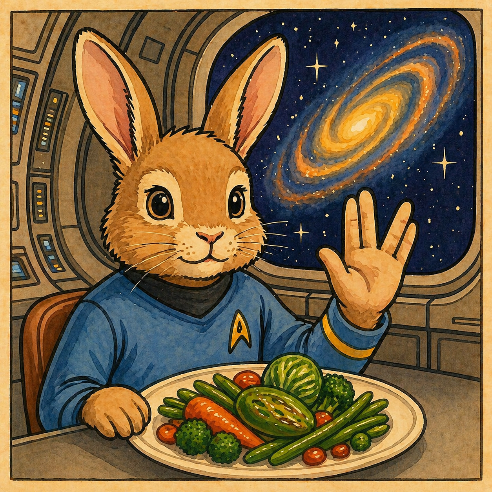
:::
::::

::: {.corner}
《救命》 · 迈克尔 · 格雷格
:::
